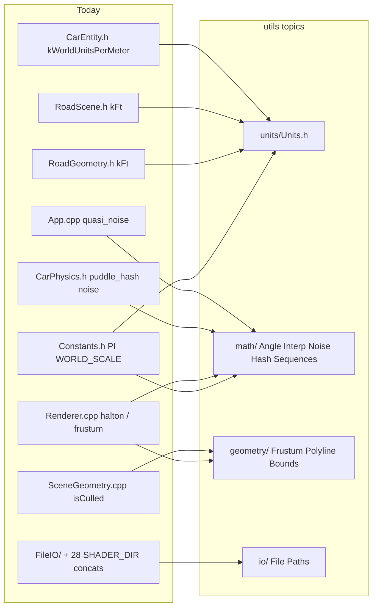

# Utils component design: a topic-organised `src/utils/`

**Status:** Historical planning doc (2026-09-29), **restored 2026-10-11** from the local-only archive. The plan was
largely carried out: `src/utils/` is now topic-organised (see [`../src/utils/README.md`](../src/utils/README.md) for the
live layout and [`CLEANUP_2026-09-29.md`](CLEANUP_2026-09-29.md) for what shipped). Sections 1 and 2.6 describe the
**pre-cleanup** tree (file names such as `Constants.h`, `FileIO/`, line numbers) and are kept as the rationale, not as a
description of the current code. The `scene-and-physics-cleanup.md` and Vulkan-util docs it mentions were not restored.
**Label:** AI-generated draft, review and fact-check before use (NYPL AI policy).
**Date:** 2026-09-29. **Slice:** `src/utils/**` plus generic helpers found anywhere in `src/`. **Toolchain checked read-only:** Apple clang 21.0.0 (clang-2100.3.34.2), arm64-apple-darwin25.6.0.

The owner asked for "a big utils component directory with header files that match the topic of the utils, for cleanup". This doc inventories what exists, proposes the target layout and conventions, gives a complete move table and the single `Units.h` design, and says where C++20 simplifies things. Vulkan helpers get a reserved directory only (designed in a separate doc). Scene and physics refactors are in a separate scene-and-physics cleanup doc (not restored).

## 1. Current friction (measured)

`src/utils/` today is 9 entries and 321 lines of code in total (excluding the README): `Constants.h` (17), `Smoothing.h` (58), `Types.h` (13), `StbImage.cpp` (2), `VulkanCheck.h` (56), `VulkanInit.h` (53), `FileIO/` (16 + 26) and `types/` (12 + 28 + 40). It is organised by *file kind*, not by *topic*: math (`Smoothing.h`), Vulkan (`Vulkan*.h`), IO (`FileIO/`), and constants sit side by side, and everything else generic lives elsewhere.

**1.1 The same constant is defined many times.**

| Concept | Definitions found | Evidence |
|---|---|---|
| feet to WU (`kFt`) | 4 | `tools/toml_baker.cpp:69-70` (its own `WORLD_SCALE` and `kFt`, next to a second copy of the packed `RoadConfig` struct at :22-67); `RoadGeometry.h:34` literal `0.3048f * 1000.0f`; `RoadScene.h:227` via `WORLD_SCALE`; `kFt` appears on 133 lines of `RoadScene.cpp` |
| metres to WU | 5 | `Constants.h:13` `WORLD_SCALE`; `CarEntity.h:227` `kWorldUnitsPerMeter = 1'000.f`; `test_car_physics.cpp:681` `kWorldScale`; the RoadGeometry literal; `toml_baker.cpp:69` |
| pi / two-pi | 7 | `PI` + macro `SWISH_PI` (`Constants.h:6,10`; the macro has 0 other uses), `kEnginePi` (`CarPhysics.h:14`), `kTwoPi` (`WheelKinematics.h:12`), a second `kTwoPi = 6.2831853f` (`WindshieldRainPass.cpp:75`), `kPi` (`DebugUI.cpp:329`), the literal `3.14159265f / 180.0f` (`App.cpp:518`) |
| crown slope | 2 | `RoadConfig.h` `kCrownSlope`, `RoadGeometry.h:38` |
| wheelbase | 2 | `CarParams::wheelbase = 2.45f` m (`CarPhysics.h:50`) vs `CarEntity::kWheelbase = 2'450.f` WU (`CarEntity.h:238`) |
| angle wrap | 3 | `Smoothing.h:54` `fmod(..+540,360)-180`, `CarEntity.cpp:265` `fmod(..+180,360)-180`, `WheelKinematics.h:20` `wrap_angle_2pi` |
| deg/rad conversion | 30 `glm::radians/degrees` calls in 8 files plus 12+ hand-rolled `* 180.f / kEnginePi` in tests (`test_car_physics.cpp:1114-1808`) | grep |

The cost of not having one unit source is documented in the code itself: "applied WORLD_SCALE twice" is written down in `CorridorAsset.h:36`, `CorridorDriver.h:20`, `test_corridor.cpp:545`, and `WheelKinematics.h:229` ("scales by 1000 TWICE"). Four separate write-ups of the same class of bug.

**1.2 Generic helpers hidden in `.cpp` files or domain headers** (full list in the move table, section 2.6): `halton` in the anonymous namespace of Renderer.cpp; `extractFrustumPlanes` (Renderer.cpp:688) and the sphere-vs-planes test `isCulled` (SceneGeometry.cpp:67) are two halves of one frustum-culling utility in two files; `tree_hash` (RoadScene.cpp:1428); `puddle_hash`/`puddle_noise` in a 953-line physics header (CarPhysics.h:889,894), documented there as "a THIRD MANUAL COPY" of GLSL; `quasi_noise` (App.cpp:37); `scaled`/`constant` vector helpers (CorridorScene.cpp:37,44); `to_vec4` (RoadScene.cpp:410); `ribbon_length`/`ribbon_sample` (RoadGeometry.cpp:70,77) that are plain polyline math hosted by a road class; `arr3`/`rd3` TOML-GLM glue (DebugParamsIO.cpp:17,22).

**1.3 Duplicated Vulkan glue** (reserve, do not design here): `setViewportAndScissor` (Renderer.cpp:54) and `setViewportScissor` (IBLManager.cpp:45); `createShaderModule` as `Pipeline::createShaderModule` (Pipeline.h:56) and again in the anonymous namespace of DepthOnlyPipeline.cpp:30; `beginOneTime`/`endOneTime` (IBLManager.cpp:52,67).

**1.4 Path and include hygiene.** 58 includes reach `utils/` through relative paths (`../../utils/...`; 20 of them `VulkanCheck.h`, 18 `Types.h`), while tests use `scene/...` rooted at `src/` (`tests/CMakeLists.txt` adds `src` to the include path, the `swish` target does not). `SHADER_DIR`, `TEXTURE_DIR`, `ASSET_DIR`, `CONFIG_DIR` string-concatenation appears on 41 lines (28 for `SHADER_DIR` alone, in 12 files).

**1.5 Small smells in what is already there.**
- `FileIO` is a class with one `static` method and a stale `// TODO:` above a finished implementation (`FileIO.h:10-12`); a namespace function is enough.
- `StdTypes.h` defines `swish::vector`, `swish::array`, `swish::unique_ptr`, `swish::str`. A grep for unqualified uses found none outside the header (verify before deleting); they invite ADL/name-shadowing surprises.
- Two spellings of the same GLM aliases (`vec3` and legacy `Vec3`, `GlmTypes.h`); `Vec3` has 322 uses.
- `MAX_FRAMES_IN_FLIGHT` is a renderer setting parked in the "constants" header.
- `utils/README.md` still shows `Types.h` as holding the GLM aliases and `WORLD_SCALE`; that has already drifted (they moved to `Constants.h`/`types/`).
- `enum` cycle helpers are copy-pasted: `WeatherPreset.h:12-37` and `CameraMode.h:21-55` both define `*_count()`, `next_*()`, `*_name()`.

**1.6 Test coverage of utils.** 2 test files touch `src/utils`: `test_smoothing.cpp` (5 cases) and `test_file_io.cpp` (4 cases). Constants, types, and Vulkan helpers have none. Whole suite: 8 files, 137 `TEST_CASE`s.

## 2. Proposal

### 2.1 Target layout

```
src/utils/
  Utils.h                 umbrella (math+units+color+geometry+container+io+time+meta; NOT vulkan/debug)
  types/                  (kept) StdTypes.h GlmTypes.h GlfwTypes.h  + Types.h umbrella shim
  math/     Constants.h Angle.h Interp.h Smoothing.h Hash.h Noise.h Sequences.h
  units/    Units.h                                   single WORLD_SCALE / ft() / m()
  geometry/ Frustum.h Polyline.h Bounds.h
  color/    Color.h
  mesh/     MeshMath.h                                scene-independent bits only
  container/ VectorOps.h
  meta/     EnumCycle.h
  io/       File.h File.cpp Paths.h StbImage.cpp
  time/     FrameClock.h                              dt clamp / accumulator (see 2.6)
  vulkan/   (reserved: VulkanCheck.h VulkanInit.h + helpers, designed in the Vulkan-util doc)
  debug/    TomlGlm.h                                 all inside #ifdef SWISH_DEBUG_UI
  README.md               generated index (table of headers, one line each)
tests/utils/              mirrors the tree: test_<topic>_<header>.cpp
```

**Dependency rule (enforced by review, and by a CMake `swish_utils` INTERFACE target that links only glm):** `utils/` depends on the standard library and GLM only. It never includes `scene/`, `renderer/`, `core/`, or `debug/` project headers. This is why `MeshBuilder` and the glTF helpers are *not* moved into utils (they need `MeshData`/`DrawCall`/tinygltf); only their scene-independent arithmetic is (`mesh/MeshMath.h`, `geometry/Bounds.h`).

### 2.2 Conventions

| Topic | Rule |
|---|---|
| Namespace | `swish::util::<topic>` (`swish::util::math`, `::units`, `::geom`, `::color`, `::io`). Keep `swish::vk` for Vulkan glue. Call sites may `namespace um = swish::util::math;` locally, never `using namespace` in a header. |
| File names | `PascalCase.h` per topic, one theme per header, <= ~200 lines. Free functions `snake_case` (matches `exp_smooth`, `wrap_angle_2pi`); constants `kCamelCase`; types `PascalCase`. |
| Header-only vs `.cpp` | Header-only if the function is small, templated, or `constexpr` (everything under `math/`, `units/`, `geometry/`, `color/`, `container/`, `meta/`). A `.cpp` only when it pulls heavy includes (`<fstream>`, `stb_image.h`) or holds a large table. Never define non-`inline` functions in headers. |
| Types | `float` is the default (GPU parity). A `template <std::floating_point T>` overload only where the corridor code needs `double` (`CorridorAlignment.cpp`). |
| `constexpr` | Everything that can be, so `static_assert` tests are possible. `inline constexpr` for variables. |
| Errors | No exceptions in `math/` (pure, `noexcept`). `io/` throws `std::runtime_error` as `FileIO` does today. |
| Deprecation | Old paths stay as one-line forwarding headers (`#include "utils/math/Smoothing.h"` + `using`) for one release, marked `[[deprecated]]` on functions, then removed. |
| Includes | Rooted at `src/`: `#include "utils/math/Angle.h"`. Add `${CMAKE_SOURCE_DIR}/src` to the `swish` target (tests already have it) and retire the 58 relative `../../utils` includes with one scripted, reviewable rewrite. |

### 2.3 Per-header doc-comment template

```cpp
// ── <Header name> ────────────────────────────────────────────────────
// Purpose   : one sentence, what problem it removes.
// Units     : e.g. "angles in DEGREES unless the name ends _rad"; "lengths in WU".
// Complexity: O(1) / O(n), allocation? (say "no allocation" explicitly)
// Precision : float bit-identity notes, e.g. "matches GLSL fract()".
// Example   : one 3-line usage snippet.
// See also  : ../units/Units.h, docs/GLOSSARY.md#wu, shaders/lighting.frag:puddleHash
// Test      : tests/utils/test_math_angle.cpp
```
Rule: "Units" and "Test" lines are mandatory; a header without a matching test file fails the review checklist.

### 2.4 Include-what-you-use guidance
Each util header includes exactly what it uses and nothing from GLFW/Vulkan (`GlfwTypes.h` already forward-declares). Umbrella `Utils.h` carries `// IWYU pragma: export` per line as `Types.h` does today, and is meant for tests and prototypes only; library code includes the narrow header. Add a CI-optional `include-what-you-use` or `clang-tidy misc-include-cleaner` target (both run from the local Homebrew LLVM if installed; not verified here).

### 2.5 `units/Units.h`: the single unit source

Convention (unchanged): $1\ \text{m} = 10^{3}\ \text{WU}$, hence

$$1\ \text{ft} = 0.3048\ \text{m} = 304.8\ \text{WU},\qquad 1\ \text{mi} = 1609.344\ \text{m} = 1.609344\times10^{6}\ \text{WU}.$$

The unit scale is also a float-precision decision. A binary32 has 24 significant bits, so the spacing at magnitude $x$ is $\operatorname{ulp}(x)=2^{\lfloor\log_2 x\rfloor-23}$. At the corridor end ($x = 2.897\times10^{7}$ WU, in $[2^{24},2^{25})$) that is 2 WU = 2 mm, which is why the treadmill rebases the origin and why a *second* $\times 10^3$ would turn 18 mi into $2.9\times10^{10}$ WU where $\operatorname{ulp}\approx 2$ m (the exact bug the four comments in 1.1 warn about).

```cpp
// src/utils/units/Units.h  (header-only, no dependencies but <cstdint>)
namespace swish::util::units {
inline constexpr float kWuPerMetre   = 1000.0f;                 // the ONE definition
inline constexpr float kMetresPerFt  = 0.3048f;
inline constexpr float kWuPerFt      = kMetresPerFt * kWuPerMetre; // == old 0.3048f * 1000.0f, bit-identical

constexpr float m(float metres)      noexcept { return metres * kWuPerMetre; }
constexpr float ft(float feet)       noexcept { return feet * kWuPerFt; }      // NOT feet*0.3048f*1000
constexpr float to_m(float wu)       noexcept { return wu / kWuPerMetre; }
constexpr float to_ft(float wu)      noexcept { return wu / kWuPerFt; }
constexpr float mph_to_mps(float v)  noexcept { return v * 0.44704f; }

static_assert(m(1.0f) == 1000.0f);
static_assert(to_m(m(2.45f)) == 2.45f);                                  // round-trip, exact for this value
static_assert(ft(1.0f) > 304.79f && ft(1.0f) < 304.81f);
static_assert(static_cast<long>(kWuPerMetre) == 1000);
}  // namespace swish::util::units
// Legacy shim (Constants.h): inline constexpr float WORLD_SCALE = units::kWuPerMetre;
```

Design notes:
- **Bit-identity:** `ft(x)` must multiply by the precomputed `kWuPerFt` (a float), exactly as `13.0f * kFt` does today, so the release output stays byte-identical. Do **not** implement it as `x * 0.3048f * 1000.0f` (a different rounding order).
- **User-defined literals** (`13_ft`) are tempting, but a `long double` literal narrowed to `float` can round differently from a direct `13.0f`/`2.67f` literal (double rounding). Provide them only if a test proves equality for every literal in use; the function form is the safe default.
- **Strong types** (`struct Wu { float v; }`) would have caught the "twice" bugs at compile time, but cost churn across ~400 sites. Recommendation: not now; use them only at API boundaries that mix SI and WU (`CarEntity`: `get_speed_mps()` already isolates SI from WU).
- `MAX_FRAMES_IN_FLIGHT` leaves this family and goes to a renderer config header.

### 2.6 Move table (pre-cleanup location to new header)

| # | Current location (size) | Symbol | New header | Notes |
|---|---|---|---|---|
| 1 | `Constants.h:10` | `PI`, `SWISH_PI` | `utils/math/Constants.h` | `pi = std::numbers::pi_v<float>`; delete macro (0 uses) |
| 2 | Constants.h:13, RoadGeometry.h:34, RoadScene.h:227, CarEntity.h:227, test_car_physics.cpp:681, tools/toml_baker.cpp:69-70 | `WORLD_SCALE`, `kFt`, `kWorldUnitsPerMeter`, `kWorldScale` | `utils/units/Units.h` | 6 defs to 1; the baker is a separate executable, so it needs `swish_utils` on its include path |
| 3 | Constants.h:15 | `MAX_FRAMES_IN_FLIGHT` | `renderer/RendererConfig.h` | not a util |
| 4 | CarPhysics.h:14, WheelKinematics.h:12, WindshieldRainPass.cpp:75, DebugUI.cpp:329, App.cpp:518 | `kEnginePi`, `kTwoPi`, `kPi`, literal | `utils/math/Constants.h` + `Angle.h` (`deg_to_rad`, `rad_to_deg`) | replaces 30 `glm::radians/degrees` only where a constexpr is needed; leave the rest |
| 5 | `Smoothing.h:43` (58 lines) | `exp_smooth`, `exp_smooth_angle_deg` | `utils/math/Smoothing.h` (+ uses `Angle.h`) | keep test_smoothing.cpp, add to `tests/utils/` |
| 6 | Smoothing.h:54, CarEntity.cpp:265, WheelKinematics.h:19 | three wrap idioms | `utils/math/Angle.h`: `wrap_deg_180`, `wrap_rad_2pi`, `shortest_delta_deg` | test on +-179/181, negatives |
| 7 | App.cpp:37 (6 lines) | `quasi_noise` | `utils/math/Noise.h` | camera-shake sum of sines |
| 8 | CarPhysics.h:889-913 | `puddle_hash`, `puddle_noise` | `utils/math/Noise.h` (GLSL-parity hash/value noise) | keeps sin-hash formula; cross-link the 2 GLSL copies |
| 9 | CarPhysics.h:851, 924 | inline Hermite `t*t*(3-2t)` | `utils/math/Interp.h`: `smoothstep`, `saturate`, `inv_lerp` | do NOT swap to `std::lerp` where mirroring GLSL `mix` (rounding differs) |
| 10 | RoadScene.cpp:1428 | `tree_hash` | `utils/math/Hash.h` (`wang_hash01`) | golden-value test |
| 11 | Renderer.cpp:43 | `halton` | `utils/math/Sequences.h` | TAA jitter |
| 12 | Renderer.cpp:688 + SceneGeometry.cpp:67 | `extractFrustumPlanes`, `isCulled` sphere test | `utils/geometry/Frustum.h` | one header, `std::span<const Vec4,6>` |
| 13 | RoadGeometry.cpp:70,77 | `ribbon_length`, `ribbon_sample` | `utils/geometry/Polyline.h` (`length`, `sample_at_arclength`) | `Ribbon` keeps `pts` in SceneTypes; take `span<const Vec3>` |
| 14 | RoadScene.cpp:30-42 | AABB then bounding sphere of an index range | `utils/geometry/Bounds.h` (`bounding_sphere(span<const Vec3>)`) | MeshBuilder calls it |
| 15 | RoadScene.cpp:410 | `to_vec4` | `utils/color/Color.h` (`rgba(const float(&)[4])`) | + tint helpers |
| 16 | CorridorScene.cpp:37,44 | `scaled`, `constant` | `utils/container/VectorOps.h` (`affine`, `filled`) | |
| 17 | WeatherPreset.h:12-37, CameraMode.h:21-55 | count/next/name x2 | `utils/meta/EnumCycle.h` (`next<E>()` concept-constrained) | each enum keeps a `constexpr std::array<string_view,N>` |
| 18 | `FileIO.h/.cpp` (42 lines) | `FileIO::readBinaryFile` | `utils/io/File.h`: `read_binary(path)` | old class as shim; 5 call sites in 2 files (Pipeline.cpp:20,21,184; DepthOnlyPipeline.cpp:53,54) |
| 19 | 28 `SHADER_DIR` lines in 12 files + 13 other dir macros | path concat | `utils/io/Paths.h`: `shader_path("x.spv")`, `asset_path()`, `config_path()` | macros stay defined by CMake |
| 20 | `StbImage.cpp` | stb TU | `utils/io/StbImage.cpp` | unchanged content |
| 21 | `VulkanCheck.h`, `VulkanInit.h` | `VK_CHECK`, factories | `utils/vulkan/` | reserved, see Vulkan-util doc; 32 includes to rewrite |
| 22 | Renderer.cpp:54, IBLManager.cpp:45,52,67, Pipeline.h:56, DepthOnlyPipeline.cpp:30 | viewport, one-time cmd, shader module | `utils/vulkan/` | reserved, see Vulkan-util doc |
| 23 | DebugParamsIO.cpp:17,22 | `arr3`, `rd3` | `utils/debug/TomlGlm.h` | `#ifdef SWISH_DEBUG_UI` gated |
| 24 | test_corridor.cpp:40-46 | lon/lat to ENU | stays in tests unless production needs it | note only |
| 25 | `StdTypes.h` | `vector`, `array`, `unique_ptr`, `str` | delete after grep-verify | 0 non-`std::` uses found |
| 26 | `RainPhysics.h` (4 fns) | Marshall-Palmer etc. | **stay** (domain physics, already tested) | listed so the audit is complete |
| 27 | ModelManager.cpp:49,76,120 | glTF matrix helpers | **stay** in `scene/ModelManager/GltfMath.h` | tinygltf dependency, not a util |

Not moved because it is domain code, not generic: `MeshBuilder` (RoadScene.cpp:15-400; goes to `scene/RoadScene/MeshBuilder.{h,cpp}` per the scene doc), `default_clearcoat_strength` (SceneTypes.h:107).

### 2.7 Tests mirror
`tests/utils/test_<topic>_<Header>.cpp`, one per header, all registered by a single `tests/utils/CMakeLists.txt` that builds an `swish_utils_tests` executable linking only `swish_utils` (proves the dependency rule). Two test kinds per header: (a) `static_assert` compile-time tests for `constexpr` functions (`Units.h`, `Angle.h`), (b) Catch2 golden values for float math with explicit `WithinAbs`. CI rule: `scripts/check_utils_tests.sh` fails if a `utils/**/*.h` has no `tests/utils/` file.

### 2.8 Where C++20 simplifies this design
CMake at the time said `set(CMAKE_CXX_STANDARD 17)` (`CMakeLists.txt:4`); the owner chose C++20, so step 0 of the migration flips it (the project has since moved on to C++23). Feature-test macros from `clang++ -std=c++20 -dM -E` on this machine: `__cpp_concepts 202002`, `__cpp_consteval 202211`, `__cpp_lib_span 202002`, `__cpp_lib_math_constants 201907`, `__cpp_lib_bitops 201907`, `__cpp_lib_bit_cast 201806`, `__cpp_lib_ranges 202110`, `__cpp_lib_source_location 201907`, `__cpp_lib_format 202110`; the headers `<numbers> <span> <bit> <ranges> <concepts> <format>` preprocess cleanly.

| C++20 feature | Use here | Caveat |
|---|---|---|
| `std::numbers::pi_v<float>` | replaces 7 pi definitions | constant equals the literal to float precision; rounding identical (both round the same real) |
| `std::span` | `Frustum.h`, `Polyline.h`, `Bounds.h`, and `emit_sweep_*` (today `const std::vector<Vec3>&`, `RoadScene.h`) | span has no `operator==`; fine |
| Concepts | `std::floating_point` for math; `EnumCycle` requires an enum with a `Count` sentinel | keep constraints tiny; error messages get better, compile time barely changes |
| `constexpr`/`consteval` | all of `Units.h`/`Angle.h`; `consteval` for compile-time-checked tile-size LCM in `RoadParams` | `<cmath>` trig is **not** `constexpr` in the standard until C++26: no compile-time sin/cos tables |
| Designated initializers | `DrawCall dc{...}` (currently 5 assignments after `dc{}`, RoadScene.cpp:20-25), `RoadParams`, `RoadLayout` | fields must appear in declaration order; `-Wpedantic` is on |
| `<bit>` | `std::rotl`/`bit_cast` in `Hash.h`; `std::bit_width` for mip counts (a grep found no `log2` mip code today, so only for future use) | |
| `std::lerp` / `std::midpoint` | new code only | not bit-identical to `a + (b-a)*t`; do **not** use where mirroring GLSL `mix` (puddle noise) |
| `std::source_location` | a function form of the check for non-Vulkan errors | `VK_CHECK` stays a macro (needs the expression text) |
| `std::format` | optional in `io/` error strings | libc++ float formatting depends on deployment target; verify before adopting; low value, skip for now |
| Ranges | little: `std::ranges::minmax` on scalar data only | GLM vectors are not totally ordered; do not force it |

## 3. Diagrams

TikZ (dependency direction of the proposed layout):

```latex
\documentclass[tikz,border=6pt]{standalone}
\usetikzlibrary{arrows.meta,positioning,shapes.geometric}
\begin{document}
\begin{tikzpicture}[
  box/.style={draw, rounded corners=2pt, minimum width=2.3cm, minimum height=0.8cm, font=\small, align=center},
  layer/.style={box, fill=blue!8},
  util/.style={box, fill=green!10},
  res/.style={box, fill=gray!15, dashed},
  dep/.style={-{Stealth[length=2.2mm]}, thick}
]
  \node[layer] (app) {core/App};
  \node[layer, right=of app] (rend) {renderer};
  \node[layer, right=of rend] (scene) {scene};
  \node[layer, right=of scene] (dbg) {debug};

  \node[util, below=2.2cm of app] (math) {math};
  \node[util, right=of math] (units) {units};
  \node[util, right=of units] (geom) {geometry};
  \node[util, right=of geom] (io) {io};
  \node[util, below=of math] (color) {color};
  \node[util, right=of color] (cont) {container\\meta};
  \node[res, right=of cont] (vk) {vulkan\\(reserved)};
  \node[util, right=of vk] (dd) {debug\\(gated)};

  \node[font=\small\bfseries, below=0.6cm of color] {swish::util  (std + GLM only)};

  \draw[dep] (app) -- (math);
  \draw[dep] (rend) -- (geom);
  \draw[dep] (rend) -- (vk);
  \draw[dep] (scene) -- (units);
  \draw[dep] (scene) -- (io);
  \draw[dep] (dbg) -- (dd);
  \draw[dep] (geom) -- (math);
  \draw[dep] (color) -- (math);
  \draw[dep] (units) -- (math);
\end{tikzpicture}
\end{document}
```

Mermaid (where today's scattered helpers land):



## 4. Migration steps

| # | Step | Effort | Risk |
|---|---|---|---|
| 0 | `CMAKE_CXX_STANDARD 20`; add `src/` to the `swish` include path; build clean with `-Wall -Wextra -Wpedantic` | S | Low (fix any new warnings; designated-init order) |
| 1 | Add `tests/utils/` + CMake target `swish_utils_tests`; add `swish_utils` INTERFACE target | S | Low |
| 2 | Create `units/Units.h` with `static_assert`s; make `WORLD_SCALE`, `kFt`, `kWorldUnitsPerMeter`, `kWorldScale` forward to it | S | Low; verify by asserting old and new floats are `==` (bitwise) |
| 3 | `math/Constants.h` + `Angle.h`; replace the 7 pi defs and 3 wrap idioms, tests first | M | Medium (wrap edge cases at +-180; keep old outputs via golden tests) |
| 4 | Move `Smoothing.h`; add `Interp.h`, `Hash.h`, `Noise.h`, `Sequences.h` | M | Low; puddle noise must stay bit-equal to GLSL, golden test |
| 5 | `geometry/Frustum.h` merging `extractFrustumPlanes` + `isCulled`; `Polyline.h`; `Bounds.h` | M | Medium (culling regressions look like popping; screenshot check per CLAUDE.md) |
| 6 | `io/File.h`, `io/Paths.h`; migrate 5 call sites and 41 dir-macro lines | M | Low |
| 7 | `meta/EnumCycle.h`, `container/VectorOps.h`, `color/Color.h` | S | Low |
| 8 | Reserve `utils/vulkan/`; move `VulkanCheck.h`/`VulkanInit.h` only after the Vulkan-util doc lands; leave shims | S | Low (32 include rewrites) |
| 9 | Scripted rewrite of 58 relative includes to `utils/...` (single commit, `git mv` + sed) | S | Low; do last to keep diffs reviewable |
| 10 | Delete shims, `StdTypes` unused aliases, `SWISH_PI`; regenerate `utils/README.md`; CHANGELOG entry (project rule) | S | Low |
| 11 | Release-build parity: build `SWISH_DEBUG_UI=OFF` before/after, compare rendered frames on a fixed seed/pose | M | The check that matters |

Total: about 2 to 3 focused days of work; steps 2, 3, and 5 carry the only real risk.

## 5. Open questions

1. Namespace depth: is `swish::util::math` acceptable, or should it stay flat (`swish::math`)? The proposal picks `util` to keep the topic obvious in stack traces.
2. `PascalCase.h` file names with `snake_case` functions: keep, or move to lower-case file names?
3. Should `RainPhysics.h` and the wet-grip half of `CarPhysics.h` form a shared `physics/` (weather) component instead of living in the renderer and scene layers?
4. Are strong unit types wanted at the CarEntity/Treadmill boundary (the place the "x1000 twice" bugs happened), even though the repo-wide cost is high?
5. Is `utils/README.md` to be hand-written or generated from the doc-comment "Purpose" lines?
6. The `tests/README.md` says tests do not link GLFW, but `tests/CMakeLists.txt` links `glfw` for Camera.cpp; decide whether the utils test target should be the GLFW-free one (recommended).
7. Confirm with the owner that public `WORLD_SCALE` may be renamed; call sites are few (`RoadScene.h:227` is the only production use outside `Constants.h`), so the rename is cheap.
