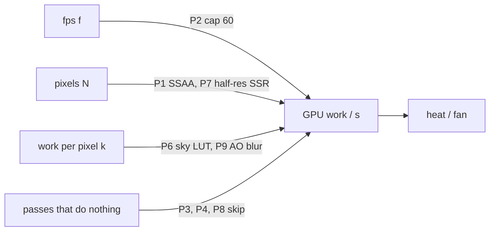
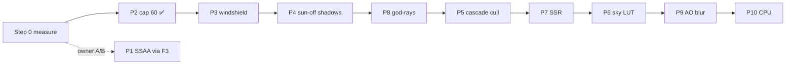

# Perf to-do: cut invisible GPU/CPU work

> Drafted by AI (Claude) on 2026-11-21 from a static code audit (nothing was profiled) and the owner's
> grilling decisions. Owner review required. Short checklist: [`todo.md`](todo.md) → "Perf: cut invisible GPU/CPU work".
> All costs below are **estimates from code reading**. Step 0 replaces them with `GpuProfiler` numbers.

**Rules the owner set:** `make debug` first. 60 fps cap. **No visible change**: every cut gets an A/B toggle, and
release stays byte-identical unless the owner signs off.

---

## 0. Why the fan spins: the cost model

The GPU's power, and so its heat, roughly follows the work it does per second:

$$
P_\text{GPU} \;\propto\; f_\text{fps} \cdot \sum_{p \,\in\, \text{passes}} N_p \cdot k_p
$$

- $f_\text{fps}$: frames per second.
- $N_p$: pixels (or vertices) pass $p$ touches.
- $k_p$: work per pixel (texture taps, loop steps, bytes moved).

Every item below lowers one of the three factors:



**The pixel budget.** GLFW already gives a 2× Retina framebuffer, and SSAA multiplies by $s$ again:

$$
N = (s \cdot W_\text{swap}) \times (s \cdot H_\text{swap}), \qquad
N_{s=2} = 4\,N_{s=1}
$$

| Window | Swapchain | $s=2$ render | MP |
|---|---|---|---|
| default 800×600 pt | 1600×1200 | 3200×2400 | 7.7 |
| maximized 14" MBP | 3024×1964 | 6048×3928 | 23.8 |

The panel itself has 5.9 MP, so at $s=2$ maximized every full-res pass shades **4×** the visible pixels.

---

## Step 0 (owner, in the app): measure first

- [ ] `make debug`. Read the startup log line from `Swapchain.cpp:22` (the extent) and check whether the display is ProMotion (120 Hz).
- [ ] Open the `GpuProfiler` panel. Write down ms per pass at rain 0 and at rain 1.0, at the default window size and maximized.
- [ ] Repeat after each item below. Keep the numbers in this file.

| Pass | rain 0 ms | rain 1 ms | after fix ms |
|---|---|---|---|
| G-buffer | | | |
| Shadow | | | |
| Lighting | | | |
| SSR | | | |
| SSAO + blur | | | |
| God-rays | | | |
| Windshield | | | |

---

## P2: 60 fps cap + idle while minimized — DONE 2026-11-21

**What:** FIFO paces to the display. On ProMotion that is 120 fps, and nothing else limited the loop. A minimized window kept rendering.

**Done in** [`App.cpp`](../src/core/App/App.cpp) `App::run`:

```cpp
constexpr Clock::duration kFramePeriod = std::chrono::nanoseconds(1'000'000'000 / 60);
// ...
if (glfwGetWindowAttrib(win, GLFW_ICONIFIED) || !glfwGetWindowAttrib(win, GLFW_VISIBLE)) {
    glfwWaitEventsTimeout(0.1);
    last_frame_time = static_cast<float>(glfwGetTime());  // no dt spike on restore
    next_frame      = Clock::now();
    continue;
}
// ... drawFrame ...
next_frame += kFramePeriod;
if (const Clock::time_point now = Clock::now(); next_frame < now) next_frame = now;
else std::this_thread::sleep_until(next_frame);
```

**Why it helps:** $P \propto f$, so $120 \to 60$ halves all GPU and CPU work per second:

$$
\frac{P_{60}}{P_{120}} = \frac{60}{120} = 0.5
$$

While minimized, frame work drops to roughly zero.

**Alternatives considered:**

| Option | Pro | Con |
|---|---|---|
| **CPU deadline sleep (chosen)** | Portable, ~10 lines, also caps a covered window | `sleep_until` can wake late by ~0.1–1 ms; with FIFO at 120 the occasional frame waits an extra vblank (small judder) |
| `CAMetalLayer.displaySyncEnabled` + `preferredFrameRateRange` (via MoltenVK `VK_EXT_metal_objects`) | Hardware-exact 60 pacing on ProMotion, no judder | macOS-only Objective-C++ glue in the swapchain |
| `VK_KHR_present_wait` / `present_id` pacing | Exact, standard Vulkan | MoltenVK support is incomplete; more code |

**Owner check:** the title bar shows about 60 fps; Activity Monitor CPU and GPU drop when minimized; driving feels smooth. If you see judder, upgrade to the `CAMetalLayer` option.

---

## P1: SSAA A/B — already exists, owner judges

**Finding:** the A/B is **already built**. **F3** cycles `1.0 → 1.5 → 2.0`
([`AppInput.cpp:103`](../src/core/App/AppInput.cpp)). The debug panel has a "SSAA scale" slider (1.0–2.0) with Apply
([`DebugUI.cpp:1304`](../src/debug/DebugUI.cpp)). The shipped default is `kRenderScale = 2.0f`
([`PostProcessManager.h:229`](../src/renderer/PostProcessManager/PostProcessManager.h)).

- [ ] Owner: press F3 at a highway view, and look at the car silhouette, the guardrail tops and the lane lines at 1.0, 1.5 and 2.0. Read the frame times.
- [ ] If 1.5 looks the same as 2.0, change the default (debug `DebugParams.h:261` and, after sign-off, release `kRenderScale`). That needs a changelog entry, and the release goldens change on purpose.

**Why it helps:** every full-res pass scales with $s^2$:

$$
\frac{N_{1.5}}{N_{2.0}} = \frac{1.5^2}{2.0^2} = 0.5625, \qquad \frac{N_{1.0}}{N_{2.0}} = 0.25
$$

The G-buffer alone writes about 24 B/px (RGBA8 albedo + RGBA16F normal + 2× RGBA8 + D32):

$$
24\ \text{B} \times 23.8\ \text{MP} \approx 570\ \text{MB/frame} \;\xrightarrow{\;s=1.5\;}\; 320\ \text{MB}
$$

**Alternatives** (each would be a visible change, so the owner judges):

| Option | Saving | Look |
|---|---|---|
| $s = 1.5$ | 44% of all full-res work | Near identical on Retina |
| $s = 1.0$ + TAA (already built, `taaEnabled=false`) | 75% | TAA can ghost on fast motion |
| $s = 1.0$ + FXAA in the composite | 75% | Softer texture detail |
| Smaller G-buffer normal: RG16 octahedral or `A2B10G10R10` instead of RGBA16F ([`PostProcessManager_Images.cpp:48`](../src/renderer/PostProcessManager/PostProcessManager_Images.cpp)) | 4 B/px of G-buffer bandwidth | Invisible if decoded right; release goldens change |

---

## P3: windshield passes at rain 0

**What:** [`WindshieldRainPass::record`](../src/renderer/WindshieldRainPass/WindshieldRainPass.cpp) (line 140) runs every frame whenever the car has windshield draws:

```cpp
if (geo.windshield_draws().empty() || !car.has_geometry()) return;
record_wetness_update(c.cmd);                                   // fullscreen R16F pass + full vkCmdCopyImage B->A
record_scene_snapshot(c.cmd, c.frameIndex, /* HDR */ ..., c.renderExtent);  // full RGBA16F copy
```

At rain 0 the drop shader discards every pixel (`windshield_rain.frag:196`), so nobody reads the snapshot.

**Cost:** a copy reads and writes every byte, so the HDR snapshot moves $2 \times 8$ B/px. The wetness pass plus its copy move about $8$ B/px:

$$
B \approx (16 + 8)\ \text{B/px} \times N
\;=\; 24 \times 7.7\ \text{MP} \approx 185\ \text{MB/frame (default)}, \quad 570\ \text{MB (maximized)}
$$

At 60 fps maximized that is about $34$ GB/s. Base M-series chips have roughly 68–120 GB/s in total, shared with the CPU.

**Do:**

- [ ] Skip both steps when rain is 0 **and** the glass is dry. Keep drawing until the wetness has decayed, so the drying-off animation still plays:

```cpp
// WindshieldRainPass.cpp, record()
if (geo.windshield_draws().empty() || !car.has_geometry()) return;
// Perf P3: nothing to refract or wet once rain has stopped and the glass has dried.
if (c.state.rainIntensity <= 0.0f && m_glassDry) return;
```

`m_glassDry` needs a CPU-side estimate. Reuse the decay the CPU already tracks (`LensWetness`). For example, set it once
rain has been 0 for longer than the wetness decay time $\tau$:

$$
w(t) = w_0\, e^{-t/\tau} < 10^{-3} \iff t > \tau \ln(1000) \approx 6.9\,\tau
$$

- [ ] Replace the B→A copy with a ping-pong. Swap which image is "history" each frame, and keep two framebuffers and two descriptor sets:

```cpp
// sketch: m_wetCur flips 0/1 each frame; pass writes m_wetImages[m_wetCur ^ 1] reading m_wetImages[m_wetCur]
const uint32_t src = m_wetCur, dst = m_wetCur ^ 1u;
bi.framebuffer = m_wetFramebuffers[dst];
vkCmdBindDescriptorSets(cmd, VK_PIPELINE_BIND_POINT_GRAPHICS, m_wetPipeLayout, 0, 1, &m_wetDescSets[src], 0, nullptr);
// ... draw ...
m_wetCur = dst;  // no vkCmdCopyImage
```

- [ ] Add a debug toggle `windshieldSkipWhenDry` (default on), so the owner can A/B it.

**Alternatives:**

| Option | Saving | Notes |
|---|---|---|
| **Skip when dry (chosen)** | 100% at rain 0 | Pixel-identical: the shader already discards everything |
| Ping-pong instead of copy | ~4 B/px always | Pixel-identical |
| ¼-res wetness map | ~94% of the wetness cost when raining | Wetness is low-frequency; bilinear upsample is near invisible. A/B needed |
| Copy only the windshield's screen rect (scissor from the projected glass bounds) | 50–80% of the snapshot when raining | More code; the bounds must include the refraction offset |

---

## P4: shadows when the sun is off

**What:** [`GeometryProducer::record_shadow`](../src/renderer/GeometryProducer/GeometryProducer.cpp) (line 101) draws 3
cascades into a 6144×2048 D32 atlas every frame. Rain sets `m_sunLux = 0`
([`WeatherController.cpp:256`](../src/renderer/WeatherController/WeatherController.cpp)), and debug starts at rain 1.0, so
**at debug startup the whole shadow pass is multiplied by zero**. `lighting.frag:556-626` still does the per-pixel lookup:
16 blocker + 16 PCF + 9 blend taps in debug.

**Cost when the sun is off:**

$$
\underbrace{3 \times D_\text{casters}}_{\text{shadow draws}} \;+\; N \times 41\ \text{taps}
\approx 7.7\ \text{MP} \times 41 \approx 315\text{ M texture taps / frame wasted}
$$

**Do:**

- [ ] Publish the sun's lux to passes. `FrameState` ([`IRenderPass.h:49`](../src/renderer/Passes/IRenderPass.h)) has no sun term yet:

```cpp
struct FrameState {
    float wetness       = 0.0f;
    float rainIntensity = 0.0f;
    float sunLux        = 0.0f;  // Perf P4/P8: direct sun (or moon) illuminance; 0 under rain cloud
    // ...
};
```

- [ ] Skip the shadow draws when it is 0. Lighting already treats an off-map lookup as lit, and the result is multiplied by 0 anyway:

```cpp
// GeometryProducer::record_shadow (or the ShadowPass record)
if (c.state.sunLux <= 0.0f) return;  // Perf P4: no direct light -> nothing to shadow
```

- [ ] Branch the shader. `sunScale` is the same for every pixel, so the branch costs nothing and skips all 41 taps:

```glsl
// lighting.frag, around :556
float shadow = 1.0;
if (sunScale > 0.0) {   // Perf P4: uniform branch, whole warp agrees
    shadow = sampleShadowCSM(/* ... */);
}
```

**Alternatives:**

| Option | Saving | Notes |
|---|---|---|
| **Skip at `sunLux == 0` (chosen)** | 100% of shadows in rain/overcast | Pixel-identical |
| Update cascade 2 (the far one) every other frame | ~⅓ of the shadow pass | Can shimmer when the sun moves fast; A/B |
| Cache the atlas while the sun direction and camera cell are unchanged | Most frames free | The car moves every frame, so cascade 0 must still redraw |

---

## P5: per-cascade shadow cull

**What:** shadow casters are culled by camera distance only (`useFrustum = false`, `maxDistance = 600 m`). Every caster
within 600 m is drawn into **all 3** cascades, even though cascade 0 covers only the first tens of metres:

```cpp
shadowCull.useFrustum  = false;
for (uint32_t k = 0; k < NUM_CASCADES; ++k) {
    m_depthOnlyPipeline.set_cascade(cmd, subRect, m_cascadeVP[k]);
    for_each_static([&](const SceneGeometry& g, const Vec3& offset) {
        g.record_depth(cmd, m_depthOnlyPipeline, shadowCull, offset, stats);
    });
```

**Do:** reuse the existing `CullParams::planes` and `util::geometry::extract_frustum_planes`, per cascade. Disable the
**near** plane: a caster between the sun and the cascade box still throws a shadow into it.

```cpp
for (uint32_t k = 0; k < NUM_CASCADES; ++k) {
    // Perf P5: cull against this cascade's light box; near plane opened so sun-side casters still count.
    util::geometry::extract_frustum_planes(m_cascadeVP[k], shadowCull.planes);
    shadowCull.planes[4] = Vec4(0.0f, 0.0f, 0.0f, 1e30f);  // never-outside plane
    shadowCull.useFrustum = true;
    // ... unchanged draw loop ...
}
```

> ⚠️ Check the space first. `isCulled` tests centres in render-frame world space (`model * centre + originOffset`). If
> `m_cascadeVP` is camera-relative (like the rebased push constants), pass `m_cascadeVP[k] * translate(-cameraPos)`
> instead. Validate with the existing `cullShadowSubmitted` counter and an A/B screenshot of the shadows.

**Why it helps:** with nested cascades of radius $r_0 < r_1 < r_2$ and casters spread evenly along the road, draws per
cascade scale with the cascade's length along the road:

$$
D_\text{now} = 3\,D_{600\text{m}}, \qquad
D_\text{culled} \approx D_{600\text{m}} \cdot \frac{r_0 + r_1 + r_2}{600\ \text{m}}
$$

For example, with $r = 30, 120, 400$ m that is $0.92\,D$ instead of $3\,D$: about **3× fewer shadow draws**, with the
same vertex work saved on the GPU.

**Alternatives:**

| Option | Saving | Notes |
|---|---|---|
| **Per-cascade frustum (chosen)** | ~3× shadow draws | Pixel-identical if the planes are right |
| Skip small casters in far cascades (`radius < texelSize_k`) | Further cut in cascade 2 | Tiny props lose far shadows (invisible at that texel size) |
| Lower the shadow cull distance (600 m → 400 m) | Linear in distance | Visible at the horizon; A/B |

---

## P6: sky-view LUT instead of a per-pixel raymarch (debug)

**What:** with the procedural sky on (`skyProcedural = kDebugBuild`), `lighting.frag:377` calls `atmSky()` for every sky
pixel, every frame: `ATM_VIEW_STEPS = 20` × `ATM_LIGHT_STEPS = 6`, with 3 `exp()` per density sample
([`atmosphere.glsl:22`](../shaders/common/atmosphere.glsl)), done twice when the moon is up.

**Cost:**

$$
k_\text{sky} \approx 20 \times (1 + 6) \times 3\ \exp \approx 420\ \exp/\text{px}, \qquad
N_\text{sky} \approx 0.4\,N \approx 3\ \text{MP} \Rightarrow \sim 1.3\ \text{G}\ \exp/\text{frame}
$$

Yet the sky only changes when the time of day or the weather changes. The IBL bake already has that dirty flag
(`maybe_rebake_ibl` → `bake_atmosphere`, [`IBLManager.cpp:570`](../src/renderer/IBLManager/IBLManager.cpp)).

**Do:**

- [ ] On the same dirty flag, bake a **sky-view LUT** (Hillaire 2020): a small RGBA16F texture indexed by view azimuth and elevation, about 192×108. Use a non-linear elevation map, so the horizon gets more texels:

$$
v = 0.5 + 0.5\,\operatorname{sign}(\theta)\sqrt{|\theta| / (\pi/2)}
$$

- [ ] In `lighting.frag`, sample the LUT instead of `atmSky()`. Keep the **sun disc and stars per pixel**: they are sharp and cheap.

```glsl
// lighting.frag sky branch, sketch
vec3 sky = (pc.skyLutOn != 0)
    ? texture(skyViewLut, skyViewUV(viewDir, sunDir)).rgb   // Perf P6: 1 fetch
    : atmSky(viewDir, sunDir);                              // A/B: the exact raymarch
sky += sunDisc(viewDir, sunDir) + stars(viewDir);
```

- [ ] Debug toggle `skyLut` (default on) for the A/B.

**Why it helps:** $k$ drops from ~420 `exp` to 1 bilinear fetch per sky pixel. The bake costs $192 \times 108 \times 420
\approx 8.7$ M `exp`, **once** per change instead of per frame:

$$
\frac{k_\text{LUT}}{k_\text{march}} \approx \frac{1}{420}
$$

**Alternatives:**

| Option | Saving | Notes |
|---|---|---|
| **Sky-view LUT (chosen)** | ~99% of the sky cost | Near-identical; low-frequency sky |
| Sample the already-baked IBL cube at mip 0 | 99%, no new texture | The cube face resolution blurs the horizon gradient; A/B |
| Fewer steps (12×4) | ~65% | Banding near the horizon at sunset |
| Transmittance LUT + shorter view march (full Hillaire) | ~85% | More code; the right path only if the sky must animate every frame |

---

## P7: SSR at half resolution, skipped when dry

**What:** [`SsrPass.cpp:32`](../src/renderer/Passes/SsrPass.cpp) runs at the full render extent, with up to 40 march
steps ([`ssr.frag:101`](../shaders/ssr.frag)). In debug the wet-only gate is compiled out:

```glsl
#ifndef SWISH_DEBUG_UI
    reflectivity *= smoothstep(0.02, 0.20, wetLocal);   // release only
#endif
```

So debug marches **every glossy pixel**, including dry car paint. Release early-outs per pixel when dry, but the
fullscreen pass and the G-buffer fetches still run.

**Do:**

- [ ] CPU skip when the world is dry. The SSR image is cleared to black once, and the composite adds 0:

```cpp
// SsrPass::record
if (c.state.wetness < 0.02f && !c.tune.ssrDebugUnrestricted) return;  // Perf P7
```

- [ ] Render SSR at **½ render extent**. At $s = 2$ that is still the native swapchain resolution. The composite already samples with bilinear filtering.
- [ ] Debug toggle `ssrHalfRes` (default on) for the A/B.

**Why it helps:**

$$
\frac{N_\text{½}}{N_\text{full}} = \frac{1}{4}, \qquad
\text{march cost} \approx N_\text{wet} \times 40 \times (\text{proj} + \text{depth fetch})
$$

With 40% wet road maximized: $0.4 \times 23.8 \approx 9.5$ M px × 40 steps becomes $2.4$ M px × 40 steps.

**Alternatives:**

| Option | Saving | Notes |
|---|---|---|
| **½ res + dry skip (chosen)** | 75% wet, ~100% dry | Can soften mirror-sharp reflections; A/B |
| Hi-Z (depth mip) tracing | ~3–5× fewer steps | Needs a depth pyramid pass; best quality per ms |
| 24 steps + binary refine | ~40% | Thin objects can miss |
| Temporal: march ½ the pixels per frame + reproject | 50% | Needs velocity (TAA path exists) |

---

## P8: god-rays gated on the sun (bug fix)

**What:** [`GodRaysPass.cpp:57`](../src/renderer/Passes/GodRaysPass.cpp) only checks whether the sun is on screen
(`vis`), not whether it shines. Under rain (`sunLux = 0`) it still draws faint shafts from the overcast sky, which
contradicts `WeatherController`'s "rain means no god-ray source". It costs 48 taps (`godrays.frag:36`) at ½ res.

**Do:**

```cpp
// GodRaysPass::describe, after vis is computed
if (c.state.sunLux <= 0.0f) vis = 0.0f;  // Perf P8 + bug: no sun -> no shafts
```

Better still, skip the draw entirely and clear the target once, so the composite reads 0.

**Cost saved while raining:**

$$
\tfrac14 N \times 48 \approx 1.9\ \text{MP} \times 48 \approx 92\ \text{M taps/frame (default window)}
$$

**Alternatives:** run at ¼ render resolution (radial blur is low-frequency): 4× cheaper whenever the sun *is* out. A/B.

---

## P9: separable SSAO blur

**What:** [`ao_blur.frag:22`](../shaders/ao_blur.frag) runs a 5×5 loop, 25 taps. Debug is depth-weighted, with an
`exp()` per tap; release is a plain box.

**Do:** split it into a horizontal pass and a vertical pass of 5 taps each:

```glsl
// ao_blur.frag, one direction per pass (pc.dir = (1,0) then (0,1))
for (int i = -2; i <= 2; i++) {
    vec2  s = texture(aoTex, fragUV + float(i) * pc.dir * texelSize).rg;
    float w = exp(-abs(s.g - centre.g) / max(kDepthSigma * centre.g, 1e-6));
    sum += s.r * w; wsum += w;
}
```

**Why it helps:**

$$
k: 5^2 = 25 \;\to\; 2 \times 5 = 10\ \text{taps} \quad (2.5\times)
$$

That is minus one extra RG16F write and read of the intermediate.

> ⚠️ Honest caveat. The **release box blur** separates **exactly** (same pixels). The **debug depth-weighted
> (bilateral) blur** does not separate exactly: a separable bilateral is a close approximation, and edges can differ
> slightly. A/B toggle `aoBlurSeparable`. If the debug halos come back, keep 5×5 in debug only.

**Alternatives:** run AO at ¼ render resolution (still ½ native): 4× cheaper for both SSAO and the blur. A/B.

---

## P10: CPU-side

**a) Redundant material binds.** [`SceneGeometry.cpp:128`](../src/renderer/SceneGeometry/SceneGeometry.cpp) calls
`vkCmdBindDescriptorSets` on **every** draw. Under MoltenVK each bind turns into Metal argument-buffer work.

```cpp
VkDescriptorSet lastSet = VK_NULL_HANDLE;           // Perf P10a
for (const auto& dc : m_drawCalls) {
    // ... cull ...
    VkDescriptorSet matSet = materials.get_set(dc.material);
    if (matSet != lastSet) {                         // skip the bind when the material repeats
        vkCmdBindDescriptorSets(cmd, VK_PIPELINE_BIND_POINT_GRAPHICS, layout, 1, 1, &matSet, 0, nullptr);
        lastSet = matSet;
    }
```

The output is identical. The saving grows if draws are **sorted by material once at upload**:

$$
\text{binds} = D \;\to\; M_\text{runs} \le D, \qquad \text{sorted: } M_\text{runs} = \#\text{materials}
$$

**b) ImGui panel built while hidden.** [`Renderer_Frame.cpp:128`](../src/renderer/Renderer/Renderer_Frame.cpp) calls
`m_debugUI.begin_frame(...)` every frame. Only `present()` checks whether the panel is visible.

```cpp
if (m_debugUI.visible()) m_debugUI.begin_frame(m_debugParams, view, proj);  // Perf P10b
```

Check that `end_frame`/`present` tolerate a skipped `begin_frame`, and that hotkeys handled inside the panel code
still work. Alternative: redraw the panel at about 30 Hz, or only after input.

---

## Order and expected effect



The cheap, pixel-identical skips (P3, P4, P8) go first. Then the culls, then the A/B items. P1 is the owner's call at
any time and is already wired to F3.

**Gates for every item:** `make test` and `make test-debug` green, release goldens untouched (unless signed off),
0 warnings, a changelog entry in `docs/changelog/2026-11.md`, then the owner's A/B in the app with the Step 0 table updated.

**References**
- Hillaire, S. (2020). *A Scalable and Production Ready Sky and Atmosphere Rendering Technique.* EGSR / CGF 39(4). (sky-view LUT, P6)
- Gribb, G. and Hartmann, K. (2001). *Fast Extraction of Viewing Frustum Planes from the World-View-Projection Matrix.* (P5)
- Dimitrov, R. (2007). *Cascaded Shadow Maps.* NVIDIA. (P4/P5)
- McGuire, M. and Mara, M. (2014). *Efficient GPU Screen-Space Ray Tracing.* JCGT 3(4). (Hi-Z SSR alternative, P7)
- Pham, T. and van Vliet, L. (2005). *Separable Bilateral Filtering for Fast Video Preprocessing.* ICME. (P9 caveat)
