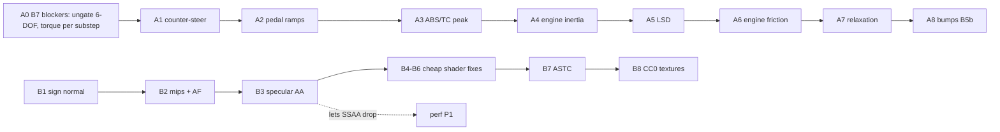

# Realism ideas: driving feel first, then looks

> **AI-generated (Claude), 2026-11-21. Owner review required.** This comes from a read-only audit; nothing was built, run or changed.
> - **Values:** 993 values marked **[est]** or **[unverified]** are estimates; check them against real sources before using them as tuning defaults.
> - **Citations:** from memory (titles and chapters, no page numbers).
> - **Code:** every C++ and GLSL sketch is uncompiled.
>
> Related files: [`perf-todo.md`](perf-todo.md) (GPU heat), [`code-smells-todo.md`](code-smells-todo.md) (bugs). Open B items: [`todo.md`](todo.md) B5b, B5d, B6, B7.
> **Goal (owner):** sim-cade, as real as reasonable. **Driving feel is the priority.** Keyboard first, with ABS and TC on.

---

## 0. What limits the feel today (each checked in the code)

| # | Finding | Where | Why it matters |
|---|---|---|---|
| 1 | The shipped car is a **bicycle model with static axle loads** in its lateral grip cap | `src/scene/Entity/Bicycle.h:63-76` | **Lift-off oversteer cannot happen** on a dry road. The fun lives in the 6-DOF path. |
| 2 | The **6-DOF rigid chassis** (combined-slip tyre, real wheel spin, springs, anti-roll bars) is **debug-only** | `CarEntity.cpp:110-116` (`#ifdef SWISH_DEBUG_UI`) | Players never get it. B7 ("flip the default") is the gate. |
| 3 | At speed, **keyboard steering allows only about 2°** of road-wheel angle | `KeyboardSteer.h:22,42` | $1.5\arctan(L\mu g/v^2)$ at 30 m/s is 2.1°. A 15° slide needs about 15° of counter-steer, so **slides can't be caught on arrow keys**. |
| 4 | **Throttle and brake are binary** 0/1 | `CarEntity.cpp:40-45` | Lifting off dumps about 760 N of rear load in one frame, so oversteer comes on as a snap. |
| 5 | **ABS and TC use a fixed $\kappa = 0.12$**, ignoring the `kappaPeak` slider and the lateral slip | `RigidChassis.h:246-247` | ABS braking in a turn ploughs; TC doesn't help the exit line. |
| 6 | Release runs **1 physics step per frame**; debug runs **240 Hz** | `CarEntity.cpp:99-108` | Release can go unstable on frame hitches at low speed (see CS-12). |
| 7 | The 6-DOF path computes **engine torque once per frame**, not per substep | `CarEntity.cpp:476-503` | The rev limiter and TC react only at frame rate. |
| 8 | **Release textures have no mips and no anisotropic filtering** | `TextureManager.cpp:118-140,191-199`, `Device.cpp:73` | The road shimmers and shows moiré, **and** the GPU wastes bandwidth (fan). |

---

# Part A: Driving (do these first)

## A0. B7 blockers (before any feel work)

1. **Ungate the 6-DOF path.** Move `update_rigid_body` out of `#ifdef SWISH_DEBUG_UI`. This changes release output on purpose: **add a new rigid golden** and leave the bicycle golden alone (never regenerate it to pass).
2. **Evaluate engine torque inside each substep.** Pass the gear, torque curve and throttle in `ChassisInput`, so rpm, the limiter and TC follow $\omega$ every $h \le 1/240$ s.
3. **Keep the current substep scheme.** `RigidChassis::advance` already uses equal slices with $h \le 1/240$ and $n \le 16$. A fixed accumulator with render interpolation is **not** needed.
4. **Give the bicycle model release substeps,** at least while it remains the fallback (CS-12). Explicit Euler is stable only while $\lambda\,\Delta t < 2$, where
   $$\lambda \approx \frac{C_f + C_r}{m v_x} = \frac{73\,500 + 133\,200}{1279 \cdot 5} \approx 32\ \text{s}^{-1}$$
   That requires $\Delta t < 62$ ms, but the frame cap allows 67 ms.

## Ranked improvements (feel gain ÷ effort)

### A1. Counter-steer assist: steer relative to the front axle's travel direction (B6) ★★★
**What you feel:**
- At speed, the arrow keys command a front **slip angle**, not an absolute angle.
- Hands off in a slide, the fronts line up with the direction of travel, like caster on a real car.
- **Lift-off slides become catchable on the keyboard.** Parking speed is unchanged.

**Math** (front slip, in the sign convention of `Bicycle.h:60`):
$$\alpha_f = \frac{v_l + a r}{v_x} - \delta \quad\Rightarrow\quad \delta_c = \arctan\frac{v_l + a r}{|v_x|}\ \text{makes}\ \alpha_f = 0$$
$$w = k_{cs}\,\mathrm{clamp}\!\left(\tfrac{v_x - v_{lo}}{v_{hi} - v_{lo}}, 0, 1\right),\qquad \delta = (1-w)\,s\,\delta_{lim} + w\,(\delta_c + s\,\alpha_{max})$$

| Symbol | Meaning | Value |
|---|---|---|
| $s$ | stick position | $[-1, 1]$ |
| $\alpha_{max}$ | commanded front slip at full stick | 7° |
| $k_{cs}$ | assist strength | 0.7 |
| $v_{lo}, v_{hi}$ | assist fade-in speeds | 3 m/s, 8 m/s |
| $a$ | CG to front axle | 1.363 m |

With the stick at 0, $F_{yf} = 0$. The only yaw moment left, $-bF_{yr}$, turns the car back toward its velocity.

**Plugs into** `KeyboardSteer.h` and `CarEntity::keyboard_input_frame` (`CarEntity.cpp:40-55`):
```cpp
// KeyboardSteerParams: + float assist = 0.7f, assistSlipDeg = 7.f, assistLo = 3.f, assistHi = 8.f;
inline float front_travel_angle_rad(float vx, float vl, float r, float a) {
    return std::atan((vl + a * r) / std::max(std::fabs(vx), 1.f));  // steer here -> zero front slip (caster)
}
inline float keyboard_steer_deg(float s, float vx, float vl, float r, float a, float plainLimitDeg, float lockDeg,
                                const KeyboardSteerParams& p) {
    const float w        = p.assist * std::clamp((vx - p.assistLo) / (p.assistHi - p.assistLo), 0.f, 1.f);
    const float plain    = s * plainLimitDeg;
    const float assisted = front_travel_angle_rad(vx, vl, r, a) * (180.f / util::units::kPi) + s * p.assistSlipDeg;
    return std::clamp(plain + w * (assisted - plain), -lockDeg, lockDeg);  // assist = 0 -> today's exact output
}
```
- **Risk:** state feedback with a one-frame lag can oscillate. The 90°/s steer-rate limit damps it; add a 50 ms filter on $\delta_c$ if needed.
- **Tests:**
  - At 30 m/s, starting from $\beta = 12°$ with the stick at 0: $|\beta| < 2°$ within 2 s.
  - `assist = 0` gives output identical to today's.
- **Sources:** Pacejka, *Tire and Vehicle Dynamics*; Milliken & Milliken, *Race Car Vehicle Dynamics* (caster, hands-off stability); Rajamani, *Vehicle Dynamics and Control*.

### A2. Pedal ramps for keyboard throttle and brake (B6) ★★★
**What you feel:** the throttle is no longer a stab. A lift mid-corner sheds rear load over about 0.12 s, so oversteer builds progressively instead of snapping.

**Math:** each pedal $u \in [0,1]$ is rate-limited, $\dot u = \pm R$.

| Ramp | Rate |
|---|---|
| Throttle press | 4 /s |
| Throttle lift | 8 /s |
| Brake press | 5 /s |

The load-transfer rate is $\dot{\Delta F_z} = \frac{m h}{L}\dot a_x$. An instant lift at 0.3 g moves $1279 \cdot 9.81 \cdot 0.3 \cdot 0.46 / 2.272 \approx 762$ N in **one frame**.

```cpp
inline constexpr KeyboardSteerParams kThrottleRamp{.riseRate = 4.f, .returnRate = 8.f};
inline constexpr KeyboardSteerParams kBrakeRamp{.riseRate = 5.f, .returnRate = 10.f};
m_key_throttle = keyboard_stick_step(m_key_throttle, keys.up ? 1 : 0, dt, kThrottleRamp);
m_key_brake    = keyboard_stick_step(m_key_brake, (keys.down && !keys.up) ? 1 : 0, dt, kBrakeRamp);
f.throttle = m_key_throttle;  f.brake = m_key_brake;
```
- **Risk:** throttle wins over brake in `apply_input_frame`, so the brake waits up to 125 ms for the throttle ramp to empty. Zero the throttle as soon as Down is pressed.
- **Sources:** Rajamani (driver models); Fiedler, "Fix Your Timestep!".

### A3. ABS and TC that target the combined-slip peak ★★★
**What you feel:** under ABS the car **still turns**, so trail-braking works. TC holds the exit line. Both follow the `kappaPeak` slider.

**Math** (the similarity tyre peaks at $\rho = 1$; $s_y = \tan\alpha / \tan\alpha_p$):
$$\kappa^* = \kappa_p \max\!\left(\sqrt{\max(\rho^{*2} - s_y^2,\, 0)},\ 0.3\right),\quad \rho^* \approx 0.85,\qquad T \leftarrow T\left[1 - \mathrm{clamp}\!\left(\tfrac{|\kappa| - \kappa^*}{0.5\kappa_p}, 0, 1\right)\right]$$
- **Brake bias check:** the ideal front share is $\phi_f^* = \frac{b}{L} + z\frac{h}{L} \approx 0.40 + 0.20z$, which is 0.60 at 1 g. The 0.62 default is right.
- **Replaces** `RigidChassis.h:246-247`:
```cpp
const float tanPk = k.front ? m_p.tan_alpha_peak_front : m_p.tan_alpha_peak_rear;
const float sy    = (-vs / vden) / tanPk;
const float kStar = m_p.tire.kappaPeak * std::max(std::sqrt(std::max(m_p.aid_rho * m_p.aid_rho - sy * sy, 0.f)), 0.3f);
const float band  = 0.5f * m_p.tire.kappaPeak;
if (in.abs) tb *= 1.f - std::clamp((-kappa - kStar) / band, 0.f, 1.f);
if (in.tc && td > 0.f) td *= 1.f - std::clamp((kappa - kStar) / band, 0.f, 1.f);
```
- **Test:** braking hard at 25 m/s with 0.7 g lateral and ABS on, the yaw rate keeps its sign and at least 50 % of its value.
- **Sources:** Savaresi & Tanelli, *Active Braking Control Systems Design for Vehicles* (2010); Pacejka (combined slip).

### A4. Engine inertia reflected onto the driven wheels ★★
**What you feel:** wheelspin builds progressively instead of flaring instantly. Power oversteer can be steered with the throttle, and downshifts load the rear.

**Math:** $J_{wheel} = I_w + \tfrac12 I_e G^2$, with $G = i_g i_{fd}$ and $I_e \approx 0.15$ kg·m² [est].

| Gear | $G$ | $J_{wheel}$ |
|---|---|---|
| 1st | $3.154 \cdot 3.444 = 10.86$ | $1.6 + 8.9 = 10.5$ kg·m² (6.5× today) |
| 6th | | +0.6 kg·m² |

```cpp
// RigidChassis::step spin branch:
const float inertia = m_p.wheel_inertia_kgm2 + in.driveline_inertia_kgm2[c];
const float denom   = inertia + h * slope * k.radius_m;
// CarEntity::update_rigid_body (RWD):
const float jRefl = 0.5f * m_profile.engineInertiaKgm2 * ratio * ratio;
in.driveline_inertia_kgm2[2] = in.driveline_inertia_kgm2[3] = jRefl;
```
- **Source:** Gillespie, *Fundamentals of Vehicle Dynamics* (rotational inertia).

### A5. Clutch-type limited-slip differential, rear (993) ★★
**What you feel:** the inside rear stops flaring on corner exit, coast locking steadies the car on a lift, and it turns in with a slight on-power push, a real 911 trait.

**Math** (Salisbury clutch pack, deadbeat equalisation, so no stiff-coupling stability limit):
$$T_{cap} = T_{pre} + S_\pm |T_{in}|,\qquad T_{eq} = \frac{\omega_L - \omega_R}{h\,(1/J_L + 1/J_R)},\qquad T_x = \mathrm{clamp}(T_{eq}, \pm T_{cap})$$
- Ramps: $S_+ / S_-$ = 40 % / 65 % [unverified]. Preload: $T_{pre} \approx 50$ N·m [est].

```cpp
std::array<float, 4> drive = in.drive_torque_nm;
if (m_p.lsd_preload_nm > 0.f || m_p.lsd_power > 0.f) {
    const float tIn = drive[2] + drive[3];
    const float cap = m_p.lsd_preload_nm + (tIn >= 0.f ? m_p.lsd_power : m_p.lsd_coast) * std::fabs(tIn);
    const float jL  = m_p.wheel_inertia_kgm2 + in.driveline_inertia_kgm2[2];
    const float jR  = m_p.wheel_inertia_kgm2 + in.driveline_inertia_kgm2[3];
    const float tX  = std::clamp((m_omega[2] - m_omega[3]) / (h * (1.f / jL + 1.f / jR)), -cap, cap);
    drive[2] -= tX; drive[3] += tX;  // then use drive[c] below
}
```
- **Test:** on a split-μ launch the LSD car accelerates harder. With every LSD parameter at 0, behaviour is bit-identical.
- **Sources:** Milliken & Milliken (differentials); Jacobson et al., *Chalmers Vehicle Dynamics Compendium* (free PDF).

### A6. Engine friction, part-throttle blend, and limiter hysteresis ★★
**What you feel:** 993-like engine braking on a lift (today it uses the 992's `-90 N·m * rpm/7000`), and a clean limiter bounce instead of a buzz.

**Math:**
$$T_e(n, u) = u\,T_{WOT}(n) - (1-u)(T_0 + k_f n)$$
- Friction: $T_0 \approx 15$ N·m and $k_f \approx 0.009$ N·m/rpm [est], about 76 N·m at 6800 rpm.
- Limiter: fuel cuts at $n \ge n_{red}$ and comes back below $n_{red} - 150$.

```cpp
struct EngineFriction { float t0Nm = 15.f, perRpm = 0.009f; };
inline float engine_net_torque(float rpm, float throttle, bool fuelCut, const TorqueCurve& c, const EngineFriction& f) {
    const float drive = fuelCut ? 0.f : engine_torque(rpm, c);
    return throttle * drive - (1.f - throttle) * (f.t0Nm + f.perRpm * rpm);
}
inline bool fuel_cut_step(bool cut, float rpm, float redline) { return cut ? rpm > redline - 150.f : rpm >= redline; }
```
- **Needs** A0 blocker 2.
- **Sources:** Heywood, *Internal Combustion Engine Fundamentals* (FMEP); Gillespie.

### A7. Tyre lateral relaxation length plus low-speed damping ★★
**What you feel:**
- No sideways creep when parked on a 5-6 % bank (about 7 mm/s today).
- No low-speed lateral fizz.
- A small, real turn-in lag: $\sigma/v = 13$ ms at 30 m/s.
- It replaces the arbitrary $v_{den} = \max(|v_f|, 3)$ hack.

**Math** (single-point transient model, implicit, so unconditionally stable):
$$\dot y = -v_s - \frac{|v_f|}{\sigma}y \;\Rightarrow\; y_{n+1} = \frac{y_n - h\,v_s}{1 + h|v_f|/\sigma},\qquad \tan\alpha' = y/\sigma$$
- $\sigma \approx 0.4$ m [est].
- Rear lateral stiffness $k_y = C_{F\alpha}/\sigma \approx 241$ kN/m, which gives $\omega h = 0.11$ at 1/240 s: stable.
- Low-speed damping $c_{ls} \approx 9$ kN·s/m, faded out by 3 m/s.

```cpp
float& y = m_defl_y[c];
y = (y - h * vs) / (1.f + h * std::fabs(vf) / m_p.relax_len_m);
const float tanAlpha = y / m_p.relax_len_m;
TireForce tf = combined_tire_force(kappa, tanAlpha, s.fn_n, m_p.static_load_n[c], in.mu, tanPk, m_p.tire);
tf.fy -= m_p.low_speed_damp_ns_per_m * vs * std::clamp(1.f - std::fabs(vf) / 3.f, 0.f, 1.f);
tf.fy  = std::clamp(tf.fy, -in.mu * s.fn_n, in.mu * s.fn_n);
```
- **Risk:** reset $y$ on any teleport or origin rebase.
- **Sources:** Pacejka (non-steady-state tyre behaviour); Jacobson, *Chalmers Compendium*.

### A8. Per-wheel road height and bumps (B5b) ★★
**What you feel:** the LIE concrete-slab "clack-clack" rhythm, the rumble-strip buzz, and crests and banks felt wheel by wheel.

**Math:**
- **Per-wheel penetration:** $\text{pen}_c = g(x_c, z_c) + \Delta z_c - y_c + p_c$.
- **Slab joint:** a raised-cosine dip, depth about 3 mm and width at least the 0.15 m contact patch. Slab pitch about 4.6 m [unverified].
- **Anti-aliasing:** box-filter the profile over the distance travelled in the step, $\bar z = \frac{Z(s_1) - Z(s_0)}{s_1 - s_0}$, where $Z$ is its antiderivative.
- **Rumble strips:** a 0.3 m pitch at 30 m/s is 100 Hz, near the 120 Hz Nyquist limit of a 240 Hz step. Feed only their envelope to the spring; send the buzz to the camera, audio and FFB.

```cpp
inline float slab_joint_dz_avg(float s0, float s1, float pitch, float depth, float width) {
    auto Z = [&](float s) {
        const float k = std::floor(s / pitch), u = std::clamp(s - k * pitch - 0.5f * pitch, -0.5f * width, 0.5f * width);
        const float w = 2.f * util::units::kPi / width;
        return -k * 0.5f * depth * width - 0.5f * depth * (u + 0.5f * width + std::sin(w * u) / w);
    };
    return std::fabs(s1 - s0) < 1e-5f ? 0.f : (Z(s1) - Z(s0)) / (s1 - s0);
}
```
- **Risk:** there is no unsprung mass yet, so sharp inputs go straight into the body. Keep the width rule and the box filter.
- **Sources:** Pacejka (tyre enveloping, effective road plane, Zegelaar); Gillespie (ride and road roughness).

### A9. Light yaw-stability assist (ESC-lite), default 0 or low ★
**What you feel:** one wheel gets braked to trim a spin, a safety net for keyboard beginners.

**Math:**
$$r_{ref} = \mathrm{clamp}\!\left(\frac{v_x \delta}{L + K_{us}v_x^2},\ \pm\frac{0.85\,\mu g}{v_x}\right),\quad K_{us} = \frac{m}{L}\!\left(\frac{b}{C_f} - \frac{a}{C_r}\right) \approx 1.2\times10^{-3},\quad M_z = k_{esc}(r_{ref} - r)$$
- **Which wheel:** brake the front wheel when $|r| > |r_{ref}|$ (oversteer), otherwise the rear.
- **Brake torque:** $T_b = |M_z|\,R_w / (t/2)$.
- **Risk:** it fights A1 if both are strong. Use a deadband of about 500 N·m and a low gain.
- **Sources:** Rajamani (yaw stability control); Bosch *Automotive Handbook* (ESP).

### A10. Per-wheel self-aligning torque (FFB / future wheel controller) ★
**Math:** $M_z = -\big(t_0\max(0, 1 - |\rho|) + t_m\big)F_y$, with $t_0 \approx 35$ mm and mechanical trail $t_m \approx 20$ mm [est].
- **Column torque:** $(M_{z,FL} + M_{z,FR})/i_s$, steering ratio $i_s = 16.5$.
- **Where:** record it per corner in `ChassisCornerState`, then feed `AppDrivingTools.cpp:134-142` instead of the linear bicycle estimate.
- **Sources:** Gillespie (steering systems); Pacejka (pneumatic trail).

### Tuning only (no code), for the B7 A/B
- **Tyre shape:** `tyre shape C` = 1.45 keeps 76 % of grip in a full slide. **1.30 keeps 89 %**, which makes slides more forgiving on keys.
- **Aero balance:** rearward, which is stable. At 150 mph it adds about 275 N on the front and 1100 N on the rear.

### Dropped (low feel gain for the effort)
- **Full Pacejka MF 5.2/6.1:** the current similarity curve already covers combined slip and load sensitivity, and there is no 993 coefficient data.
- **Ackermann in the physics:** affects low speed only.
- **Camber thrust, tyre temperature.**
- **Unsprung mass:** revisit after A8.
- **Shift torque gap:** fold it into A6.

---

# Part B: Looks (cheap first; several also cut GPU heat)

**Already strong:**
- **Wet model:** Lekner-Dorf darkening, water F0, puddles, ruts, wet streaks.
- **Paint:** clearcoat and flakes.
- **Lighting:** retroreflection, multiscatter GGX (debug), PCSS (debug), aerial haze, AgX tonemapping.

The weak links are **texture sampling**, **specular aliasing** and **tiling**.

### B1. Fix the sign normal fallback (bug, 1 line). Same as CS-03.
`MaterialDescriptors.cpp:154`: `if (!tex) tex = textures.get_texture(std::string("default") + kSuffixes[b]);`. Signs stop being lit as if they were tilted 55°.

### B2. Release mips (gamma-correct) plus anisotropic filtering ★★★ (better look **and** cooler GPU)
**What you see:** the road and grass stop shimmering, and lane texture stays sharp toward the horizon. Mips **reduce** bandwidth, because minified fetches hit small, cache-resident levels.

**Math:**
$$c_{mip} = \mathrm{sRGB}\!\left(\tfrac14\textstyle\sum_{i=1}^4 \mathrm{lin}(c_i)\right),\qquad N_{AF} = \min\!\left(\lceil\rho_{max}/\rho_{min}\rceil,\ N_{max}\right)$$
- **GPU support (checked with `vulkaninfo`):** `samplerAnisotropy=true`, `maxSamplerAnisotropy=16`.

```cpp
deviceFeatures.samplerAnisotropy = VK_TRUE;                       // Device.cpp:73, required first
samplerInfo.anisotropyEnable = VK_TRUE; samplerInfo.maxAnisotropy = 8.0f; samplerInfo.maxLod = VK_LOD_CLAMP_NONE;
// mip loop out of #ifdef; sRGB formats average in linear:
auto lin = [](uint8_t v){ float c=v/255.f; return c<=0.04045f? c/12.92f : std::pow((c+0.055f)/1.055f,2.4f); };
auto enc = [](float c){ c = c<=0.0031308f? c*12.92f : 1.055f*std::pow(c,1/2.4f)-0.055f; return uint8_t(c*255.f+0.5f); };
```
- **Release-visible:** needs owner sign-off.
- **Sources:** Williams, "Pyramidal Parametrics" (1983); *Real-Time Rendering* 4e §6.2.

### B3. Specular anti-aliasing: Toksvig plus Kaplanyan-Hill ★★★
**What you see:** no sparkle on panel edges, wet asphalt or guardrails. **This is what lets SSAA drop to 1.5 or 1.0 without looking worse (P1 in the perf plan).**

**Math:** the averaged normal length $r = |\bar n|$ gives the von Mises-Fisher concentration
$$\kappa = \frac{3r - r^3}{1 - r^2},\qquad \alpha^2 \mathrel{+}= \frac1\kappa + \min\!\left(\tfrac12(\|\partial_x n\|^2 + \|\partial_y n\|^2),\ 0.18\right)$$

**Replaces** `gbuffer.frag:136-137`:
```glsl
float r   = clamp(length(normalMap), 1e-3, 0.9999);
float a2  = roughness * roughness; a2 *= a2;
a2       += (1.0 - r * r) / (3.0 * r - r * r * r);           // Toksvig / vMF
vec3  dx  = dFdx(N), dy = dFdy(N);
a2       += min(0.5 * (dot(dx, dx) + dot(dy, dy)), 0.18);    // Kaplanyan-Hill
roughness = sqrt(sqrt(clamp(a2, 0.0, 1.0)));
```
- **Needs** B2 (mips).
- **Sources:** Toksvig, "Mipmapping Normal Maps" (JGT 2005); Kaplanyan et al., HPG 2016; Tokuyoshi & Kaplanyan, I3D 2019.

### B4. Horizon occlusion for normal-mapped reflections ★★
**What you see:** at grazing angles, bumpy asphalt, brick and trim stop showing bright sky speckles.

**Math:** $h = \mathrm{sat}(1 + k\langle R, N_g\rangle)$, $L_{env} \leftarrow h^2 L_{env}$, $k \approx 1.3$.

**Plugs into** `lighting.frag:778`:
```glsl
vec3  Ng = normalize(cross(dFdx(fragWorldPos), dFdy(fragWorldPos))); Ng *= sign(dot(Ng, V));
float hz = clamp(1.0 + 1.3 * dot(R, Ng), 0.0, 1.0);
envColor *= hz * hz;
```
- **Sources:** Russell, "Horizon Occlusion for Normal Mapped Reflections" (2015); Lagarde & de Rousiers, "Moving Frostbite to PBR" (2014).

### B5. Fade paint flakes by pixel footprint ★★
**What you see:** flakes glint up close and blend into smooth metallic paint at range, with no salt-and-pepper crawl.

**Math:** $f = \mathrm{sat}\!\left(\frac{s_{cell}}{1.5\,\|\mathrm{fwidth}(p)\|} - 1\right)$

**Plugs into** `gbuffer.frag:181-189`:
```glsl
float keep  = clamp(flakeScale / (1.5 * length(fwidth(fragWorldPos))) - 1.0, 0.0, 1.0);
flakeNormal = normalize(mix(N, flakeNormal, keep)); flakeMask *= keep;
```
- **Sources:** Jakob et al., SIGGRAPH 2014; Zirr & Kaplanyan, I3D 2016.

### B6. Alpha-tested foliage that keeps its coverage ★★
**What you see:** tree cards don't thin out or vanish with distance.

**Math:** $a' = \frac{a(1 + 0.25\lambda) - 0.5}{\max(\mathrm{fwidth}(a), 10^{-4})} + 0.5$

```glsl
float lod = textureQueryLod(albedoTex, fragUV).x;
float a   = albedoSample.a * (1.0 + 0.25 * max(lod, 0.0));
a = (a - 0.5) / max(fwidth(a), 1e-4) + 0.5;  if (a < 0.5) discard;
```
- **Sources:** Golus, "Anti-aliased Alpha Test" (2017); Castaño, "Computing Alpha Mipmaps" (2010).

### B7. GPU texture compression, ASTC ★★ (cooler GPU)
**What you see:** nothing directly. VRAM and texture bandwidth drop 4-9×, and JPG block artefacts disappear from the normal maps.

**Math:** $\text{bpp}_{6\times6} = 128/36 = 3.56$ against 32 for RGBA8, about 9×. A 1024² texture with mips goes from 5.33 MiB to 0.62 MiB.

**How:**
- Encode offline with `astcenc` (Apache-2.0).
- The `.astc` format is a 16-byte header plus blocks, so **no new library** is needed.
- Formats: `ASTC_6x6_SRGB` for albedo, `ASTC_4x4_UNORM` for normal and roughness. Both are supported on this Mac.

```cpp
struct AstcHeader { uint8_t magic[4], bx, by, bz, x[3], y[3], z[3]; };  // 13 AB A1 5C
// level bytes = ceil(w/bx) * ceil(h/by) * 16 ; no .astc on disk -> existing RGBA8 path
```
- **Risk:** this is the first non-RGBA8 upload path, so the per-level copy offsets must be exact.
- **Source:** Nystad et al., "Adaptive Scalable Texture Compression" (HPG 2012).

### B8. Better CC0 textures, with roughness / AO / height packed together ★★
**What you see:** real aggregate in the asphalt, galvanised guardrails, real bark. AO grounds the crevices.

**How:** pack the `_roughness` slot as R = roughness, G = AO, B = height. That keeps the 3 descriptor slots. Re-export the old maps with G = B = 255.

Candidate sets (**check the IDs on the sites before downloading**):

| Use | Candidate |
|---|---|
| LIE asphalt | ambientCG Asphalt025C / 026C, Poly Haven asphalt_02 |
| Concrete slabs / barriers | ambientCG Concrete031 / 034, Poly Haven concrete_floor_worn_001 |
| Guardrail | `GalvanizedSteel01_MR_1K` (already downloaded, not yet wired), Poly Haven metal_plate |
| Bark | ambientCG Bark007 / 012, Poly Haven bark_brown_02 |
| Leaves | ambientCG LeafSet cards |
| Sign sheeting | procedural micro-prism normal; the existing retro term (`lighting.frag:938`) does the rest |

- **Math:** $L_{amb} = k_D\,\rho\,E_{sky}\cdot ao_{tex}\cdot ao_{ssao}$.
- **Budget:** 2K textures cost 4× the texels, which B7 pays for.
- **Licence:** add each set to `assets/CREDITS.md`.

### B9. Hex-tiling to kill road and grass repetition ★
**What you see:** no visible 3 m grid at speed, in roughness too, so puddle edges and sheen stop repeating.

**Math** (Mikkelsen hex-tiling: luminance-weighted, contrast-sharpened barycentrics):
$$w_i' = \frac{w_i^\gamma(1 + \beta\ell_i)}{\sum_j w_j^\gamma(1 + \beta\ell_j)},\quad \gamma \approx 7,\ \beta \approx 0.6$$
- Sample with `textureGrad` using the original derivatives, so mip selection doesn't seam.
- A new `shaders/common/hextile.glsl` replaces the rotated second tap at `gbuffer.frag:121-126`. A sketch is in the research notes; per-vertex rotation also needs the normals rotated.
- **Cost:** 3 taps per map. Do it after B7, or tile only albedo and roughness.
- **Sources:** Mikkelsen, "Practical Real-Time Hex-Tiling" (JCGT 2022); Heitz & Neyret (HPG 2018).

### B10. Grass macro variation plus detail normal ★
- **What you see:** dry patches, mowing stripes and colour drift along 30 mi of verge.
- **How:** 40 m world-space fbm drives hue and roughness, and an RNM detail-normal blend adds fine relief.
- **Math:** $n = \frac{t}{t_z}(t\cdot u) - u$.
- **Sources:** Barré-Brisebois & Hill, "Blending in Detail" (2012); *GPU Gems 3* ch. 1.

### B11. GTAO replacing SSAO (no extra cost)
**What you see:** better contact shadow at barrier bases and under the car, and no grey cast on bright surfaces.

**Math:** $\hat a = \tfrac14(-\cos(2h - n) + \cos n + 2h\sin n)$, plus a multi-bounce fit.
- **Cost:** 2 slices × 6 steps = 12 taps, against 16 today.
- **Source:** Jimenez et al., "Practical Realtime Strategies for Accurate Indirect Occlusion" (SIGGRAPH 2016).

### B12. Deferred decals for skid marks (B5d) ★
- **How:** project a box decal into the G-buffer: $uv = (M^{-1}_{decal}\,p_{world})_{xz} + 0.5$, as a new `DecalPass` placed between the G-buffer and lighting.
- **Value:** only worth it for skid marks; `pavement.glsl` already covers oil, patches and polish.
- **Sources:** Kincaid, "Deferred Decals" (GDC 2009); Persson, "Volume Decals" (*GPU Pro 2*).

---

## Suggested order



- **Driving:** A0 → A1 + A2 (B6, the biggest keyboard win) → A3 → **owner A/B, then flip B7** → A4-A8. A9 and A10 are optional.
- **Looks:** B1 → B2 → B3 → B4/B5/B6 together → B7 → B8 → B9/B10 → B11 → B12.
- **Cross-link:** B2 + B3 + B7 make the image cleaner **and** the GPU cooler. B3 is what lets the perf plan's SSAA drop from 2.0.

**Gates for every item:**
- debug-first, with sliders in `Tunables.def`;
- release byte-identical until you sign off;
- tests green;
- a changelog entry;
- tuning notes in `docs/wheels/tuning-notes.md` or `docs/surface/tuning-notes.md`;
- an in-app checklist for you (agents don't launch the app).

## Not verified
- No build, run or test was done; every sketch is uncompiled.
- **Unverified values:** LSD 40/65, $I_e$ 0.15, $\sigma$ 0.4 m, engine friction, slab and rumble pitch.
- **Unread code:** the `CorridorAlignment::surface_at` signature and the full assertions of `test_rigid_chassis.cpp`.
- **Untested:** the CC0 set IDs, and whether the Toksvig signal survives ASTC-compressed normals.
- **Sign conventions** for A1 and A9 were checked against `Bicycle.h:60` and `RigidChassis.h:223-240`, but not numerically.
