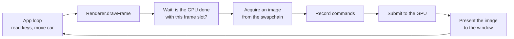

# Renderer terms, explained

> [!warning] AI-generated
> Claude wrote this from reading the Swish code and the audit notes. Check anything you plan to rely on against the code. Line numbers and names refer to the `master` tree at HEAD `a42f14b`.

**How to read this file.** Every `##` heading is one term with a short, plain-English explanation. Under it, the `### Deep dive` heading has the technical detail, the math, and where it shows up in the code and in `renderer-todo-obsidian.md`. Read the `##` parts first. Open a deep dive only when you want to code the fix yourself.

## The big picture

Swish draws a car on a road, 60 times a second or more. Each picture is called a frame. For every frame, the **CPU** (the normal processor) tells the **GPU** (the graphics chip) what to draw, and the GPU draws it into an image that appears in the window. Most of the todo items are about doing that hand-off more safely or more smoothly.



### Deep dive

The loop lives in `App.cpp` (about L279-399). `Renderer::drawFrame` (`Renderer.cpp:335`) runs the middle boxes. The two bugs and five experience items in the todo each sit at one box in this diagram:

| Todo item | Box |
|-----------|-----|
| R1 quit hang | "Acquire an image" (the swapchain is rebuilt when the window changes size) |
| E1 sky bake stall | "Record commands" plus a hidden full stop for the GPU |
| E2 input lag | "App loop" versus "Wait" order |
| E3 timeouts | "Wait" and "Acquire" |
| E4 fps readout | "App loop" |
| E5 cache file | startup and shutdown, not the loop |

## CPU and GPU

The CPU is the general-purpose brain: it runs your game logic, reads the keyboard and decides where the car is. The GPU is a second chip that is very good at doing the same small job on millions of pixels at once. They work at the same time, like a cook (CPU) writing orders and a kitchen line (GPU) cooking them.

### Deep dive

The CPU and GPU run **asynchronously**: when the CPU "draws", it only writes instructions into a list and hands the list over. The GPU runs the list later. This is why a call like `vkQueueSubmit` returns quickly while the picture is not finished yet, and why you need things like fences (see below) to know when the GPU is done.

When this README says a stall is "GPU-bound", the GPU is the slow one and the CPU waits. "CPU-bound" is the other way around. The E1 sky bake is GPU-bound: the 113.6 ms is the GPU doing a lot of work while the CPU waits for it.

## Frame

One picture. If the game runs at 60 frames per second (fps), each frame has about 16.7 ms to be finished.

### Deep dive

$$
T = \frac{1}{f}, \qquad f = 60\ \text{Hz} \Rightarrow T \approx 16.7\ \text{ms}, \qquad f = 120\ \text{Hz} \Rightarrow T \approx 8.3\ \text{ms}
$$

A "dropped frame" means one frame took longer than $T$, so the screen showed the old picture twice. The E1 bake of 113.6 ms spans $113.6 / 16.7 \approx 6.8$ frames, so about 7 frames are dropped in a row. Our eyes see that as a freeze.

**Frame time** (milliseconds per frame) is a better number than fps for finding problems, because it adds up: if the GPU work takes 5 ms and the CPU takes 8 ms, the frame costs about the larger of the two when they overlap.

## Delta time (`dt`)

The number of seconds since the last frame. The car moves by `speed × dt`, so it travels the same distance per second whether the game runs at 30 or 120 fps.

### Deep dive

In `App.cpp` the loop computes `delta_time = current_time - last_frame_time` and then caps it:

```cpp
delta_time = std::min(delta_time, 1.0f / 15.0f);  // cap at ~67ms to prevent physics explosion
```

The cap exists because a very large `dt` (after a long freeze) would make the physics take one giant step and throw the car around. With the cap, a 113 ms hitch becomes a 66.7 ms step: the car slows down for a moment instead of teleporting.

$$
\Delta t_{\max} = \frac{1}{15}\ \text{s} \approx 66.7\ \text{ms}
$$

For the fps readout (E4) you must use the raw, uncapped time. If you use the capped value, a long stall is under-counted and the fps looks better than it is.

## Vulkan and MoltenVK

Vulkan is the programming interface (an API) Swish uses to talk to the GPU. It is very explicit: you manage everything yourself. MoltenVK is a translator that turns Vulkan calls into Metal, which is the interface Apple's GPUs understand. macOS has no native Vulkan, so every Vulkan call here goes through MoltenVK.

### Deep dive

Because Vulkan is explicit, a lot of "boring" setup code exists (swapchain, fences, command buffers, pipelines). The benefit is predictable performance. The cost is that mistakes (a missing wait, a wrong layout) can freeze or corrupt the picture instead of giving a friendly error.

`CLAUDE.md` lists MoltenVK-specific traps:
- No comparison samplers, so shadow maps use manual PCF.
- Push-constant blocks must be a multiple of 16 bytes.
- Formats must match across blits.
- No ray tracing, so reflections are IBL plus SSR only.

When this README says "I could not confirm whether MoltenVK does X" (see E3), it means the behavior depends on the translation layer, not on Vulkan itself.

## Renderer

The class (`Renderer.h`, `Renderer.cpp`) that owns all the graphics setup and draws each frame. The rest of the game asks it for things ("use this camera", "draw this mesh"), and it does the Vulkan work.

### Deep dive

`Renderer` owns the Vulkan context, device, swapchain, command manager, sync objects, post-processing, and IBL manager. On `master` it is large (about 1,580 lines) and includes `drawFrame`. On the newer lookdev branch it was split into several files and a pass registry. Anything in the todo that names `Renderer_Frame.cpp` belongs to that other branch.

Ownership rule (see "Ownership and `unique_ptr`" below): the Renderer owns the camera. The App only borrows it through `get_camera()`.

## Swapchain

A small ring of images that the window shows one after another. While the window displays image A, the GPU draws the next frame into image B. When B is ready, they swap.

### Deep dive

`Swapchain.cpp` asks for `minImageCount + 1` images (`Swapchain.cpp:20`), usually 3. The swapchain is tied to the window size and format. When the window is resized, minimized, or the system says the images are "out of date", the old swapchain must be destroyed and a new one created. That is `Renderer::recreateSwapchain` (`Renderer.cpp:1334`).

Recreating also rebuilds everything that depends on the window size (the offscreen images in `PostProcessManager`, the sync semaphores), so it is expensive and must only happen when the GPU is idle (`vkDeviceWaitIdle`).

R1 is a bug in this function: if the window is minimized, its framebuffer size is 0, and the function waits in a loop until the size is non-zero. It never checked that the user was quitting, so Cmd-Q while minimized waited forever. The fix adds `&& !m_window->shouldClose()` and an early return.

## Present mode, vsync, FIFO and MAILBOX

When the GPU finishes an image, the swapchain needs a rule for when to show it. This rule is the present mode. **Vsync** means "only swap when the monitor is ready for a new picture", which avoids tearing (a half-old, half-new picture). **FIFO** is the strict vsync queue. **MAILBOX** is the "latest picture wins" mode.

### Deep dive

- **FIFO:** images queue up; the screen takes one per refresh. If the queue is full, the program waits. Guaranteed to exist everywhere. Frame rate matches the monitor (60 or 120 Hz).
- **MAILBOX:** the queue has one slot. A newer finished image replaces the waiting one. No tearing, and the program rarely blocks, so lower latency and a higher fps than FIFO.

On `master`, `Swapchain.cpp:124-131` prefers MAILBOX and falls back to FIFO. That is why E2 (input lag from waiting before reading input) matters less on this tree: MAILBOX seldom blocks. On the lookdev branch the code is hard-wired to FIFO, where the waiting is longer.

## Frames in flight

How many frames the CPU is allowed to prepare while the GPU is still working on earlier ones. The project allows 2. This keeps the GPU fed and the CPU from waiting on every frame.

### Deep dive

Each in-flight slot has its own copy of everything the CPU changes every frame: uniform buffers, descriptor sets, a command buffer, and a fence. `m_currentFrame` cycles through the slots:

```cpp
m_currentFrame = (m_currentFrame + 1) % MAX_FRAMES_IN_FLIGHT;
```

With 2 slots, the CPU can be at most one frame ahead of the GPU. The trade-off is latency: the more frames in flight, the older the input that ends up on screen.

$$
L \approx (\text{frames in flight}) \times T
$$

This is a rough rule, not exact. It is why E7 in the old todo said "do not lower it unless steering still feels late".

## Fence and semaphore

Two kinds of "done" signals. A **fence** lets the CPU ask "has the GPU finished that work?" A **semaphore** lets one GPU step wait for another GPU step, without the CPU being involved.

### Deep dive

In `drawFrame`:
- `m_syncObjects->waitForFence(...)` (first line) blocks the CPU until this slot's previous frame has finished, so we may safely reuse its buffers.
- `getImageAvailable` semaphore: the swapchain signals it when an image is ready to draw into. The submit waits on it.
- `getRenderFinished` semaphore: signalled when drawing is done. The present waits on it.

A fence is **reset** (`resetFence`) only after a successful acquire. If you reset it first and then the acquire fails (the swapchain is out of date), nobody signals it again and the next wait deadlocks. The current code gets this order right, which was checked in the audit.

E3 is about the wait: `vkWaitForFences(..., UINT64_MAX)` means "wait forever". If the GPU hangs, so does the app, silently. A timeout turns that into an error message.

## Acquire and present

**Acquire** means "give me an image from the swapchain to draw into". **Present** means "I'm done, show it". They are the two ends of every frame.

### Deep dive

`vkAcquireNextImageKHR` returns a result code:
- success: draw as normal.
- `VK_ERROR_OUT_OF_DATE_KHR`: the window changed; recreate the swapchain and skip this frame.
- `VK_SUBOPTIMAL_KHR`: still works, but a recreate would be better.
- `VK_TIMEOUT` (only if you set a timeout, as in E3): no image came back in time.

`vkQueuePresentKHR` returns similar codes, handled in `handlePresent` (also recreates if `m_window->wasResized()`).

## Command buffer and queue

A **command buffer** is a recorded list of GPU instructions ("start this pass, draw these triangles, end the pass"). A **queue** is the line the GPU takes lists from. The CPU records a list, submits it to the queue, and moves on.

### Deep dive

`recordCommandBuffer` writes the whole frame's instructions: the G-buffer pass, lighting, post-processing, composite. It is reset and re-recorded every frame (`resetBuffer`). `vkQueueSubmit` hands it to the GPU and attaches the fence and semaphores.

**`vkQueueWaitIdle(queue)`** blocks the CPU until everything already submitted to that queue is finished. It is a blunt tool: the whole queue drains. `IBLManager::bake` calls it twice (at the start, to be sure no frame is still reading the sky cubes, and at the end through `endOneTime`, to wait for the bake). Those two stops are the "hidden full stop" in the E1 diagram.

**`vkDeviceWaitIdle`** is the same idea for the whole GPU. It is used when tearing down or recreating the swapchain. R5 guards `cleanup()` so it is not called with a null device.

## Shader, GLSL and SPIR-V (`.spv`)

A shader is a small program that runs on the GPU, once per pixel (or once per vertex). Swish writes shaders in GLSL (text files in `shaders/`), and a compiler turns them into SPIR-V (`.spv` files) that Vulkan can load.

### Deep dive

- A **vertex shader** places each corner of a triangle on the screen.
- A **fragment shader** decides the color of each pixel. `ibl_prefilter.frag` is a fragment shader.
- `glslc` compiles `.frag`/`.vert` into `.spv`.

The app loads `.spv` at startup, so after editing a shader you must rebuild and restart. That is the "kill the running app before rebuilding" rule in `CLAUDE.md`.

Changing a shader changes the `.spv` file, which changes what the release build produces. The project rule is that release output stays byte-identical unless the change is intentional and recorded. F1 in E1 is an intentional shader change, so it needs a changelog entry.

## Pipeline and pipeline cache

A **pipeline** is a bundle of settings the GPU needs before it can draw: which shaders, how to blend colors, what the vertex layout is. Building one is slow. The **pipeline cache** is a file that remembers earlier builds so the next start-up is faster.

### Deep dive

`Device::createPipelineCache` loads `config/pipeline_cache.bin` (path in the build tree, `Device.cpp:17`) if it exists. Vulkan checks a header in the blob (vendor, device, driver version), so a stale or foreign cache is ignored safely. `savePipelineCache` writes it back on clean shutdown.

E5 is about that write. The current code opens the file with `trunc` (empty it), then writes. If the app crashes between those two steps, the file is left short. The fix is an **atomic write**: write a temporary file first, then `rename` it over the real one. A rename is a single step; the real file is either the whole old version or the whole new version, never half of one.

## Render pass, G-buffer and deferred lighting

**Deferred rendering** means: first draw the scene's raw facts into several hidden images (color, normal direction, how shiny, depth). That set is the **G-buffer**. Then a second pass reads those images and works out the lighting for every pixel once. It keeps lighting cost independent of how many objects are on screen.

### Deep dive

Swish's order (from `CLAUDE.md`): G-buffer, deferred PBR lighting, transparent objects, bloom, then composite with an AgX tonemap (squashing very bright values into a displayable range).

A **render pass** is a Vulkan object that says which images a set of draws writes into, and in what state they start and end. The IBL bake uses its own render pass (`m_cubeRenderPass`) to draw into cube faces.

The lighting shader reads set 1 (G-buffer), set 2 (shadow map), set 3 (scene params / IBL). The exact set layout is in `CLAUDE.md` and changes between branches, so check it before editing shader bindings.

## PBR, roughness and clearcoat

**PBR** (physically based rendering) means materials are described with real-world properties instead of faked colors. The most important one for this todo is **roughness**: 0 is a perfect mirror, 1 is completely matte. **Clearcoat** is the extra glossy lacquer layer on car paint.

### Deep dive

PBR lighting has a diffuse part (light scattered in all directions, like chalk) and a specular part (light bounced like a mirror, blurry when rough). Specular reflections of the sky are what make the Porsche look glossy, so they are the reason the project keeps the 256-pixel prefilter resolution for roughness 0 (see "Prefilter").

## Image-based lighting (IBL), HDRI and cubemap

**IBL** lights the scene using a picture of the sky instead of individual lamps. The picture is stored as a **cubemap**: six square images forming the faces of a box around the scene. **HDRI** is a sky photo that stores real brightness (not clipped at white). On `master`, Swish builds the sky itself with a shader instead of loading an HDRI.

### Deep dive

For every point on the car, the shader asks: "what does the sky look like in the direction a mirror would reflect?" and "how much light arrives from the whole sky?" Looking up a six-faced cube by direction is how it answers.

`IBLManager` keeps three cubemaps:

| Cube | Size | Purpose |
|------|------|---------|
| environment | 256² per face | the raw sky |
| irradiance | 32² per face | blurred sky for diffuse lighting |
| prefiltered | 256² down to 16², 5 mip levels | the sky blurred by roughness, for specular lighting |

`kFaces = 6`, `kEnvDim = 256`, `kIrrDim = 32`, `kPrefilterDim = 256`, `kPrefilterMips = 5` (`IBLManager.h:58-63`).

## Bake

To "bake" is to do an expensive calculation once, store the result, and reuse it. The sky cubemaps are baked whenever the weather changes, so the per-frame cost stays small.

### Deep dive

`IBLManager::bake` (`IBLManager.cpp:360`) does three things in one command buffer:
1. Draws the procedural sky into the 6 faces of the environment cube.
2. Convolves it into the irradiance cube (32² per face).
3. Convolves it into the prefiltered cube (6 faces × 5 mips).

The result is only recomputed when the sky changes. `Renderer::maybeRebakeIBL` (`Renderer.cpp:1448`) compares the current sun direction, clarity and sun color to the last baked values (a **dirty check**). If nothing changed, it returns without baking.

The measured time was **113.6 ms**. See E1 for the analysis and fixes (F1 and F2).

## Prefilter, GGX and mip levels

The **prefilter** step blurs the sky by different amounts for different roughness values: sharp for glossy paint, very blurry for rough tarmac. **GGX** is the standard formula for how light scatters off a slightly rough surface. A **mip level** is a smaller, pre-blurred copy of an image; the prefiltered cube stores one mip per roughness step.

### Deep dive

For each output pixel, the shader (`ibl_prefilter.frag`) takes 256 random-but-well-spread samples of the sky around the reflection direction. The spread depends on roughness: low roughness clusters the samples tightly, high roughness spreads them wide.

- **Importance sampling** picks samples where the GGX shape is strongest, instead of uniformly, so 256 samples are enough.
- **Hammersley** is a way to generate 256 evenly spread 2D points (`hammersley(i, SAMPLES)`).

Roughness per mip is $m / (k - 1)$ where $k = 5$ mips:

| Mip | Size | Roughness |
|-----|------|-----------|
| 0 | 256² | 0.00 |
| 1 | 128² | 0.25 |
| 2 | 64² | 0.50 |
| 3 | 32² | 0.75 |
| 4 | 16² | 1.00 |

Mip 0 holds 75% of the pixels:

$$
\frac{393216}{393216 + 98304 + 24576 + 6144 + 1536} \approx 0.75
$$

At roughness 0, the GGX sampling returns the reflection direction itself for every sample, so all 256 samples read the same texel. The shader does 256 copies of the same read. F1 in E1 replaces that with a single read. The outcome should be the same, but 75% of the prefilter work disappears.

## Split-sum approximation and BRDF LUT

A shortcut that splits the expensive specular lighting math into two parts: one part depends only on the sky (the prefiltered cube) and one depends only on the view angle and roughness (a small lookup table, the **BRDF LUT**, baked once at startup). Multiplying the two gives a good result very cheaply.

### Deep dive

The shader uses `V = R = N` (view, reflection and normal all equal) when prefiltering. That is the "split-sum simplification" noted in `ibl_prefilter.frag`: it makes the blur the same in every direction, which is wrong at grazing angles but cheap and usually close enough. `bakeBRDF` runs once at startup (`IBLManager.cpp:349`), not on every weather change.

## Dirty check and debounce

A **dirty check** answers "did anything change since last time?" and skips work if not. A **debounce** waits until changes have stopped for a moment before reacting, so rapid changes (like dragging a slider) cause one reaction, not hundreds.

### Deep dive

The IBL bake already has a dirty check (`m_baked*` compared to `m_sunDir`, `m_clarity`, `m_sunColor`). What it does not have is a debounce. In a debug build, dragging a sky slider changes the values every frame, so a bake (113 ms, or about 40 ms after F1) runs every frame. F2 adds a trailing-edge debounce: remember when the values last changed, and only bake when 200 ms have passed since.

The dirty state stays set while we wait, because `m_baked*` is only updated after a real bake. That is why the early `return` is safe.

## Latency and input lag

Latency is the delay between pressing a key and seeing the result. Lag is the same thing when it feels bad.

### Deep dive

Each stage adds delay: reading the key, simulating, recording, GPU draw, waiting for the display. In the loop order, the keyboard is read before `drawFrame` waits on the fence, so the input behind a picture can be up to one frame old:

$$
L_{\text{before}} \le L_{\text{after}} + T
$$

E2 moves the wait earlier so the keys are read after the sleep, not before. On MAILBOX the wait is usually short, so the gain is small; on FIFO it can be a full frame.

Whether it is worth it is a feel test. Numbers cannot decide it for you.

## Timeouts

A timeout is a limit on how long a wait may last. Without one, a stuck wait looks like a frozen program.

### Deep dive

`UINT64_MAX` as a Vulkan timeout means "wait forever". E3 replaces it with 5 seconds (`5'000'000'000` nanoseconds) in two places: the fence wait in `SyncObjects.cpp` and the swapchain acquire in `Renderer.cpp`. On timeout the code throws a message that says what timed out.

The risk is a false alarm: if a covered window makes MoltenVK hold the acquire longer than 5 s, a throw would crash a program that was merely waiting. After the edit, test with the window covered. If it throws, either raise the limit or treat `VK_TIMEOUT` as "skip this frame".

## Ownership and `unique_ptr`

"Ownership" answers the question: who is responsible for freeing this object? C++ has a smart pointer, `std::unique_ptr`, that says "exactly one owner; the object is freed when the owner goes away". A raw pointer (`Camera*`) says nothing about who frees it.

### Deep dive

Before R2:

```cpp
void Renderer::set_camera(Camera* camera) { m_camera.reset(camera); }
```

The caller wrote `new Camera()` and passed the raw pointer. The Renderer silently took ownership. A future caller who kept their own owner would cause a **double free** (two owners both delete it, which crashes). Even `set_camera(get_camera())` would delete the camera it just stored.

After R2:

```cpp
void set_camera(std::unique_ptr<Camera> camera);  // takes ownership
Camera* get_camera() const;                       // non-owning view
```

The signature now shows that ownership moves. Callers write `renderer.set_camera(std::move(camera));`. `std::move` is the explicit "I am giving this away" marker; after it, the old variable is empty (null) and must not be used. That is why the call order in `AppInit` matters: read `camera->get_fov()` **before** the move.

> [!bug] A mistake worth remembering
> `get_camera()` must not return a `unique_ptr`. If it did (as happened once during this work), every call would take the camera away from the Renderer. A getter returns a plain `Camera*`: a borrowed view, not ownership.

## Debug build and release build (`SWISH_DEBUG_UI`)

Swish can be built two ways. `make run` makes the **release** build: the one meant to be played. `make debug` makes the **debug** build, which adds the Dear ImGui tuning panels (sliders for sky, rain, camera and more). The debug-only code is hidden behind a compile switch.

### Deep dive

Code inside `#ifdef SWISH_DEBUG_UI ... #endif` is compiled only for the debug build. The project rule: the release build's output must stay **byte-identical** to before, unless you intentionally change it and say so. That is why every new debug-only feature is wrapped in that switch, and why E4 (fps title) offers a "wrap it in `#ifdef`" option.

Debug builds are also where sliders trigger the IBL rebake on every drag step (see "Dirty check and debounce").

## Atomic write

A way to save a file so that readers only ever see the old version or the new one, never a half-written mix.

### Deep dive

Steps: write the data to `file.tmp`, check that the write succeeded, then `std::filesystem::rename("file.tmp", "file")`. On the same disk, a rename is a single filesystem operation: it either happens or it does not.

The non-atomic version opens the real file with `trunc` first, which empties it immediately. A crash after that and before the write finishes leaves an empty or short file. For the pipeline cache (E5), that costs you a slow first start, or a rejected cache, rather than data loss, but the habit is worth having.

## Measuring versus guessing

A "measured" number comes from running the program with timing code. A "guess" or "estimate" comes from reading the code. The todo marks which is which.

### Deep dive

- The 113.6 ms bake is **measured**. You ran it.
- The 75% share for mip 0 is **calculated** from the code (pixel counts), not profiled on the GPU.
- The expected "35 to 45 ms after F1" is an **estimate**. Re-measure after the change.

Use `std::chrono::steady_clock` for timing (it never goes backwards), print with `std::fprintf(stderr, ...)`, and remove the timing code afterwards. The E1 section has a ready-made split timing for "waiting for the GPU" versus "the bake itself".

## Quick reference

| If you see this word | Think |
|----------------------|-------|
| swapchain | the ring of images the window shows |
| fence | CPU asks "is the GPU done?" |
| semaphore | GPU steps wait on each other |
| acquire / present | get an image / show an image |
| vsync / FIFO / MAILBOX | rules for when to swap images |
| frames in flight | how far ahead the CPU may run |
| bake | expensive calculation done once, reused |
| prefilter / GGX / mip | pre-blurred sky copies by roughness |
| IBL / cubemap / HDRI | lighting from a picture of the sky |
| dirty check / debounce | skip if unchanged / wait until it stops changing |
| ownership / `unique_ptr` | who frees the object |
| `SWISH_DEBUG_UI` | debug-only code, hidden in release |
