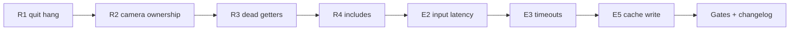
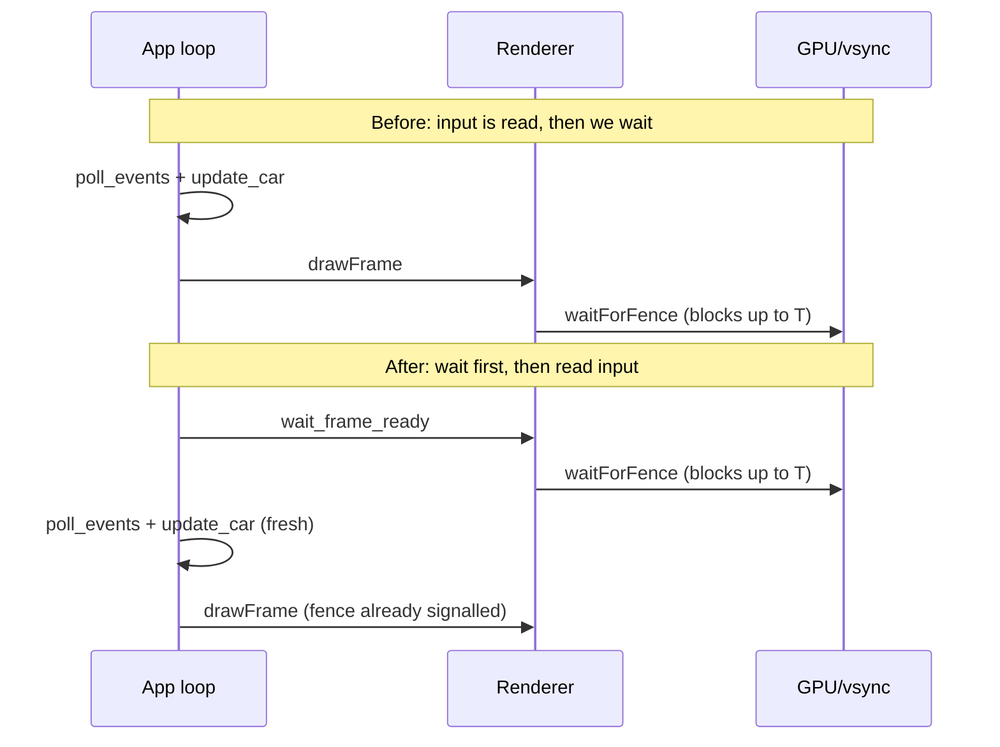

# Renderer todo

> [!warning] AI-generated
> Claude wrote this list from a code audit. A human must review it before acting. Nothing here was built, run or measured.

> [!info] How to read this note
> **R1-R6** are audit fixes. **E1-E5** are experience improvements. **Gates** and **Changelog** at the end are required by the project rules. Tick a box when the step is done and checked, not when it is written.



---

## Do first

### R1. Quit hang while minimized #fix #must ⏫

> [!bug] Problem
> `recreateSwapchain` waits until the window has a size. It never checks the close flag. Minimize the window, press Cmd-Q, and the size stays 0, so `waitEvents()` loops forever.

File: `src/renderer/Renderer/Renderer.cpp`, `recreateSwapchain` (about L211).

```cpp title:"Renderer.cpp" ln:true hl:2,6
    int width = 0, height = 0;
    m_window->getFramebufferSize(&width, &height);
    while ((width == 0 || height == 0) && !m_window->shouldClose()) {
        m_window->waitEvents();
        m_window->getFramebufferSize(&width, &height);
    }
    if (m_window->shouldClose()) return;  // leave the old swapchain intact: the main loop is about to exit
```

- [x] Apply the edit above
- [x] Read the callers in `Renderer_Frame.cpp` (`acquireImage`, `handlePresent`). They must not touch the swapchain after a skipped recreate. With the early return before `m_swapchain->cleanup`, the old swapchain stays valid, so this should hold.
- [x] **App test:** `make debug`, minimize, Cmd-Q. The app must exit. Repeat with `make run`.
- [x] **App test:** drag-resize the window. Recreate must still work.

### R2. Make camera ownership explicit #fix ⏫

> [!bug] Problem
> `set_camera(Camera*)` calls `m_camera.reset(camera)`. The raw pointer hides that ownership moves. `set_camera(get_camera())` frees the camera it just stored.

Three places change.

```cpp title:"Renderer.h (L101)" ln:true
void set_camera(std::unique_ptr<Camera> camera);
```

```cpp 
title:"Renderer.cpp (L196)" ln:true
void Renderer::set_camera(std::unique_ptr<Camera> camera) { m_camera = std::move(camera); }
```

```cpp 
title:"AppInit.cpp (first site, about L157-175)" ln:true hl:1,15
auto camera = std::make_unique<Camera>();
camera->set_position(Vec3(6501.0f, 1448.0f, -5000.0f));
camera->set_yaw(-90.0f);
camera->set_pitch(-3.0f);
camera->set_collision_enabled(false);
// ... extent / aspect / set_perspective unchanged ...
m_camera_ctl.set_base_fov(camera->get_fov());  // read BEFORE the move
renderer.set_camera(std::move(camera));
```

> [!warning] Second call site (about L222-230)
> The lookdev path calls `renderer.set_camera(camera)` and then `camera->get_fov()`. After `std::move` the pointer is null. Swap the two lines: call `set_base_fov(camera->get_fov())` first, then `set_camera(std::move(camera))`.

- [x] Change `Renderer.h` and `Renderer.cpp`
- [x] Change both call sites in `AppInit.cpp`
- [x] Add `#include <memory>` where the build asks for it
- [x] Build both configs: `make build` and `make debug`

### R3. Delete dead debug getters #cleanup 🔼

> [!question] Decide first
> Only delete these if no plan still needs them. A grep found zero callers outside `Renderer.h` and `Renderer.cpp`. The debug UI gets the same data through `RenderToolsView` (`Renderer.cpp:L108-119`).

In `Renderer.h`, inside `#ifdef SWISH_DEBUG_UI` (L133-142), remove:

```cpp title:"Renderer.h: remove these six" ln:true
const ShaderHotReload&               shader_hot_reload() const { return m_shaderReload; }
void                                 set_shader_hot_reload_enabled(bool e) { m_shaderReload.set_enabled(e); }
const std::vector<NamedDeclaration>& pass_declarations() const { return m_passDecls; }
const std::vector<std::string>&      pass_declaration_warnings() const { return m_declWarnings; }
const GpuProfileSnapshot&            gpu_profile() const { return m_gpuProfiler.snapshot(); }
const CaptureStatus&                 capture_status() const { return m_frameCapture.status(); }
```

Keep `request_capture` (used at `AppInput.cpp:107`).

- [x] Run one last grep: `grep -rnw "gpu_profile\|capture_status\|pass_declarations" src tests`
- [ ] Delete the six **lines**
- [x] Build `make debug` (these are debug-only, so also build release to prove nothing changed)

### R4. Includes #cleanup 🔽

- [x] Remove `#include <array>` from `Renderer.h` and `Renderer.cpp` (unused)
- [x] Add `#include <string>` to `Renderer.h` (the debug block uses `std::string`)

### R5. Guard `cleanup()` #optional 🔽

Only worth doing if you add error recovery in `App`. `vkDeviceWaitIdle` on a null device is undefined behavior.

```cpp title:"Renderer.cpp, top of cleanup()" ln:true
if (!m_device || !m_device->getDevice()) return;
```

- [ ] Decide: do it or skip it

### R6. Format #cleanup

- [ ] `make format` (run last, after every edit above). It fixes stray blank lines, trailing spaces, and the misleading `else` in `init_passes`.

---

## Experience improvements

> [!tip] Latency math
> At refresh rate $f$, one frame lasts $T = 1/f$. At 60 Hz, $T \approx 16.7\ \text{ms}$. At 120 Hz, $T \approx 8.3\ \text{ms}$. The physics step is capped at $\Delta t_{\max} = 1/15\ \text{s} \approx 66.7\ \text{ms}$ (`App.cpp:112`), so a hitch slows the sim instead of throwing the car.

### E1. Weather key stalls the picture #experience ⏫

> [!bug] Problem
> `on_cycle_weather` (`AppInput.cpp:84`) leads to `set_hdri`, which loads the HDRI from disk, calls `vkQueueWaitIdle`, and bakes convolutions on the main thread (`IBLManager.cpp:426-449`; procedural path at `453-478`). The picture freezes for the whole bake.

Cheapest fix: preload every preset HDRI at startup, so the key only swaps a ready cube. Cross-fading between presets is a bigger feature. Do not start it without deciding.

- [ ] **App test:** press the weather key while driving in `make run`. Note the stall in milliseconds: _____ ms
- [ ] If the stall is under about 50 ms, skip E1. If not, design the preload.

### E2. Input is sampled before the vsync wait #experience ⏫

> [!bug] Problem
> The loop reads keys and steps the car (`App.cpp:88-99`), then `drawFrame` blocks on `waitForFence` (`Renderer_Frame.cpp:27`). With FIFO vsync that wait can take most of a frame. The input behind each picture is up to one frame old:

$$
L_{\text{before}} \le L_{\text{after}} + T
$$



```cpp title:"Renderer.h (public)" ln:true
void wait_frame_ready();  // block until this frame slot's fence is signalled
```

```cpp title:"Renderer.cpp" ln:true
void Renderer::wait_frame_ready() { m_syncObjects->waitForFence(m_device->getDevice(), m_currentFrame); }
```

```cpp title:"App.cpp, top of the loop (before frame_delta at L88)" ln:true hl:1
m_renderer->wait_frame_ready();  // sleep in the vsync wait BEFORE reading input
const float dt = frame_delta(last_frame_time);
```

Keep the wait inside `drawFrame`. It becomes an instant no-op because the fence is already signalled.

- [ ] Add `wait_frame_ready` and the call
- [ ] **App test:** compare steering feel before and after. Only you can judge this.

### E3. A GPU hang looks like a frozen window #experience 🔼

> [!bug] Problem
> `SyncObjects.cpp:53-54` and `Renderer_Frame.cpp:58` both wait with `UINT64_MAX`. If the GPU hangs, the app freezes with no message.

```cpp title:"SyncObjects.cpp (L53-54)" ln:true
constexpr uint64_t kFenceTimeoutNs = 5'000'000'000ull;  // 5 s
const VkResult     r = vkWaitForFences(device, 1, &m_inFlightFences[frameIndex], VK_TRUE, kFenceTimeoutNs);
if (r == VK_TIMEOUT) throw std::runtime_error("GPU fence wait timed out after 5 s: possible GPU hang");
VK_CHECK(r);
```

```cpp title:"Renderer_Frame.cpp (L58), acquire" ln:true
constexpr uint64_t kAcquireTimeoutNs = 5'000'000'000ull;
VkResult r = vkAcquireNextImageKHR(m_device->getDevice(), m_swapchain->getSwapchain(), kAcquireTimeoutNs,
                                   m_syncObjects->getImageAvailable(m_currentFrame), VK_NULL_HANDLE, &idx);
```

On `VK_TIMEOUT`, `is_presentable` is false, so the existing `throw` fires with "failed to acquire swap chain image!". Improve that message if you want to know it was a timeout.

> [!question] Unconfirmed
> I do not know whether MoltenVK blocks when the window is fully covered. If the app freezes when you cover the window, this becomes a **must fix**. Tell me.

- [ ] Add both timeouts
- [ ] **App test:** minimize and restore. It must not throw a timeout. Minimize is handled by R1, but verify.

### E4. No fps readout in release #experience 🔽

```cpp title:"App loop: once per second" ln:true
fpsTime += rawDt;  // use the UNCAPPED delta, not the 67 ms capped one
++fpsFrames;
if (fpsTime >= 1.0f) {
    char title[96];
    std::snprintf(title, sizeof title, "Swish  %.0f fps  %.1f ms", fpsFrames / fpsTime, 1000.0f * fpsTime / fpsFrames);
    glfwSetWindowTitle(m_window->getHandle(), title);
    fpsTime = 0.0f;
    fpsFrames = 0;
}
```

$$
\text{fps} = \frac{N_{\text{frames}}}{\Delta t}, \qquad \text{frame time (ms)} = \frac{1000\,\Delta t}{N_{\text{frames}}}
$$

- [ ] Add it behind a config flag, so the shipped title stays clean
- [ ] Declare `float fpsTime = 0.0f; int fpsFrames = 0;` next to `last_frame_time`

### E5. Pipeline cache write is not atomic #experience 🔽

> [!bug] Problem
> `Device::savePipelineCache` (`Device.cpp:196-203`) opens with `trunc` and writes in place. A crash during the write leaves a short file.

```cpp title:"Device.cpp, savePipelineCache()" ln:true hl:5-10
size_t size = 0;
if (vkGetPipelineCacheData(m_device, m_pipelineCache, &size, nullptr) != VK_SUCCESS || size == 0) return;
std::vector<char> data(size);
if (vkGetPipelineCacheData(m_device, m_pipelineCache, &size, data.data()) != VK_SUCCESS) return;
const std::filesystem::path path = pipeline_cache_path();
const std::filesystem::path tmp  = path.string() + ".tmp";
{
    std::ofstream out(tmp, std::ios::binary | std::ios::trunc);
    if (!out) return;
    out.write(data.data(), static_cast<std::streamsize>(size));
    if (!out) return;  // do not publish a short file
}
std::error_code ec;
std::filesystem::rename(tmp, path, ec);  // atomic replace on the same filesystem
```

- [ ] Check what type `pipeline_cache_path()` returns (string or path) and adjust the first line
- [ ] Add `#include <filesystem>`
- [ ] **App test:** delete the cache file once. The second launch should start faster than the first.

### Not recommended now

- **E6** Vsync is fixed on (`Swapchain.cpp:125-127`). Fine for a sim. Add a config value only if you want a latency-test mode.
- **E7** Swapchain asks for `minImageCount + 1` (`Swapchain.cpp:24`). Standard. Revisit only if steering still feels late after E2, and only by measuring.

---

## Gates

Run after all edits. Kill the running app before you rebuild.

```bash
make format
make format-check
make test
make test-debug
make check
```

- [ ] `make format-check` clean
- [ ] `make test` green
- [ ] `make test-debug` green
- [ ] `make check` clean
- [ ] Release build output is unchanged where you did not intend a change (debug-only code stays under `#ifdef SWISH_DEBUG_UI`)

## Changelog (project rule: required for fixes and refactors)

File: `docs/changelog/2026-11.md` (new month, create it). Then run `python3 scripts/changelog_index.py`.

```markdown
### 2026-11-01 — Renderer audit fixes

Fixed a hang on quit while minimized and made camera ownership explicit.

<details><summary>Technical summary</summary>

**Root cause.** `recreateSwapchain` never checked the close flag; `set_camera` took an unmarked raw pointer.

**Fix.** [src/renderer/Renderer/Renderer.cpp](src/renderer/Renderer/Renderer.cpp), [src/renderer/Renderer/Renderer.h](src/renderer/Renderer/Renderer.h), [src/core/App/AppInit.cpp](src/core/App/AppInit.cpp).

| File | Change |
|------|--------|
| `src/renderer/Renderer/Renderer.cpp` | close check in `recreateSwapchain`, `set_camera(unique_ptr)` |
| `src/renderer/Renderer/Renderer.h` | `set_camera` signature, getters removed, includes |
| `src/core/App/AppInit.cpp` | `make_unique<Camera>` at two call sites |

</details>
```

- [ ] Write the entry (adjust the table to what you actually changed)
- [ ] Run `python3 scripts/changelog_index.py`
- [ ] If R3 lands, grep `docs/render-pipeline.md` and `src/renderer/README.md` for the removed getters
- [ ] Add any new lesson to `tasks/lessons.md`
- [ ] Ask for a commit only when you are ready. Never commit or push unprompted.

## Open items (needs the Tasks plugin)

```tasks
not done
path includes renderer-todo
sort by priority
```

## Review (fill in when done)

- What shipped:
- What did not:
- Lessons:
