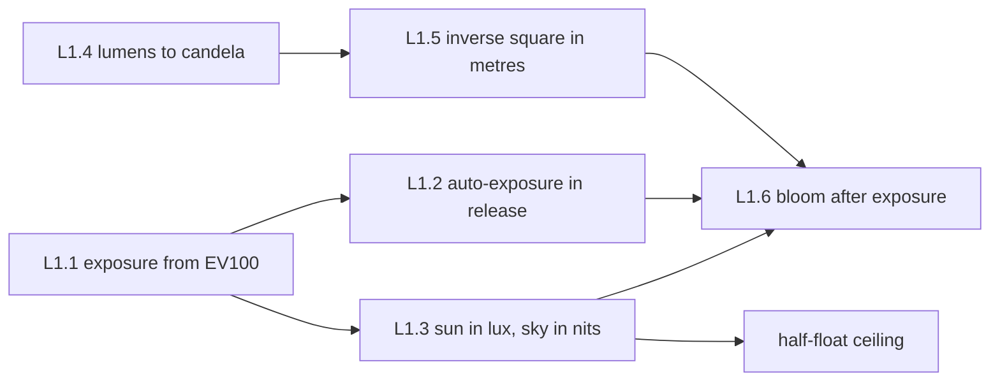

# Active plan

> Reorganised 2026-09-29. Finished and shipped sections were moved **verbatim** to
> [`archive/2026-06.md`](archive/2026-06.md), [`archive/2026-07.md`](archive/2026-07.md) and
> [`archive/2026-08.md`](archive/2026-08.md) and (2026-11-20 pruning) [`archive/2026-11.md`](archive/2026-11.md);
> open items from them are carried below.
> Checkbox state inside the archive is a **snapshot** and some open boxes there shipped later — the
> "Verify before starting" note at the bottom lists the ones known to be stale. Ground truth for what
> shipped: `git log` and [`CHANGELOG.md`](../CHANGELOG.md). Current user goal:
> [`docs/user-goals/CURRENT.md`](../docs/user-goals/CURRENT.md).

## Renderer roadmap: R7-R10 + E1-E5 (planned 2026-11-01, branch `bug/fix-camera-ownership`)

Source: [`renderer-next-steps-README.md`](renderer-next-steps-README.md) plus the grilling session on 2026-11-01. The owner writes the code. Manual checks: [`upcoming-tests.md`](upcoming-tests.md). The visual guide is a private artifact with the same checklist.

Decisions:

- Scope: E1-E5 plus four small Renderer-class fixes. FrameInputs struct, geometry passthrough removal, header diet and the minimize `waitEvents` loop are out.
- No new unit tests now; candidates are listed in `upcoming-tests.md`.
- E3 acquire timeout: log once, then skip. E4: title bar, both builds (intended release change). E5: `.tmp` + `rename`.

Order:

- [x] **R7** Assert `m_window` at the top of `recreateSwapchain()`; keep the pointer (no `Window&` member). (done)
- [x] **R8** `cleanup()`: device block under `if (m_device && m_device->getDevice())`, `m_device.reset()`, then `m_context->cleanup()` guarded on `getInstance()` and `m_context.reset()`. `~Renderer` calls `cleanup()`. (fixed 2026-11-20: the committed half-step reset m_device before using it; teardown now device-users -> device -> instance; clean exit code 0 in both builds)
- [x] **R9** `cleanup()` and `recreateSwapchain()` call `wait_for_idle()` instead of `vkDeviceWaitIdle`. (done)
- [x] **R10** Split `init_passes(bool)` into `init_passes()` / `resize_passes()` with `pass_init_ctx(const RendererServices&)`. The ctx holds a reference, so keep `svc` local in the caller. (done 2026-11-20: callers switched, old overload removed)
- [x] **E1 measure** Time load / idle-wait / bake in `IBLManager::set_hdri` (:368) and `bakeFromHdri` (:426). (done 2026-11-20: load ~20 ms, idle wait ~0.05 ms, bake ~120-140 ms -> the bake dominates; [IBL] log line now prints all three)
- [x] **E5** Atomic pipeline cache write in `Device::savePipelineCache` (:196). (done 2026-11-20: .tmp + std::filesystem::rename)
- [x] **E3** Fence: 5 s, throw. Acquire: 5 s, log once and skip, checked before the `is_presentable` throw. (done 2026-11-20)
- [x] **E4** fps in the title bar from `glfwGetTime()` in `App::run`; `frame_delta` untouched. (done 2026-11-20: title "swish  |  N fps", 0.5 s window)
- [x] **E1 fix** Option A pre-staged (roughness-0 early return in `ibl_prefilter.frag`; regenerate the `.spv` golden on purpose). B/C/D if the load dominates. (option A done 2026-11-20: roughness-0 early return, bake 140 -> 132 ms, ~6 %; the hitch needs B/C/D = async or frame-split bake, see L2.4)
- [ ] **E2** Measure fence vs acquire, then pick A/B/C/D; feel test.
- [ ] Gates after each item; changelog in `docs/changelog/2026-11.md` (R1-R6, R7-R10, one per E item).

## Rain impact splashes, burn-style phases (planned 2026-11-20, debug-only)

Source: the technique behind the "burn to Gaussians" effect in `willeastcott/splat-walk` (studied, not copied: the repo has no licence). That effect evaluates a stateless per-instance phase function (rest data + stable hash + time since event) each frame, packs the phase weights into one `uint` and lets the fragment shader choose between gaussian, outline ring and dot. Here, the same idea draws rain impact splashes on the road. This closes todo A2 (see "Open items by area").

Decisions (grilling 2026-11-20):

- First slice: rain impact splashes. Tire-spray droplets, puddle bow wave, dust and smoke come later.
- No 3D Gaussian splat renderer: Swish scenes are meshes.
- Impact point: an analytic road plane. No depth-buffer hits, so no splashes on the hood or roof yet.
- Run it in the vertex shader inside `RainSystem`: a second instanced draw. No compute pass, no new buffers, no new pass in `PassList.def`.
- Phases: an expanding crown ring outline on the road, then 2-4 hashed droplet dots on short ballistic arcs. No impact flash.
- Debug-only: the draw and its tunables live under `#ifdef SWISH_DEBUG_UI`. Release output stays byte-identical. Promote to release after the owner's app check.
- Blend: additive like the rain streaks. Brightness scales with sun and ambient from the camera UBO.
- Event slots (burn's origin + time uniforms): not now. They arrive with the puddle-hit slice.

Design note found while planning: `rain.vert` wraps drops in a box centred on the camera, so a drop never "lands". A splash derived from a drop would slide with the car. Splashes therefore come from their own field. It is a grid snapped to world coordinates around the camera. Each cell fires at hashed times with period $P$ and offset $h_0 P$, so splashes stay fixed in the world. Visual sync with the individual streaks is not needed: nobody can follow one drop.

$$t_{\text{local}} = \operatorname{fract}\!\left(\frac{t}{P} + h_0\right) P, \qquad \text{ring radius } r(t_{\text{local}}) = r_{\max}\left(1 - e^{-t_{\text{local}}/\tau}\right)$$

Steps:

- [x] **S1** Check that `tests/golden/release_spv.sha256` (34 pinned files) ignores unlisted `.spv` files. Result (2026-11-20): the check is `shasum -a 256 -c` over the listed files only (no ctest). A probe `.spv` added to `build/shaders/` still exits 0, so the new `rain_splash.*.spv` needs no glob filter. The release build will compile and package two unused `.spv` files, and the executable stays the same.
- [x] **S2** Road height near the camera. Done without plumbing: `FrameUpdate::carPosition.y` plus the `road_offset` tunable (spray treats carPosition as ground level too). Values go in a 64 B push block, not a UBO. shortcut: plane is flat around the car, so ramps and interchanges will be slightly off; upgrade to depth-buffer hits later.
- [x] **S3** Tunables in `src/debug/Tunables.def` (one group): cell size, density scale (× rain intensity), period, ring max radius, ring τ, ring band width, droplet count, droplet speed, droplet size, brightness. Defaults must give zero splashes at intensity 0.
- [x] **S4** `shaders/rain_splash.vert`: `gl_InstanceIndex` maps to a cell and a sub-instance (0 = ring quad lying flat on the road, 1-4 = droplet billboards). Hash the cell's world coordinate for spawn chance, phase offset and droplet directions. Compute the phase weights and pack ring, dot, fade and spare as 4 bytes into one `flat uint`. Drop dead instances to a degenerate position (as `spray.vert` does).
- [x] **S5** `shaders/rain_splash.frag`: unpack the weights. The ring is a thin band at the expanding radius, anti-aliased with `fwidth`. A dot is a hard disc with a soft edge. Output is additive and scaled by sun and ambient.
- [x] **S6** `RainSystem`: add a second pipeline (same blend and depth state as the rain streaks) and `vkCmdDraw(6, cells × 5)` with no vertex buffer, all under `#ifdef SWISH_DEBUG_UI`. Use `vkx` builders and keep push constants 16-byte aligned.
- [ ] **S7** (owner, in the app) Measure GPU time with the existing `GpuProfiler` (`Rain` pass), with splashes on and off. Agents do not launch the app.
- [x] **S8** Gates: `make test`, `make test-debug`, `make format-check`, `make check`. Release `.spv` goldens unchanged.
- [x] **S9** Changelog entry in `docs/changelog/2026-11.md`, then `python3 scripts/changelog_index.py`.
- [ ] **Owner check in the app** (`make debug`): at rain 0 there are no splashes. At rain 1.0 the ring and droplets show on the road. Splashes stay put while the car drives. They are dim at night. Window resize still works.

### Rain round 3: wet road + rain sky (grilling 2026-11-20, not started)

Decisions:

- Priority: the wet road comes first. Traffic tail lights and cabin exposure come later.
- Scope: debug-only (`SWISH_DEBUG_UI`), so the release output stays byte-identical. Promote after the owner's sign-off.
- Road features, all four:
  1. Procedural rain ripples (Lagarde-style ring normals in puddles and the water film, scaled by rain intensity, no texture).
  2. Wheel-track ruts (darker, glossier water bands where tyres run in each lane).
  3. Reflection tuning (SSR plus wet Fresnel, so lane lines and the sky reflect).
  4. Lekner–Dorf wet darkening $A_w = 1 - \frac{(1-R_1)(1-A)}{1-pA}$, with $R_1 \approx 0.02$ and $p \approx 0.475$.
- Rain sky: use the HDRI path with rain coupling. That means fog, clarity 0, EV shift and sun off, the same as the procedural path. Fix the weather preset overriding the chosen HDRI (rain loaded Quarry Cloudy).
- Rain HDRI: Misty Morning (`kloofendal_misty_morning_puresky_2k`) by default. It is selectable live in the debug HDRI combo.
- Light rain (0.35): any rain switches to the overcast HDRI. Fog, gloss and ripples scale with wetness.
- References: the owner's 5 photos plus Google Images captures in `scratch/rain-refs/` (gitignored, never committed). From them:
  - head- and tail-light reflections stretch into long vertical streaks;
  - the road reads mid-to-light grey because it reflects the sky;
  - bright impact sparkle covers the whole surface;
  - concrete jersey barriers line the road.
- Verification: the agent runs the debug build and takes window-only screenshots (the owner allowed Mac control, 2026-11-20). Rain is checked at 0, 0.35 and 1.0.
- **After EVERY phase** (owner, 2026-11-20): append a section to [`docs/rain/tuning-notes.md`](../docs/rain/tuning-notes.md). Each section covers:
  - every knob the phase added or changed, with its default, its safe range, and what moving it does;
  - the formula behind it, in LaTeX;
  - the university slides, course notes or papers it rests on, with links and an opened/unverified mark;
  - the screenshots taken.
  The goal is that the owner can fine-tune with precision without re-reading the code. A phase is not done until its notes are in.

Phases (each ends with its tuning-notes section):

- [x] **P1** (2026-11-20) Rain-coupled HDRI sky: Misty Morning on any rain; fog / clarity / EV / sun-off on the HDRI path; fix the preset overriding the chosen HDRI.
- [x] **P1b** (2026-11-20) Tweaks: wetness latch (fixes dark noon after rain), 20 s sky fade-in, Kloofendal Overcast + Storm Sky added, HDRI comparison.
- [x] **UI1** (owner, 2026-11-20; done same day: Roboto 17 px HiDPI, high-contrast linear style, full-window panel) Debug ImGui panel ("Swish Lighting Controls" window) is thin and hard to read: bigger font / HiDPI scale, higher-contrast style, wider window. Same for the debug viewer.
- [x] **P2** (2026-11-20; root cause of the black road was an SSAO normal-sign bug) Lekner–Dorf wet darkening plus reflection tuning (SSR, wet Fresnel).
- [x] **P2b** (2026-11-20) SSR first step 8 m -> 0.4 m (debug) + normal fix, SSAO radius 1000, splash brightness 0.35.
- [x] **P2c** (2026-11-20) Analytic car-underbody sky visibility (8 cosine rays + mirror ray vs car box).
- [x] **P2d** (2026-11-20) SSR swaps the env reflection via HDR alpha; car-occluded reflections mirror the body (k_car 0.45).
- [x] **P3** (2026-11-20) Wheel-track ruts (corridor lanes 1-3; subtle under uniform overcast, strongest against lights/structure).
- [x] **P4** (2026-11-20) Procedural rain ripples on puddles + rut water (analytic wave packets, no texture).

Later slices (not planned yet): tire-spray droplets with the same shape switch (CURRENT.md issue 2), puddle hits / bow wave with event slots, dust and smoke (needs sort or OIT plus lighting).

## Lighting: time-of-day presets on physical units (planned 2026-11-14)

Source: codebase survey plus the grilling session on 2026-11-14. Goal: a realistic 18-mile compact LIE with the
1995 911 Carrera RS (993), lit by PBR at any time of day. Golden hour is the first preset to sign off.
This section replaces the scattered lighting items further down (car lights S5, "Rendering / lighting" list, feature
table rows 6 and 7); those stay in place for history.

Decisions:

- **Presets:** dawn, morning, noon, golden hour, evening, midnight. Chosen in `config/*.toml` for release; switchable live in the debug UI.
- **Sky:** procedural, with an IBL rebake on preset switch. The HDRI path stays as a debug-UI option only.
- **Units:** physical. Sun in lux, local lights in lumens, exposure in EV100 with auto-exposure.
- **Night lights:** headlights, tail and brake lights, expressway street lamps, retroreflective signs and lane markings.
- **Local shadows:** both headlights plus the nearest 2 to 4 street lamps.
- **Wet road:** dry first; every preset is re-verified at rain 0 and 1.0 in the last phase.
- **Release:** features leave the `SWISH_DEBUG_UI` gate phase by phase. Each promotion regenerates the `.spv` golden on purpose and gets its own changelog entry.
- **Corridor:** stays 18 miles (`config/lie_corridor.toml:63`). **Car:** already the 993 (`config/car.toml:17`).

Scaffold (2026-11-14, second grilling round): the owner implements; Claude scaffolded stubs, hidden tests and one
short chapter per phase. Start at [`docs/tutorials/lighting/00-index.md`](../docs/tutorials/lighting/00-index.md)
and open only the chapter for the phase you are on.

- **Stubs** (bodies are `TODO(learning Lx)`, nothing in the app includes them yet):
[`Photometry.h`](../src/utils/light/Photometry.h) (L1, L5, L6), [`ShadowFit.h`](../src/utils/light/ShadowFit.h) (L3, L7),
[`TimeOfDay.h`](../src/scene/TimeOfDay/TimeOfDay.h) (L0.7, L2), [`CorridorLamps.h`](../src/scene/Corridor/CorridorLamps.h) (L6),
[`config/time_of_day.toml`](../config/time_of_day.toml) (L2.3, not loaded yet).
- **Hidden tests** (`[.learning][lighting]`, skipped by `make test`): `build/tests/utils/swish_utils_tests "[learning][lighting]"`
and `build/tests/swish_tests "[learning][lighting]"`. Drop `.learning` from a phase's tags when it passes.
- **GLSL** snippets are in the chapters only; no shader file was touched.
- **Sky model (L2.1): decided**, Hillaire LUT sky. **Emissive (L5.1): decided**, one scalar in a free G-buffer alpha
(`gbuffer.frag:110-111`), glow colour = albedo; check the target format first.

Gate after every phase: `make test` + `make test-debug` green, 0 warnings, `make check`, changelog in
`docs/changelog/2026-11.md`, and an owner check in the app (agents run unit tests only and hand over a checklist).

### L0: fix structural bugs before tuning anything

- [x] **L0.1** Sun colour is added to the unshadowed ambient term (`lighting.frag:445`), so shadows cannot go dark. Remove it from ambient.
- [x] **L0.2** Ambient diffuse ignores `kD` and uses `(1 - metallic*0.5)` (`lighting.frag:448`), so metals get diffuse light. Use `kD`.
- [x] **L0.3** Clearcoat IBL uses the analytic `envBRDFApprox` while the base layer uses the BRDF LUT (`lighting.frag:482` vs `:461`). Use the LUT for both. Done: coat uses `texture(brdfLUT, …)`, `envBRDFApprox` deleted.
- [x] **L0.4** Clearcoat takes no energy from the base layer (`lighting.frag:469`). Attenuate the base by `1 - F_coat`. Done: `coatKeep = 1 - strength·(0.04 + 0.96(1-N·V)^5)` scales the base lobes (ambient, sun, base IBL, point/spot BRDF, wet sheen, flake).
- [x] **L0.5** The wetness dim is applied to the environment reflection as well (`lighting.frag:460`). Confirm intent, then remove or keep. Done: kept. The sky background is dimmed by the same term (sky shader), so reflections must match it. Comment records this.
- [x] **L0.6** `sunDir.w` (sun intensity) is uploaded and never read by the shader. Wire it; L1 needs it. Done: `sun_radiance = sunColor.rgb * sunDir.w` in `lighting.frag`. C++ still sends 1.0, so output is unchanged until L1 sets a real value.
- [x] **L0.7** Sun azimuth and elevation sliders are never read (`WeatherController.cpp:127`); only the gizmo moves the sun. Wire them; L2 and L3 need them. Done (debug build): with no gizmo, `apply_debug` sets `m_sunDir` from the sliders via `sun_dir_from_az_el` (now implemented, test un-hidden). Slider defaults are the angles of the shipped sun. The gizmo still wins while shown.
- [x] **L0.8** Release composite multiplies by `aoTex` (`composite.frag:99-103`) but no SSAO pass runs in release. Find what the texture is bound to. Found: `PostProcessManager::primeAOTexture` clears the AO blur image (R8) to white once at start-up, so `hdr *= ao` multiplies by 1.0 and costs one wasted texture fetch. No code change; L4.5 decides remove vs promote.
- [x] **L0.9** The GLB metallic channel is ignored; metalness is 1 only for `MAT_METAL` (`SceneGeometry.cpp:138`), so chrome and wheels shade as plastic. Read metallic from the asset. Done: scalar glTF `metallicFactor` rides on `Submesh::metalness` to `DrawCall::metalness` to the push constant. The B channel of the metallicRoughness texture is not read. Owner: check the Porsche cabin (see changelog).
- [x] **L0.10** Delete or reuse the dead `compute_sky_color` / `skyIrradiance` (`lighting.frag:178-201`); decide once the L2 sky model is chosen. Done: deleted (both were unreferenced; git history keeps them). The `SP_SKY_`* / `SP_SUN_DISC_*` macros stay for the L2 sky decision.
- [x] **L0.11** Re-measure the composite `Params` push-constant block (measured 52 bytes, not a 16-byte multiple) and pad it. Done: re-measured 52 B with `spirv-dis`; added `_pad3`..`_pad5` to `composite.frag` (now 64 B, last offset 60) and `offsetof` asserts on `PostProcessParams`.

#### L0.2 tutor walkthrough: ambient diffuse and `kD`

**Step 1. Know what is wrong.** Current code (`lighting.frag:447-448`, line numbers drift):

```cpp
vec3 lit_color = AO_DIFFUSE(albedo * ambient * ambientIrr * (1.0 - metallic * 0.5))
               + sun_term * sunShadow;
```

- `(1.0 - metallic * 0.5)` is a magic number. At `metallic = 1` it keeps **half** the diffuse. A metal has no diffuse, so it should keep **zero**.
- The sun term two lines below already does it right: `kD = (1 - F) * (1 - metallic)`. The ambient term ignores that work.

**Step 2. Learn the energy rule.** A surface splits incoming light in two. Fraction `F` is reflected as specular. The rest, `1 - F`, enters the surface and comes back out as diffuse. Metals (`metallic = 1`) have no diffuse at all, so the diffuse share is multiplied by `(1 - metallic)`. In short:

$$
k_D = (1 - F)\,(1 - \text{metallic})
$$

**Step 3. Do not just reuse** `kD`**.** Line 427 defines `kD` with `F_sun`, which is Fresnel evaluated at the sun half-vector `H` (`HdotV`). The sun is one direction. Ambient light arrives from the whole sky hemisphere, so there is no single `H`. If you reuse `kD`, the ambient diffuse depends on where the sun is. That breaks as soon as L0.7 wires the sun sliders, so the wrong answer will show up later.

For ambient, evaluate Fresnel from the view angle `N·V` instead, with roughness awareness (Lagarde / Filament style). This is one line:

$$
F_{\text{env}} = F_0 + \bigl(\max(1 - \rho,\ F_0) - F_0\bigr)\,(1 - N\!\cdot\!V)^5
$$

where $\rho$ is `roughness`. Then:

$$
k_{D,\text{amb}} = (1 - F_{\text{env}})\,(1 - \text{metallic})
$$

**Step 4. Check the numbers by hand before you touch GLSL.**

| Case | `N·V` | `metallic` | `F_env` | `k_D,amb` |
|------|-------|------------|---------|-----------|
| Dielectric, face-on (`F0 = 0.04`) | 1.0 | 0 | 0.04 | 0.96 |
| Dielectric, grazing | 0.05 | 0 | ~0.9 | ~0.1 |
| Metal (any angle) | any | 1 | any | 0 |

The metal row must be exactly zero. If it is not, the fix is wrong.

**Step 5. Write the fix.** Use the same `F0` the shader already has (line 402, a `vec3`). Shape of the change:

```glsl
// Ambient Fresnel from the view angle, not the sun half-vector (L0.2).
vec3 F_env  = F0 + (max(vec3(1.0 - roughness), F0) - F0) * pow(1.0 - NdotV, 5.0);
vec3 kD_amb = (vec3(1.0) - F_env) * (1.0 - metallic);
vec3 lit_color = AO_DIFFUSE(albedo * ambient * ambientIrr * kD_amb)
               + sun_term * sunShadow;
```

**Step 6. Fix the broken line above it first.** The working tree has an L0.1 leftover. `ambientIrr` was deleted from line 445 but is still used on line 447, so the shader will not compile. L0.1 says to drop the sun colour from ambient, so the intended definition is `vec3 ambientIrr = skyIrr * SP_IBL_DIFFUSE;`. Confirm that, then do L0.2.

**Step 7. Know what this changes.**

- Release output changes on purpose. Under CLAUDE.md, that needs a changelog entry and an intended golden update (`SWISH_UPDATE_GOLDENS=1`). Never regenerate a golden just to make a refactor pass. `release_spv.sha256` is bound to the SDK glslc.
- Possible follow-up, after L0.3 lands: the exact split-sum reflectance is `F0 * envBRDF.x + envBRDF.y` (`envBRDF` comes from the LUT). It is more accurate than `F_env`, but it needs `envBRDF` moved above line 447. Keep `F_env` for L0.2 so the change stays small.

**Step 8. Verify by looking (owner runs the app).**

- Temporarily force `metallic = 1` on the body paint. Take a window-only screenshot (`screencapture -R`). The shadowed side should be dark, with no grey matte lift.
- Restore `metallic`. Check that the dielectric body still reads with its diffuse.
- Remove the temporary force before you commit.

**Try it yourself:** why does `F_env` use `N·V` and not `H·V`? Answer in one sentence before you change the code.

**Solution (to apply):** lines 445-448 of `shaders/lighting.frag` become:

```cpp
    vec3  sun_radiance = camera.sunColor.rgb;
    vec3  skyIrr       = texture(irradianceMap, N).rgb;   // baked-sky diffuse irradiance (set 3)
    vec3  ambientIrr   = skyIrr * SP_IBL_DIFFUSE;         // L0.1: no sun colour in ambient
    // Sun (direct) term is shadowed; ambient/sky fill is not (see sunShadow above).
    vec3  sun_term  = (kD * albedo / PI + specular_sun) * NdotL * sun_radiance;

    // Ambient Fresnel from the view angle, roughness-aware (L0.2). Not F_sun: ambient has no single H.
    vec3  F_env   = F0 + (max(vec3(1.0 - roughness), F0) - F0) * pow(1.0 - NdotV, 5.0);
    vec3  kD_amb  = (vec3(1.0) - F_env) * (1.0 - metallic);
    vec3  lit_color = AO_DIFFUSE(albedo * ambient * ambientIrr * kD_amb)
                   + sun_term * sunShadow;
```

Only the `ambientIrr` definition and the `kD_amb` term change. `sun_term`, `kD` and `specular_sun` stay as they are.

**How it works (reference):**

- **Energy split.** Each light sample is split: `F_env` goes to specular (the IBL specular term further down already adds it), the rest `1 - F_env` is diffuse. Diffuse is then scaled by `(1 - metallic)` because metals have no diffuse.
- **Why** `N·V`**.** Ambient light comes from the whole hemisphere, so there is no single half-vector. The view angle is the only angle that is fixed per pixel. Using `H·V` (sun) ties ambient to sun position.
- **Why** `max(1 - ρ, F0)`**.** Rough surfaces have a flatter, weaker Fresnel peak. Clamping the grazing value to `1 - ρ` keeps rough dielectrics from going fully specular at the rim. With `ρ = 0` it reduces to plain Schlick.
- **Metals.** `F0 = albedo` for metal (line 402), so `kD_amb` is zero whatever `F_env` is. Result: no diffuse on metal, by construction, not by a magic number.
- **Reference values:** `F0 = 0.04` dielectric, face-on `kD_amb ≈ 0.96`; grazing `N·V → 0` gives `kD_amb → 0`.

**Checks before commit:**

1. `glslc` compiles `lighting.frag` with 0 errors.
2. Table in Step 4 holds (metal row exactly 0).
3. Release output changes on purpose. Add changelog entry in `docs/changelog/2026-11.md`. Update the golden only with `SWISH_UPDATE_GOLDENS=1` and a changelog line. Never regenerate a golden to make an unrelated refactor pass.
4. Owner app check: Step 8 screenshots (metal dark in shadow, dielectric paint still diffuse). Remove temporary `metallic` force before commit.

**Upgrade path (after L0.3):** replace `F_env` with the split-sum reflectance `F0 * envBRDF.x + envBRDF.y`. That needs `envBRDF` moved above the ambient line.

#### L0.11 tutor walkthrough: the composite push-constant block

**Step 1. Know the rule.** A push-constant block is a small struct sent with `vkCmdPushConstants`. Swish's MoltenVK rule: the block must be a multiple of 16 bytes (`vec4`-aligned), or MoltenVK can silently misbehave. `vkx::push_range<T>` (`utils/vulkan/PushConstants.h`) enforces this on the C++ struct with a `static_assert`.

**Step 2. Re-measure, do not trust the todo.** The shader block is in `shaders/composite.frag:14-28`. Count it by hand, in bytes (a `float` is 4, a `vec2` is 8 and must start on an 8-byte boundary):

| Member | Offset | Size |
|--------|--------|------|
| `threshold`, `bloom_intensity`, `exposure`, `rain_intensity` | 0, 4, 8, 12 | 16 |
| `texelSize` (`vec2`) | 16 | 8 |
| `fog_density` | 24 | 4 |
| `_pad1` | 28 | 4 |
| `brightness`, `contrast`, `saturation`, `temperature`, `tint` | 32 to 48 | 20 |
| **End** | **52** | not a multiple of 16 |

Check your count against the compiler, not your head. After a build:

```sh
~/VulkanSDK/1.4.321.0/macOS/bin/spirv-dis build/shaders/composite.frag.spv | grep "MemberDecorate %Params"
```

The last line should read `Offset 48` for `tint`, which ends at 52. I ran this and it matches the table.

**Step 3. Find what is already fixed.** The host struct `PostProcessParams` (`PostProcessManager.h:30-51`) is already padded to 64 B with three trailing floats, and line 53 `static_assert`s `sizeof == 64`. The pipeline layout pushes that whole 64 B range (`PostProcessManager_Descriptors.cpp:37`). So the pushed range is safe. What is left is the **shader side**: its block still ends at 52, and nothing checks that the host and shader layouts agree.

**Step 4. Pad the shader block to match.** Add three floats after `tint` in `composite.frag`:

```glsl
    float tint;
    // Tail padding: 52 B -> 64 B, matching PostProcessParams (host). Never read.
    float _pad3;
    float _pad4;
    float _pad5;
} params;
```

Then update the comment above the host struct (`PostProcessManager.h:27-29`). It says the shader block is 52 B and the trailing 12 B are never read; it should now say the two blocks are the same size.

**Step 5. Guard the layout so it cannot drift.** A size check does not catch a reordered member. Add `offsetof` checks next to the existing `static_assert` in `PostProcessManager.h`, using the offsets from the table (and include `<cstddef>`):

```cpp
static_assert(offsetof(PostProcessParams, texel_x) == 16 && offsetof(PostProcessParams, fog_density) == 24 &&
                  offsetof(PostProcessParams, brightness) == 32 && offsetof(PostProcessParams, tint) == 48,
              "PostProcessParams must match the push_constant block in composite.frag");
```

**Step 6. Know what you are not changing.** `bloom_extract.frag` (12 B block) and `bloom_blur.frag` (32 B block) share the same host struct and the same 64 B range. They are not 16-byte multiples either (12 is not, 32 is). That is harmless today because the pushed range is 64 B, which is larger than their block. They are out of scope for L0.11; pad them only if you want all three to match.

**Step 7. Gates.**

1. `make test` and `make test-debug` green (the `static_assert`s run at compile time).
2. Re-run the `spirv-dis` command: the last offset must be `Offset 60` (the final pad float), and the block ends at 64.
3. This edits a shader, so `composite.frag.spv` changes. Re-record only that line of `tests/golden/release_spv.sha256`, deliberately, with a changelog entry.
4. Output must be pixel-identical: padding adds no reads. Owner check in the app: the frame looks the same, including with the debug grade sliders at identity.

**Try it yourself:** `texelSize` is a `vec2` at offset 16. What would happen to every member after it if you moved it to offset 12? Answer before you edit the shader.

### L1: physical units and exposure

- [x] **L1.1** One exposure model: $\text{exposure} = \dfrac{1}{1.2 \cdot 2^{EV_{100}}}$. Replace the fixed 1.55 in `CompositePass.cpp:42`.
- [x] **L1.2** Promote auto-exposure to release (`HdrFinalizePass.cpp:31-44`), with per-preset EV100 min/max clamps. Done: auto-exposure runs in both builds (default on), compensation is subtracted from the metered EV, and the clamps come from the weather preset through `FrameState`. See [`docs/lighting-l1.md`](../docs/lighting-l1.md).
- [x] **L1.3** Sun in lux, sky in cd/m². Replace sun ≈ 1.0 and ambient 0.42 (`WeatherController.cpp:29`). Done with a fixed pre-exposure: sun 100,000 lux in `sunDir.w`, sky scale 100,000 in `weather.y`, `kPreExposure` 1e-5 in `weather.z`, so the frame is unchanged. The ambient gain (0.42) is kept on purpose: it also scales diffuse sky only, and removing it would change the look. Per-preset physical values and the night-time pre-exposure belong to L2.
- [x] **L1.4** Local lights in lumens, converted to candela: point $I = \Phi / 4\pi$, spot $I = \Phi / \pi$. Replace lamp 5.0 (`RoadScene_Furniture.cpp:586`) and headlight 30 (`CarLights.h:49`). Done: lamps are 16,000 lm (1,273 cd) and the car lights are lumens through `spot_candela_from_lumens`; the debug keys are now `head_lumens`, `tail_lumens`, `brake_lumens`.
- [x] **L1.5** Inverse-square falloff must run in metres, not world units (1 m = 1000 WU, use `Units.h`). Add a unit test for the conversion. Done: point and spot falloff is `I / d_m^2` with metres from `camera.weather.w`; the wet halo keeps its old shape through `kHaloPerCd`. The road golden's `generate.light_hash` was re-recorded on purpose.
- [x] **L1.6** Re-tune bloom threshold and intensity (0.45) for the new range. Done: bloom multiplies by the shared `frame_exposure` before the threshold, which is now 2.74 in exposed space (1.77 x 1.55); the intensity needed no retune.

#### L1.1 tutor walkthrough: one exposure model

**Step 1. Know what exposure is.** The HDR frame holds scene luminance, which can be any positive number. The screen can only show 0 to 1. **Exposure** is the single multiplier applied before tone mapping that decides which part of that range lands on screen. Today it is a magic number, `pp.exposure = 1.55f` (`CompositePass.cpp:42`). L1.1 replaces it with a physical model, so later phases (sun in lux, auto-exposure) can drive it from one place.

**Step 2. Learn the model.** Photographers measure the scene with **EV100**, the exposure value at ISO 100. Each +1 EV is one stop, which halves the amount of light let in. For a saturation-based sensor, the brightest luminance that does not clip is

$$
L_{\max} = 1.2 \cdot 2^{EV_{100}}
$$

and the multiplier that maps $L_{\max}$ to 1.0 is its inverse:

$$
\text{exposure} = \frac{1}{1.2 \cdot 2^{EV_{100}}}
$$

Anchor values to remember:

| Scene | $EV_{100}$ | exposure |
|-------|-----------|----------|
| Sunny noon | 15 | $\approx 2.5 \times 10^{-5}$ |
| Overcast day | 12 | $\approx 2.0 \times 10^{-4}$ |
| Dusk | 8 | $\approx 3.3 \times 10^{-3}$ |
| EV 0 | 0 | $1/1.2 \approx 0.83$ |

Check the halving rule yourself: going from EV 3 to EV 4 must exactly halve the exposure.

**Step 3. Implement the formula (your learning stub).** In `src/utils/light/Photometry.h`, replace the body of `exposure_from_ev100`:

```cpp
[[nodiscard]] inline float exposure_from_ev100(float ev100) {
    return 1.0f / (1.2f * std::exp2(ev100));
}
```

Add `#include <cmath>` at the top if it is missing, and drop the `[[maybe_unused]]` on the parameter. Then in `tests/utils/test_light_Photometry.cpp` remove `.learning` from the tags of `"L1: exposure halves for every EV100 stop"` so `ctest` guards it. Run it first on its own: `build/tests/utils/swish_utils_tests "[photometry][L1]"`.

**Step 4. Do not plug in a real EV100 yet. This is the trap.** Your scene is not in physical units: the sun is about 1.0, not about 100000 lux (that is L1.3). With a noon value of 15 the exposure is $\approx 2.5 \times 10^{-5}$, and the frame goes black. So L1.1 must keep today's look. Solve for the EV100 that reproduces 1.55:

$$
EV_{100} = -\log_2(1.2 \cdot 1.55) = -\log_2(1.86) \approx -0.8953
$$

Check the round trip before you trust it:

$$
\frac{1}{1.2 \cdot 2^{-0.8953}} = \frac{1}{1.2 \cdot 0.5376} \approx 1.5500
$$

A negative EV100 looks odd for a sunny scene. That is the point: it is a placeholder for "the old magic number, expressed in the new model". L1.3 will make it a real value.

**Step 5. Make the edit in `CompositePass.cpp`.** Add the include with the others, then replace line 42:

```cpp
#include "utils/light/Photometry.h"
```

```cpp
// Shipped EV100. -0.8953 reproduces the old fixed 1.55 exactly; raise it (about 14 for noon)
// once L1.3 moves the lights to lux and nits.
constexpr float kShippedEv100 = -0.8953f;
```

Put the constant in the anonymous namespace above `CompositePass`. Then in `describe()`:

```cpp
pp.exposure = util::light::exposure_from_ev100(kShippedEv100);  // was 1.55f
```

The shader's `params.exposure` just receives a different float. There is **no shader edit and no `.spv` hash change**. The result is 1.549997 against 1.55, a difference of about $3 \times 10^{-6}$ that you cannot see.

**Step 6. Leave the debug path alone, for now.** Lines 46 to 55 (`#ifdef SWISH_DEBUG_UI`) still use `c.tune.exposure`, a linear slider, and `c.state.exposure` from auto-exposure. That is a second exposure model. Convert the slider to EV100 in **L1.2**, which already reworks auto-exposure and its `aeMin` / `aeMax` clamps. Doing it now would mix two phases.

**Step 7. Gates.**

1. The `[photometry][L1]` test passes, then `make test` and `make test-debug` stay green with 0 warnings.
2. A changelog entry in `docs/changelog/2026-11.md` (use the LaTeX from Step 2 and Step 4).
3. Owner check in the app: the frame looks the same as before.
4. Tick L1.1 above and note the placeholder EV100 so L1.3 knows to replace it.

**Try it yourself:** if you set `kShippedEv100 = 15.0f` and ran the app, what would you see, and which later phase fixes it? Answer before you edit.

#### L1 tutor guide: the whole chapter

**Start here.** The interactive lesson for this chapter is the artifact [The L1 Light Lab](https://claude.ai/artifact/SuJigQuwpRJwmhwnnpF2Fq). It has a live WebGPU scene (falls back to a 2D canvas), one animated lesson per item, the code to write, and the alternatives with their trade-offs. This section is the same plan in the repo, so you can work offline. L1.1 is already walked through above.

*Generated with Claude Code from the Swish source. Review it before relying on it. Photometric figures (lamp lumens, lux tables) are typical values for sanity checks; confirm them against a datasheet before shipping.*

**The idea in one paragraph.** Swish stores light in made-up numbers: a sun of about 1.0, a lamp of 5.0, an exposure of 1.55. L1 replaces each with a physical unit (lux, candela, EV100) so one exposure can span noon and midnight. Most of the work is small. Three traps are not, and they are marked below.



| Item | Main files | What changes | Depends on |
|------|-----------|--------------|------------|
| L1.1 | `Photometry.h`, `CompositePass.cpp` | One exposure formula, placeholder EV | L0.6 done |
| L1.2 | `Photometry.h`, `HdrFinalizePass.cpp` | EV-based auto-exposure, in release | L1.1 |
| L1.3 | `WeatherController.cpp`, `lighting.frag` | Sun in lux, sky in cd/m², half-float guard | L1.1, L0.6 |
| L1.4 | `Photometry.h`, `RoadScene_Furniture.cpp`, `CarLights.h` | Lamps in lumens, converted to candela | none |
| L1.5 | `Photometry.h`, `lighting.frag` | Inverse square in metres | L1.4 |
| L1.6 | `bloom_extract.frag`, `BloomPasses.cpp`, `CompositePass.cpp` | Threshold after exposure | L1.1 to L1.3 |

Do them in table order, but do L1.4 and L1.5 as one change: candela means nothing until the shader treats it as candela.

##### L1.2 walkthrough: auto-exposure in release

**Know the law.** A light meter reads EV100 from average scene luminance $L$ (calibration constant $K = 12.5$, ISO 100):

$$
EV_{100} = \log_2\!\left(\frac{L \cdot 100}{12.5}\right) = \log_2(8L)
$$

Feed that into the L1.1 formula and a lovely thing happens:

$$
\text{exposure} \cdot L = \frac{L}{1.2 \cdot 2^{\log_2(8L)}} = \frac{L}{9.6\,L} = \frac{1}{9.6} \approx 0.104
$$

So the current rule `exposure = aeKey / luminance` is the **same law** with a key of 0.104. Today's default `aeKey = 0.30` is brighter by $\log_2(0.30/0.104) \approx 1.53$ stops. Keep that as an exposure compensation if you want the old look. **Sign:** a positive compensation brightens, so it is *subtracted* from the metered EV (an earlier version of this guide added it, which darkens).

**Implement the stub** in `Photometry.h`:

```cpp
[[nodiscard]] inline float ev100_from_luminance(float avgLuminance) {
    const float L = std::max(avgLuminance, 1e-4f);   // a black frame must not give -inf
    return std::log2(L * 100.0f / 12.5f);
}
```

**Use it** in `HdrFinalizePass::beginFrame`. Keep the readback and the exponential chase exactly as they are (`m_adaptedLum += (lum - m_adaptedLum) * rate`), and replace the last line:

```cpp
// compensation brightens when positive, so it is SUBTRACTED from the metered EV
const float ev = glm::clamp(ul::ev100_from_luminance(m_adaptedLum / ul::kPreExposure) - u.tune.evCompensation,
                            u.state.evMin, u.state.evMax);
u.state.exposure = ul::exposure_from_ev100(ev);   // was: clamp(aeKey / m_adaptedLum, aeMin, aeMax)
```

**Promote it to release.** Today `beginFrame`, `record_luminance_pyramid` and the luminance readback sit under `#ifdef SWISH_DEBUG_UI`. The move is: build the 1x1 readback resources in release, drop the `#ifdef`, and take `evMin` / `evMax` from the active preset (`TimeOfDayPreset` already has `ev100Min` / `ev100Max`). Read `HdrFinalizePass.cpp` and `PostProcessManager` before you start; the names above are what I found, not an API I added.

**Alternatives.**

| Metering | Cost | Note |
|----------|------|------|
| Arithmetic mean (today) | none | The sun disc and lamp heads drag the frame dark |
| Log-average (geometric mean) | two small shader edits | Recommended. Store `log2(lum)` in the first downsample, `exp2` after the readback |
| Histogram, 10 to 90 percent clip | a compute pass | Most robust, overkill for L1 |
| Centre-weighted | a weight mask | Cheap, odd when the car turns |

**Check.** In a steady scene, `exposure * luminance` settles at 0.104 for any luminance. Leaving a tunnel gives a short flash, then it settles. With `evMax` too low, a sunlit scene stays blown out, which is why the clamps belong to the preset.

##### L1.3 walkthrough: sun in lux, sky in cd/m²

**The numbers.** A clear noon sun gives about $E = 100\,000$ lux on a surface facing it. A full moon gives about 0.3 lux. A Lambertian surface of albedo $\rho$ turns illuminance into luminance:

$$
L = \frac{\rho\,E}{\pi}
$$

Sunlit asphalt ($\rho = 0.1$) is about 3,183 nits. The EV that exposes it well is $\log_2(8L) \approx 14.6$, which is the old "sunny 16" rule showing up on its own. A lamp pool of 15 lux needs about EV 1.9, and moonlight about EV $-3.7$.

**Wire it (as built).** L0.6 made `lighting.frag` read `sunColor.rgb * sunDir.w`, so the sun amount rides in `sunDir.w` and the colour is only a tint. `Look` in `WeatherController.cpp` gained `sunLux` and `skyNits`, and `set_weather` passes both plus a fixed pre-exposure:

```cpp
// every preset keeps its old look, so all carry one old scene unit = 100,000 lux until L2 calibrates them
constexpr float kSunLux  = util::light::kLegacyUnitLux;
constexpr float kSkyNits = util::light::kLegacyUnitLux;

m_cameraUniforms->set_weather(Vec4(m_sunDir, m_sunLux), Vec4(m_sunColor, look.ambient), m_clarity, m_skyNits,
                              util::light::kPreExposure);
```

```glsl
// lighting.frag: each light is multiplied by its pre-exposed amount where it is defined
float sunScale = camera.sunDir.w * camera.weather.z;    // lux  * pre-exposure
float skyScale = camera.weather.y * camera.weather.z;   // nits * pre-exposure
vec3  sun_radiance = camera.sunColor.rgb * sunScale;
vec3  skyIrr       = texture(irradianceMap, N).rgb * skyScale;   // likewise envColor, ccEnv, the haze and the sky pixels
```

The sky cubes are **not** rescaled in the bake (that would overflow half-float cubes). The scale is applied when they are sampled, so changing `skyNits` needs no rebake. The ambient gain 0.42 stays: it scales diffuse sky only, and removing it would change the look.

**Trap 1: the half-float ceiling (solved with the fixed pre-exposure above).** The HDR target is `R16G16B16A16_SFLOAT` (see the comment in `PostProcessManager.h`), whose largest finite value is 65,504. A white diffuse card in full sun is $\rho E/\pi = 31\,831$, so one stop of headroom. A GGX sun glint or the sun disc (about $1.6 \times 10^9$) overflows to infinity, and infinity poisons bloom and TAA. Choose one:

| Option | Cost | Verdict |
|--------|------|---------|
| Clamp the final lit colour at about 60,000 | one line, `min(lit_color, vec3(60000.0))` | Quick start. Highlights lose energy |
| **Pre-exposure** | multiply light by last frame's exposure in `lighting.frag`, divide it back out in the composite | **Recommended.** Values stay near 1 at noon and at midnight. One frame of lag |
| Divide all lights by a constant | none | Fails at night: the dark road becomes denormal and bands |
| Float32 target | doubles post-pass bandwidth | Debugging only |

**Check.** Noon asphalt at EV 14.6 exposes to about 0.1. Look for black blotches in the bloom, which are the sign of an `inf`. With sun lux 0 (overcast), shadows must vanish.

##### L1.4 walkthrough: lumens to candela

**The idea.** A datasheet gives flux $\Phi$ in lumens, the total light out. The shader needs intensity $I$ in candela, the light per steradian. A bare bulb spreads over the whole sphere ($4\pi$ sr):

$$
I_{\text{point}} = \frac{\Phi}{4\pi}
$$

A spot needs a rule. Frostbite uses $I = \Phi / \pi$ whatever the cone angle, so a tighter beam does not look brighter. The physical rule divides by the cone's solid angle:

$$
I_{\text{cone}} = \frac{\Phi}{2\pi\,(1 - \cos\theta)}
$$

They agree at exactly $\theta = 60^\circ$, because then $2\pi(1 - \cos\theta) = \pi$. For a 1,200 lm headlight the Frostbite rule gives 382 cd, the cone rule gives 1,631 cd at Swish's 28 degree outer angle, and about 25,600 cd for a tight 7 degree hot spot, close to a real low beam. **For headlights the cone rule is the more honest one.** The scaffold's `spot_candela_from_lumens` header documents the Frostbite rule, so implement that, and add a cone variant only if you want the other.

**Implement the stubs** (`Photometry.h`):

```cpp
[[nodiscard]] inline float point_candela_from_lumens(float lumens) { return lumens / (4.0f * units::kPi); }
[[nodiscard]] inline float spot_candela_from_lumens(float lumens)  { return lumens / units::kPi; }
```

**Replace the magic numbers.**

```cpp
// RoadScene_Furniture.cpp: was 5.0f. A 150 W high-pressure sodium lamp is about 16,000 lm (typical).
constexpr float kLampLumens = 16000.0f;
lights.push_back({pos, Vec3(1.0f, 0.9f, 0.7f), util::light::point_candela_from_lumens(kLampLumens), 50000.0f});  // about 1,273 cd

// CarLights.h: was headIntensity = 30.0f. One low beam is about 1,000 to 1,500 lm (typical).
float headLumens = 1200.0f;
```

Two things to know. The car's spot lights exist **only in debug builds** (`SpotLightData` is under `#ifdef SWISH_DEBUG_UI` in `SceneTypes.h`), so the headlight change is not visible in release. And the debug slider in `Tunables.def` (group `car_lights`) changes meaning from a multiplier to lumens, so rename it.

**Check.** 1,000 lm gives 79.58 cd as a point and 318.3 cd as a Frostbite spot. Zero lumens gives zero, never NaN.

##### L1.5 walkthrough: inverse square in metres

**The law, and the trap.** Illuminance at a surface from a point source is

$$
E = \frac{I \cos\theta_s}{d^2}, \qquad d_m = \frac{d_{\mathrm{WU}}}{1000}
$$

**Trap 2: units.** Swish measures distance in world units, where 1 m is 1000 WU. Divide candela by $d_{\mathrm{WU}}^2$ and the lamp is $10^6$ times too dim, so the frame goes black. Today's falloff, `att = win * dRef² / (dRef² + dist²)`, is dimensionless, so it never mentioned metres. That was safe, and it has to change.

**A satisfying check before you write any GLSL.** A 16,000 lm lamp is 1,273 cd. On a 9 m pole the ground directly below gets $1273 / 81 = 15.7$ lux. Real roads sit around 10 to 30 lux. If your numbers land there, the units are right.

**Implement the stub:**

```cpp
[[nodiscard]] inline float inverse_square_m(float distanceWu) {
    const float d = units::to_m(distanceWu);       // never re-type 1000
    return 1.0f / std::max(d * d, 1e-4f);          // 1 cm floor, 0.01^2
}
```

**Change the shader** (the point-light loop in `lighting.frag`):

```glsl
float d_m = dist * camera.weather.w;                   // metres per WU, from Units.h through the camera UBO
float inv = 1.0 / max(d_m * d_m, 1e-4);
float win = clamp(1.0 - pow(dist / lRad, 4.0), 0.0, 1.0);   // Karis window keeps the lamp local
win *= win;
vec3 radiance = lCol * lInt * inv * win;               // lux at the surface, lInt is candela
```

Careful with what else reads `att`: the `if (att < 0.001) continue;` early-out and the wet halo (`att * att`) both assume a value in [0, 1]. As built, the halo keeps its old bounded shape in its own `haloAtt` and its own reach, and the direct light is skipped when its pre-exposed illuminance falls under `kMinLocalHdr`. The metres-per-WU factor travels in `camera.weather.w`, taken from `util::units::to_m(1.0f)`, so the number 1000 is never typed in GLSL.

**Alternative worth knowing.** Derive each lamp's radius from its own brightness, $r_{\text{cut}} = \sqrt{I / E_{\min}}$. With a floor of 0.5 lux, 1,273 cd gives 50.5 m, which is the hand-set 50 m radius used today. Also: the old curve is not far from the physical one in shape (about twice as bright at 20 m once scaled to the same peak). What changes most is the peak and the units.

**Check.** Doubling the distance quarters the illuminance. Passing WU instead of metres gives a result $10^6$ too small, which the unit test above catches.

##### L1.6 walkthrough: bloom for the new range

**Trap 3: bloom thresholds the raw image.** `bloom_extract.frag` compares raw HDR luminance with `params.threshold` (1.77) and ignores exposure; `BloomExtractPass` even sets `pp.exposure = 1.0f`. With the sun at 100,000 lux, every pixel is far above 1.77 and the whole frame glows. The composite adds bloom first and multiplies by exposure after, so the **intensity** (0.45) needs no retune. Only the threshold moves.

$$
x = \max(Y\,e - \tau,\ 0), \qquad c = \frac{x}{x + 1}
$$

**Edit the shader.** Threshold in exposed space, keep the output in raw units:

```glsl
float brightness = dot(color, LUMA_709) * params.exposure;
float contribution = max(brightness - params.threshold, 0.0);
contribution = contribution / (contribution + 1.0);
outColor = vec4(color * contribution, 1.0);
```

**One source of truth for exposure.** Both passes must use the same number. Add a small helper and call it from `BloomExtractPass::describe` and `CompositePass::describe`:

```cpp
// renderer/Passes/Exposure.h (as built); BloomExtractPass and CompositePass both call it
inline float frame_exposure(const FrameCtx& c) {
    if (c.tune.autoExposure) return c.state.exposure;
#ifdef SWISH_DEBUG_UI
    return c.tune.exposure;
#else
    return util::light::hdr_exposure_from_ev100(kShippedEv100);
#endif
}
```

**Keep today's look.** Raw 1.77 at composite exposure 1.55 is $\tau' = 1.77 \times 1.55 \approx 2.74$ in exposed space, so set `pp.threshold = 2.74f` in `BloomPasses.cpp` first, then retune by eye. Around 1.0 means "brighter than display white".

**Alternatives.** A soft-knee prefilter (smooth onset, no popping), a threshold-less bloom that scatters about 4 percent of the whole image through a mip chain (physically closer, replaces the extract pass, a later phase), and a Karis average on the first downsample (stops lamp-head sparkle).

**Check.** At EV 15 a lamp head of 960,000 nits exposes to about 24 and sunlit asphalt to about 0.08, so only the lamp should glow. The glow must follow auto-exposure.

##### L1 gates

1. `make test` and `make test-debug` green with 0 warnings after each item.
2. Un-hide each `[.learning]` test as you implement its function (L1.1, L1.2, L1.4, L1.5 in `tests/utils/test_light_Photometry.cpp`).
3. A changelog entry per item in `docs/changelog/2026-11.md`, with the LaTeX above.
4. Shader edits change `.spv` hashes. Re-record only the touched lines of `tests/golden/release_spv.sha256`, on purpose, from a release build (it is a manual `shasum -c`, not part of `ctest`).
5. Owner check in the app after L1.1 (looks the same), L1.3 (noon, dusk, night), L1.5 (lamp pools on the road), L1.6 (glow on lamps only).

### Lighting lab (built 2026-11-15; decisions from the owner interview)

Why: the LIE corridor has no tunnel, no overpass and no lamps, so L1 (auto-exposure, clamps, lumens, bloom) could not be seen working. Reference: [`docs/lighting-lab.md`](../docs/lighting-lab.md). Launch: `SWISH_LAB=1 make debug`.

- [x] **Purpose:** a debug-only lab (`SWISH_DEBUG_UI` builds). The normal launch is unchanged.
- [x] **Layout:** one lab world chosen at launch. A walled, paved box 3.2 km (about 2 miles) on a side; the car is clamped 3 m inside the wall.
- [x] **Stations:** two parallel 400 m tunnels (unlit; lit with a 12,000 lm luminaire every 12.5 m), four overpasses 10/20/40/80 m wide and 150 m apart, a 600 m lamp stretch (16,000 lm every 40 m), a calibration lot (white, 18% grey and black cards, a matte and a metal ball, one lamp), and the open pavement.
- [x] **Sky under a roof:** roof volumes (up to 8 boxes in the debug scene-params UBO); sky ambient and reflections fade inside them, for the car too.
- [x] **Night:** log sun-lux and sky-scale sliders with Day / Dusk / Night buttons, and a pre-exposure that follows the exposure (`adaptivePreExposure`, on in the lab).
- [x] **Read-outs:** exposure meter with EV history, false-colour view, bloom mask view, light probe under the car.
- [x] **Teleport** buttons, one per station.
- [x] Unit tests for the pure parts; `docs/lighting-lab.md`; changelog entry.
- [ ] **Owner check in the app** (nothing here has been looked at): the list is in `docs/changelog/2026-11.md`, entry "Lighting lab".

Changed from the plan: the lit tunnel's lamps went from one every 25 m to one every 12.5 m at 12,000 lm, because a test showed only about 2 lux between lamps at the wider spacing.

Known limits (details in the doc): TAA lags in brightness while the exposure moves; windshield rain, wet halos and rain-fog colour ignore dusk and night; the probe's sun figure is unshadowed; roofs are hand-placed boxes.

### Car showcase: places, looks and lighting detail (decisions from the 2026-11-15 interview; built the same day, debug only; reference [`docs/car-showcase.md`](../docs/car-showcase.md))

- [x] Four places, rectangle area lights, grounding shadow, paint looks, material fixes, forced car lights, turntable, wet car surface, bloom pyramid, tests, doc, changelog.
- [ ] Owner check in the app (list in [`tasks/upcoming-tests.md`](upcoming-tests.md), "Car showcase"). Nothing has been looked at.
- Deviations: the third surface state is "Dusty" (rougher, dull clear coat, dust tint), not a textured dirt layer. The defaults below were confirmed.

Why: judge the car's lighting properly. The lab has roads and lamps but no place built to look at a car, and soft light sources do not exist in the engine.

Decided by the owner:

- **Scope:** both showcase places and car look presets, so any look can be judged in any place.
- **Places** (new lab stations): a studio with a turntable, a parking garage, a gas station canopy at night, a wet night street.
- **Soft lights:** a new rectangle area light (lights softly, appears in glossy paint as a rectangle highlight).
- **Car looks:** paint finishes (solid gloss, metallic, pearl, satin, matte), paint colours (black, white, silver, red, deep blue, yellow), lights state (off, parking, low beam, brake held), clean / wet / dirty.
- **Details:** a grounding shadow under the car for area lights, corrected car materials (rubber, glass, chrome, plastic, leather by name), the bloom pyramid, a rain-wet car surface with drops.
- The pending app checks and later unit tests live in [`tasks/upcoming-tests.md`](upcoming-tests.md).

Defaults (confirmed):

- Debug first again (`SWISH_LAB=1 make debug`); `make run` unchanged.
- Up to 16 rectangle lights, nearest first, in the debug light UBO. Diffuse plus a representative-point specular. They cast no shadows except the car's grounding shadow (the car body as a box occluder).
- The turntable orbits the camera around the parked car (a panel toggle); the car does not spin.
- Teleporting to a place applies the time of day it is built for: Midnight for the canopy and the street; the studio and garage are enclosed, so the sky does not reach them at any time. Rain stays on the R key.
- Lamp colour temperatures: 5,600 K studio panels, 4,000 K garage tubes, 6,500 K canopy LEDs, 2,100 K sodium street lamps, warm 3,000 K shop windows.
- Looks are a finish and a colour applied to the body-paint slots through the existing material overrides; material corrections are a name table, debug only.
- Unit tests for the pure parts, a reference doc, a changelog entry, and the app checks appended to `tasks/upcoming-tests.md`.

### L2 to L10: decisions from the 2026-11-15 interview (built the same day, debug first; reference [`docs/lighting-l2-l10.md`](../docs/lighting-l2-l10.md))

Decided by the owner:

- **Lab and L1 status:** run in the app, looks right.
- **Delivery:** everything in one run, one check list at the end.
- **Sky model (L2.1):** raymarched atmosphere (Rayleigh, Mie, ozone) in the bake shader and for visible sky pixels. No lookup tables.
- **Where it lands:** debug first, promote later. `make run` keeps today's HDRI look.
- **Presets:** time of day drives the sky (sun position, lux, EV clamps, lamps); the weather preset drives haze / cloud cover and rain. Any time with any weather.
- **Debug start:** noon.
- **Emissive (L5.1):** strength in the normal buffer's alpha (16-bit float); emissive colour is albedo times strength.
- **Corridor lamps (L6.1):** on the median, an arm over each carriageway, every 60 m.
- **Left out of this run:** L7 (lamp and headlight shadows), L8.3 (signs), L9.4 (mesopic look), L10.2 (lens rain and the layered wet BRDF).

Proposed defaults, to confirm:

- A key cycles time of day (T if free), plus a panel selector. The lab gets the same control.
- Weather becomes cloud cover on the procedural sky: PartlyCloudy 0.3, Cloudy 0.6, VeryCloudy 0.9. The GoldenHour weather becomes "clear"; the hour comes from the time of day. The HDRI selector stays as a debug override (L2.8).
- A preset switch does one synchronous sky rebake, so a short hitch. The bake is made cheaper (fewer irradiance taps). No continuous time slider.
- Corridor lamps are downward spot lights at about 2,100 K; the spot limit grows from 8 to 40 with nearest-first selection. Lamps and headlights switch on per preset.
- Because of "debug first", these stay open after the run: L2.2 (procedural sky as the release default), L3.4 (PCSS in release), L4.5 (SSAO in release, or remove the release multiply), L6.3 (car spot lights in release), and L4.6 (owner sign-off).
- Unit tests for the pure parts, a reference doc, changelog entries. Release shader hashes are re-recorded only if a release shader changes.

Changed from the defaults above: the bake was **not** made cheaper (the irradiance convolution is shared with release, so it was left alone); the L4.4 mip pyramid was not built, only the Karis extract; headlights use the cone rule with a tighter 8 to 16 degree beam. Nothing was run in the app: the check list is at the end of the reference doc.

### L2: procedural sky and time-of-day presets

- [x] **L2.1** Pick the sky model. Recommended: a Hillaire-style transmittance + sky-view LUT, because it stays correct with the sun at and below the horizon. This is the old "analytic sky (D3)" item. Done (debug): raymarched Rayleigh + Mie + ozone, no LUTs (`atmosphere.glsl`, `Atmosphere.h`).
- [ ] **L2.2** Make the procedural bake the default path; today it only runs when the HDRI file is missing (`WeatherController.cpp:61-66`) and the rebake is skipped when an HDRI is loaded (`:90-93`). Open by decision (debug first): the procedural sky is the debug default; release still loads the HDRI.
- [x] **L2.3** Presets as data: one TOML table per time of day (sun elevation and azimuth, lux, turbidity, EV100 clamps, lamps on/off). This also closes "weather presets as data files" (`WeatherPreset.h` enum). Done (debug): six presets loaded from `config/time_of_day.toml`; T key and panel.
- [ ] **L2.4** Rebake IBL on preset switch without a hitch. Depends on the E1 bake-timing work above. Half done: the sky rebakes on every change, but synchronously, so the hitch remains (E1 is still unmeasured).
- [x] **L2.5** Draw the visible sky from the sky model instead of prefiltered mip 0, which is only 256² (`lighting.frag:261`). Done (debug): sky pixels evaluate the model, plus the sun or moon disc and stars.
- [x] **L2.6** One sun disc for exterior and cockpit: `glass.frag` needs the set-4 branch (`GlassPass.cpp`), which also fixes the cockpit sky mismatch in `docs/user-goals/CURRENT.md:50-53`. Done (debug): `glass.frag` reflects the same physical disc. It needs no set 4; the inputs ride in the camera UBO.
- [x] **L2.7** Moon as the directional light for midnight (about 0.2 lux), plus a star/night-sky term. Done (debug): moon as the directional light when the sun is down, airglow, stars.
- [x] **L2.8** Keep the HDRI selector as a debug-only override. Done: "Procedural sky" off returns to the HDRI weather presets.

### L3: sun shadows that hold at every elevation

- [x] **L3.1** CSM blackout when the sun rises: `lookAt` with up = (0,1,0) degenerates near zenith (`GeometryProducer.cpp:175`), and one bias is shared by all cascades (`lighting.frag:342`). Fix both. The repro in `tasks/today.md:39` used the unwired slider, so redo it after L0.7. Done (debug): stable up vector (`stable_light_up`) and a slope-scaled bias. The bias is in normalised cascade depth, so it already grows with the cascade's texel size.
- [x] **L3.2** Texel snapping of the cascade origin (stops shadow shimmer while driving). Done (debug): cascade centre snapped to whole texels in light space.
- [x] **L3.3** Cascade blend band. Done (debug): `cascadeBlend` band, blended with a 3x3 PCF of the next cascade.
- [ ] **L3.4** Promote PCSS to release with a real sun angular size (`SP_SHADOW_LIGHT_SIZE` is 0 today), using manual PCF. Half done: the PCSS penumbra now uses the sun's real angular radius (debug). Release promotion is open by decision.
- [x] **L3.5** Review the shadow floor 0.25 once L0.1 lands; it may no longer be needed. Done (debug): floor 0, since the sky fills shadows. Release keeps 0.25.

### L4: golden hour sign-off (first target)

- [x] **L4.1** Multiscatter GGX energy compensation (old E1). Done (debug): Kulla-Conty style compensation from the split-sum LUT.
- [x] **L4.2** Reflection / ambient energy rebalance and Fresnel-bounded sheen (old feature row 6); cures the over-exposed far road. Done (debug): the wet sheen adds only the reflection the base lobe did not take, of the mirror environment. The ambient gain is 1.0 with the procedural sky. Needs tuning by eye.
- [x] **L4.3** Turn metallic flakes on: flake density defaults to 0 (`SceneTypes.h:89`). Done (debug): `paintFlakeDensity` 0.3 on body paint, found by material name.
- [ ] **L4.4** Bloom pyramid with Karis firefly suppression (old C2). Half done: Karis-weighted 4-tap extract (debug). The mip pyramid is not built; bloom is still one quarter-res level.
- [ ] **L4.5** Promote SSAO to release, or remove the release `aoTex` multiply (follows L0.8). Open by decision (debug first).
- [ ] **L4.6** Owner sign-off in the app on a dry road: chase, hood and cockpit views. Open: the owner's.

### L5: emissive surfaces

- [x] **L5.1** Add an emissive channel. The G-buffer has none; decide between a new attachment and a spare channel. Done (debug): emissive strength in the normal buffer's alpha (16-bit float), carried by `PushConstantData::extra`.
- [x] **L5.2** Car lens glow from the GLB `emissiveFactor` and the `*_Lens` / `_Emitter` submeshes (old car-lights S5). Done (debug): `*_Lens` / `*_Emitter` nodes glow while their lamp is on. The GLB has no `emissiveFactor`, so the luminances are `lensNits*` in the panel.
- [x] **L5.3** Emissive street-lamp heads; emissive values in cd/m² so bloom responds correctly. Done (debug): lamp heads on the corridor and in the lab, 20,000 cd/m².

### L6: local lights on the driven corridor

- [x] **L6.1** Street lamps on the corridor. Lamp placement exists only in the retired road (`RoadScene_Furniture.cpp:535-589`), and `set_scene_lights` is called only from `Treadmill.cpp:42`. Port placement into `CorridorScene` and feed the renderer. Done (debug): poles on the median every 60 m, one spot per pole, from `build_corridor_segments(al, withLamps)`.
- [x] **L6.2** 1990s high-pressure sodium colour (about 2100 K) and a downward cone, so lamps should be spots, not points. Done: `kelvin_to_rgb(2100)`, downward cones (55 to 75 degrees).
- [ ] **L6.3** Promote car spot lights to release (`lighting.frag:552`, `App.cpp:354`); the 8-spot limit must grow to hold 7 car lights plus shadowed lamps. Half done: the limit is 40 and world lamps are chosen nearest first. Release promotion is open by decision.
- [x] **L6.4** Headlight low-beam pattern with a horizontal cutoff; brake lamps keep following `m_brake`. Done (debug): cutoff above the beam axis; headlights use the cone rule with an 8 to 16 degree beam.
- [x] **L6.5** Keep nearest-N light selection (`CameraUniforms.cpp:54-60`); measure the count visible inside the far plane before considering clustered culling. Done: nearest-first kept; the panel shows spots uploaded against the total.
- [x] **L6.6** Lamps and headlights switch on per preset (L2.3). Done (debug): `lamps_on` in the preset drives the corridor lamps, the car's lights and the lens glow.

### L7: local-light shadows

- [ ] **L7.1** Spot shadow atlas: 2 headlights plus the nearest 2 to 4 lamps, manual PCF. Left out of this run by decision.
- [ ] **L7.2** Pick lamp shadow casters by distance with hysteresis, so shadows do not pop as lamps pass. Left out of this run by decision (`pick_shadow_casters` stays a stub).
- [ ] **L7.3** GPU cost budget per shadowed light; fps check with all on. Left out of this run by decision.

### L8: retroreflection

- [x] **L8.1** A retroreflective material tag. Lane markings use the default material today (`CorridorScene.cpp:167-180`). Done: lane and edge markings carry `DrawCall::retro`, written to the albedo buffer's alpha (debug).
- [x] **L8.2** Retro lobe in the spot-light loop: brightness peaks when the view direction is close to the light direction. Done (debug): `pow(dot(V, L), 64)` lobe in the spot loop, `retroGain`.
- [ ] **L8.3** Signs: the corridor has none. Depends on Layer 5 / Phase 3c exit signage. Left out of this run by decision (no signs exist).

### L9: remaining presets

- [x] **L9.1** Noon and morning (need L3). **L9.2** Evening and dawn (need L6). **L9.3** Midnight (needs L5 to L8). Wired (debug): all six presets are selectable; tuning each by eye is the owner's.
- [ ] **L9.4** Optional mesopic night look (old C8). Left out of this run by decision.

### L10: wet pass

- [ ] **L10.1** Every preset at rain 0 and 1.0; whole car is tagged `dry` today (`CarEntity.cpp:707`). Half done: rain fog takes the sky's colour, and "Rain wets the car's exterior" is a panel option. Checking every preset at rain 0 and 1 is the owner's.
- [ ] **L10.2** Wet halo and puddle reflections of lamps and headlights; layered wet BRDF (old E3); lens rain (old car-lights S6). Left out of this run by decision (wet halos and puddles are unchanged).

Not surveyed yet, check before the phase that touches them: `ssr.frag`, `godrays.frag`, `glass.frag` lighting, the IBL bake shaders, road roughness textures.

## Rigged Porsche: first-class car (started 2026-10-12, source `goals.md`)

Owner decisions, grill round 1 (2026-10-12):

- **"Precise" means all three:** (a) it looks the same as `assets/Porsche/porsche.glb` (paint and materials, nothing missing),
(b) it's dimensionally accurate to the real 911 variant, and (c) pivots sit at the real hinge points.
Mesh vs physics: the mesh wheelbase is 2.259 m against `kWheelbase` 2.45 m, and the tyre radius is 0.320 m against 0.363 m. Round 2 decides which one moves.
- **Default car:** build and verify behind `SWISH_CAR`. Once verified, it **becomes the new default**, as a separate labelled change.
- **Steering wheel:** realistic ratio, driven by the same smoothed steer angle as the front wheels.
- **Wheels: all four behaviours.** Spin at wheel speed; front steer with Ackermann; suspension travel (Phase B);
calipers steer and bounce but don't spin.
- **Wipers:** one key cycles Off → Intermittent → Low → High. The 3D blades are synced with the windshield-rain wipe.
- **Dials:** animate only the two needles, calibrated to the painted dial face. Units and range get confirmed from the face.
- **Explanation:** both an animated artifact (LaTeX, SVG diagrams, motion design: the math and how it looks in-game) and
`docs/car-rig.md`.
- **Agents:** the shared named-rig loader lands first. Then three specialists run in parallel: wheels + steering, wipers,
needles. Verification and docs run in sequence after that.

Owner decisions, grill round 2 (2026-10-12):

- **Wheel spin:** per-wheel kinematic speeds ($v_i = v + \dot\psi \times r_i$), plus a `wheel_omega[4]` hook for Phase C slip and lockup.
- **Ackermann:** tunable 0–100%, default 100%. It changes only how the front wheels are drawn; the physics is untouched.
- **Wiper key:** V cycles Off → Intermittent (~4 s pause) → Low (~45/min) → High (~65/min) → Off.
- **Wiper motion:** real park-and-sweep with eased ends. One angle drives both the 3D blades and the rain-clearing shader.
This is an intended release visual change and gets a changelog entry.
- **Needles:** critically-damped spring (~80 ms) plus a startup sweep to full scale and back.
- **Old heuristic loader** (`Combined3DWheel`*, `Steering_Wheel`): **delete it once the rigged car is the default.**
- **Tunables:** defaults in `config/*.toml`, live via `Tunables.def` in debug builds; release reads only the TOML.

Facts (Blender, 2026-10-12): the model is a **1995 911 Carrera RS (993)** by ddiaz-design, licence CC BY-NC-SA 4.0, at true 1:1 scale
(wheelbase 2.259 m vs a real 2.272 m; tyre radius 0.32 m).

- Tach: θ = −145° + 36°/1000 rpm, red zone 6800–7600.
- Speedo: km/h 0–300, non-linear.
- Needle sweep axis: pivot glTF −Z.
- Wiper spindle: glTF Y; parked at 0°; on-glass up to about 123°.
- Wheel axle: local X at the hub.

Owner decisions, grill round 3 (2026-10-12):

- **Physics:** a full **993 RS car profile**. Geometry (wheelbase, track, tyre radius) is measured from the GLB; the powertrain uses 993 RS specs, with the redline matched to the dial.
- **Speedo:** a lookup table from the measured dial marks (piecewise linear), stored in TOML.
- **Wiper axis:** fix it in Blender. Re-align the `Wiper_`* spindles to the glass normal, working on a **fresh headless copy** of the committed
`.blend`. Leave the open, unsaved Blender session untouched.
- **Licence:** add `assets/CREDITS.md` (author, source, CC BY-NC-SA 4.0, the non-commercial limit) and link it from the car docs.
- **Gearbox:** `GearboxParams` gets a `gearCount` (6 for the 993, 7 for the 992). The ratios array keeps 7 slots, and the Ch01 validators and
`gear_for_speed` / `gearbox_shift_step` loop to `gearCount`. The 992 path stays bit-identical; add a note in the Ch01 tutorial.
- **Workflow:** branch `feature/rigged-porsche` (from `debug-ui`). Agents make **local commits** on worktree branches, and I merge them
into it. **No push;** `debug-ui` **stays untouched until the owner says so.**

### Stages

- [x] S0a Blender: re-align the `Wiper_*` spindles to the glass normal (headless copy), re-export the GLB
- [x] S0b `assets/CREDITS.md`
- [x] S0c Named-rig loader branch in `ModelManager::load_car` (`Wheel_*`, `Caliper_*`, `SteeringWheel`, `Needle_*`, `Wiper_*`)
- [x] S0d 993 RS `CarProfile` + `gearCount` (992 Turbo S stays the bit-identical profile for tests)
- [x] S1a Wheels: per-wheel ω + `wheel_omega[4]` hook, Ackermann, travel, calipers; steering wheel at the real ratio
- [x] S1b Wipers: V cycles 4 modes; park-and-sweep; blades + rain shader share one angle
- [x] S1c Needles: tach fit, speedo lookup table, damped spring, startup sweep
- [ ] S2 Owner verifies in the app ([checklist](rigged-porsche-app-checks.md); unit tests green 352/377) → make rigged the default → delete the heuristic loader
- [x] S3 Changelog + [`docs/car-rig.md`](../docs/car-rig.md) + animated explainer artifact (https://claude.ai/artifact/55BYHrUrXZQZLmLBeQCKh3)

## Car lights: headlights, tail/brake lights, rain on the lenses (started 2026-10-10)

Branch `feature/car-lights` (worktree `.worktrees/car-lights`, off `debug-ui`). Asset: `assets/blend/porsche_rigged.blend`
→ `porsche_rigged.glb` (Blender rig with named nodes; real scale, wheelbase 2.259 m). Test with
`SWISH_CAR=<abs path>/assets/blend/porsche_rigged.glb make debug`.

### Feature: car lights

- **Player sees:** at night or in rain the Porsche's headlights throw two warm beams down the road; red tail
lights glow at the back and brighten when braking; in rain the beams show a wet halo and the lenses bead with water.
- **Done when:** debug build shows headlight pools on the asphalt and red brake glow behind the car (window-only
screenshots, rain 0 and 1.0, day and night); toggles off = today's image exactly; release 33/33 `.spv` hashes and
goldens unchanged; fps within 2% of before with lights on.
- **Builds:** debug-only first (`#ifdef SWISH_DEBUG_UI`); release enable is a separate, later step.
- **Default:** `car_lights.enabled = false` → identical output to today.
- **Cost:** ≤ 8 extra spot lights in the existing set-0 lights UBO (debug layout only); one extra loop in `lighting.frag`.
- **Touches:** car asset (`ModelManager` loader), `scene/Entity/CarLights.h` (new), `CarEntity`, `SceneTypes.h`
(`LightsUBO`), `shaders/common/lights.glsl`, `shaders/lighting.frag`, `CameraUniforms`, `Renderer`, `App`,
`debug/Tunables.def` + one `draw_tunable_group` line.
- **Owner:** `car-asset-engineer` (loader) → `lighting-materials-engineer` (spots) → `rain-weather-engineer` (lenses).
- **Out of scope (v1):** headlight shadows, volumetric beams, turn signals / fog lamps (still in the bumper mesh),
per-light emissive materials (the 20-slot car material table has 1 free slot), the original `porsche.glb`
(no light nodes; gets no car lights).
- **Math:** spot cone $c = \mathrm{smoothstep}(\cos\theta_o, \cos\theta_i, -\hat L\cdot\hat d)$; distance falloff = the point
lights' windowed bounded inverse-square, $att = \mathrm{win}(d/R)\frac{d_{ref}^2}{d_{ref}^2+d^2}$, $d_{ref}=0.15R$;
radiance $= CIattc$; wet halo $= CIatt^2cwk_{halo}$ (same $k_{halo}$ as street lamps).

- [x] S0 Asset: named light nodes (`Headlight_L/R`, `TailLight_L/R`, `BrakeLight_L/R`, `RearLightBar` + `_Lens`,
  `_Housing`, `_Emitter`, `_Lamp` children), root scale fixed to real size (2026-10-10, Blender)
- [x] S1 (2026-10-10) Loader + CPU logic: `ModelManager::load_car` reads light anchors by exact node name into car space;
  `CarLights.h` turns anchors + car model matrix + state into world spot lights; Catch2 test (GPU-free)
- [x] S2 (2026-10-10) GPU: `SpotLightData` array in `LightsUBO` + `lights.glsl`, spot loop in `lighting.frag`, all `#ifdef SWISH_DEBUG_UI`
- [x] S3 (2026-10-10) Wiring + tunables: `car_lights` group in `Tunables.def`; brake lamps follow `m_brake`; App pushes spots each frame
- [ ] S4 Verify (night chase screenshots, tests, 33/33 .spv done 2026-10-10; rain 0/1.0 pair + fps numbers open): debug + release builds, `make test` / `make test-debug`, 33/33 `.spv`, screenshots night/day × rain 0/1.0
- [x] S5 Lens glow: headlight / tail / brake lens submeshes tagged by node name and lit emissive when on (done as lighting L5.2 emissive lens glow)
- [x] S7 Changelog + `docs/car_system.md` + `docs/car-asset-pipeline.md` (light node convention) (done 2026-11-20)
- [x] Review: what shipped, what did not, lessons (folded into S7)

## Typed C++ system refactor + tutorial (started 2026-10-01)

Mirrors the approved plan (`~/.claude/plans/im-figuring-out-with-sunny-unicorn.md`). Each tutorial chapter
(`docs/tutorials/typed-cpp/NN-*.md`) is the spec for one phase. Owner implements chapters; Claude scaffolds
(chapter + skeleton + failing tests), reviews and verifies; renderer = owner pilot, Claude rollout. One branch
per phase (`refactor/NN-topic` off `debug-ui`); refactor phases are behaviour-preserving, **B-phases** carry
intended changes. Gate per phase: `make test` + `make test-debug` green, 0 warnings, Arch GCC builds + unit
tests, 33 `.spv` + goldens + pass-order/bindings tests, `make check` + `make format-check`, screenshots for
anything visible, changelog. Commit/merge only when the owner asks. **Arch GCC gate deferred** (owner, 2026-10-01): macOS AppleClang + CI clang gate each phase; Arch is reconciled later in one pass.

### M0 — baseline and hygiene (Claude)

- [x] P0.0 Baseline: release 218/218, debug-UI 241/241, 33/33 `.spv`, `make check` OK — committed `aab1c9c` (2026-10-01)
- [x] P0.1 (B) Quick fixes (2026-10-01, branch `refactor/00-quick-fixes`; tests green, manual key/resize check still open): cursor/edit-mode desync; weather preset desync; resize flag cleared before renderer reads it; fog "km" label; duplicated shadow dump line; double `glfwTerminate`; `EnumCycle` `Count == 0`; dead Treadmill gantry message + stale comments; stale `Window.h` TODOs
- [x] P0.2 (2026-10-01, Apple+debug green; Arch GCC gate deferred by owner until the Arch reconciliation) C++23 bump alone (`CMakeLists.txt:4`, `toml_baker`); all hashes/goldens unchanged, 0 warnings on 3 compilers
- [x] P0.3 Build: `swish_scene_core` static lib, `swish_utils` INTERFACE, warnings on tests/`toml_baker`, CI builds both test targets (clang Release) + `make check` + format-check, compiler guard on golden mesh test — done 2026-10-11 (uncommitted; format-check is report-only in CI)
- [x] P0.4 Test seam: replace `#define private public` in `test_golden_car.cpp` (done 2026-10-11: `friend struct CarEntityTestAccess`, defined only in the test; goldens untouched)
- [x] P0.5 Doc drift fixes (Units.h test path, golden README contradiction, CODING_RULES rule 9, `rel`/`NOREL`, DESIGN_PATTERNS line ref, restore `docs/utils-component-design.md`) — done 2026-10-11, docs only
- [x] P0.6 (2026-10-01, branch `docs/typed-cpp-tutorial`; chapters 01-12 written, owner review pending (one precedence bug in `upshift_lands_above_downshift` fixed at merge, `68140d8`)) Tutorial scaffold: `docs/tutorials/typed-cpp/00-index.md` + `docs/README.md` row

### M1 — foundations, core, car (owner implements)

- [~] Ch01 `static_assert` / constexpr validators (GearboxParams, MAX_FRAMES_IN_FLIGHT) — work-in-progress committed `d5d3b78` on request (2026-10-11), owner review pending

- [ ] Ch02 type_traits / `if constexpr` / concepts (`utils/meta/Concepts.h`)
- [ ] Ch03 Strong types: `Quantity<Tag>`, `Gear`, `Corner` + `PerCorner<T>`, `Direction` (car golden bit-identical)
- [ ] Ch04 `swish::fsm` engine (`src/utils/fsm/Fsm.h`), test-first, constexpr table validation
- [ ] Ch05 Gearbox on the FSM (equivalence sweep vs `gearbox_shift_step`)
- [ ] Ch06 `std::variant` event queue (`src/core/Events/`)
- [ ] Ch07 `Commands.def` + `InputSampler`/`InputFrame`; remove 5 GLFW polling sites
- [ ] Ch08 `InputMode` FSM, actions-as-data; ImGui pushes `SetEditMode`
- [ ] Ch09 `WeatherState` reducer, `RainLevel`
- [ ] Ch10 `CameraController` variant-of-states
- [ ] Ch11 RAII/ownership: `GlfwContext`, `unique_ptr<Camera>`, `RoadSurface`, `CorridorDriver` value result
- [ ] Ch12 Pure step split of `CarEntity::update`; `utils/math/Angle.h`

### M2 — debug, config, data

- [ ] Ch13 Tunables: `TUNE_V`; owner converts sky, Claude the other 9 groups; split `DebugUI.cpp`
- [ ] B2 Persist the 14 unsaved sliders
- [ ] Ch14 `RoadSchema.def` + `std::expected` validation (`road.bin` byte-identical)
- [ ] B3 Fix road-config narrowing + fallbacks
- [ ] Ch15 `std::expected` across loaders
- [ ] Cleanup: `io/Paths.h`, `FrameClock`, `puddle_hash` move, split `test_car_physics.cpp`, format 20 files, missing utils tests

### M3 — renderer (owner pilot, Claude rollout)

- [ ] Ch16 RAII handles (stable `services()` first; pilot IBLManager)
- [ ] Ch17 `OneTimeSubmit`, `RenderScope` rollout, `record_car_draws()`
- [ ] Ch18 `enum class Set`, typed binding builder
- [ ] Ch19 `PushBlock<T, Stages>` + `PushConstantBlock` concept
- [ ] Ch20 Swapchain/frame FSM, `RendererCommand` queue
- [ ] Ch21 `TrackedImage` + declarative pass reads/writes
- [ ] B4 Drop redundant SSR/GodRays HDR round trip
- [ ] Ch22 TAA history FSM, IBL `SkySource`
- [ ] Ch23 `BlendMode` + depth bias in `PipelineConfig`
- [ ] Ch24 PostProcessManager façade breakup + small ownership fixes

### M4 — wrap-up

- [ ] Ch25 Patterns recap, ADRs, doc sync, CLAUDE.md conventions, archive finished items

## Cleanup program (started 2026-09-29)

Mirrors the approved plan (`~/.claude/plans/i-just-answered-my-typed-shore.md`). The main session ticks
boxes when work is verified. **Order is fixed: 0 → 1 → 2 → 3;** a divergent hash or screenshot means stop
and re-plan. Release build (`SWISH_DEBUG_UI=OFF`) stays byte-identical unless deliberately changed.

### Phase 0 — safety net (must be green before any refactor)

- [x] 1. Flip project to C++20 (++`CMakeLists.txt:4` ++and++ `:198`++,++ `.clang-format:9`++); both configs build, 137/137 tests, 33++ `.spv` ++hashes identical to the C++17 baseline (2026-09-29)

- [~] 2. Baselines: 33 release `.spv` hashes saved in `tests/golden/release_spv.sha256` (Vulkan SDK glslc 1.4.321.0, macOS) — DONE; window-only release screenshots at rain 0 and 1.0 — STILL OPEN (needs a human-visible run)

- [x] 3. Golden tests in `tests/golden/`: trajectories against the real `CarEntity::update`; meshes for `generate()`, `generate_chunk()`, `generate_interchange_scene()` (done 2026-09-29: release 141 / debug-UI 149 tests pass; see `tests/golden/README.md`)
- [x] 4. `DebugParamsIO` round-trip / unknown-key / range tests; `static_assert`s on `SsrParams`, `GodRaysParams`, `SsaoParams`
- [x] 5. Investigated (report only, nothing changed): **C2 is a real mismatch** — `Renderer.cpp` forces SSR `puddleCoverage` to 0 in release (its comment says release is puddle-free) but `lighting.frag` `SP_PUDDLE_COVERAGE` is 0.501 in release, so the lit pass draws puddles that SSR never reflects in; **needs an owner decision**. R8: `LUMA_601` (0.299/0.587/0.114) is only the wet-albedo desaturation in `lighting.frag:322`, present since the first commit; keep as a separate named constant
- [x] 6. MoltenVK on Apple M3 Max reports `maxPushConstantsSize = 4096` (device API 1.3.313); the 224 B SSR block is far below it. Still to copy into the docs

### Phase 1 — hygiene and docs

- [x] `.gitignore` rewritten (large asset dirs, `data/osm`, `review_*/`, `build-debug/`, presets outside `build/`); corridor `.bin`/`.toml` left unignored (still untracked — `git add` them when committing)
- [x] `git rm --cached References/` (3 PDFs) — done in the owner-approved follow-ups (index deletions staged); files now in `archive/local/References/`

- [~] Docs: CLAUDE.md slim + AGENTS.md stub, REPO_MAP, RECIPES, stale-fact fixes, `.cursorrules`/`.cursor/` removed (backup in scratchpad), monthly CHANGELOG split + generated index (`scripts/changelog_index.py`, all 103 entries verified preserved) — done 2026-09-29; still open: freshness front-matter on the remaining core docs

- [x] Agent merge 20 -> 12 (local `.claude/`, `traffic-engineer` kept; backup in scratchpad), dispatch depth <= 1 rule in `.claude/README.md`
- [x] Prune `.claude/worktrees/thirsty-darwin` — done in the owner-approved follow-ups (backup in scratchpad)
- [x] CI (unproven on Linux — not runnable here): Linux job building `swish` + debug-UI config; `make help`; `make run` builds first; `build-debug/` + `CMakePresets.json`; drop Windows backend

### Deep clean (owner request 2026-09-29, running while owner is away)

- [x] Wave A (parallel, split by directory; verified: release 149/149, debug-UI 168/168, 33/33 `.spv`, 0 warnings with `-Werror`, runtime first frame pixel-identical to the pre-refactor binary, 0 validation messages): A1 scene (RoadScene.cpp split, delete dead `generate_trees`, element registry, CarPhysics.h topic headers); A2 renderer (Renderer.cpp split, migrate the 6 identical-mask barrier pairs to `vkx`, shader-module dedupe; 2 differing pairs held for sync validation); A3 core/debug (App::run split + CameraController, presets out of `build/`, more registry groups); A4 hygiene (root clutter -> `archive/docs/notes/` or backup, script portability, `make check` + size guard + pre-commit sample)
- [x] Wave B (serial, touches includes everywhere; verified: release 181/181, debug-UI 203/203, 33/33 `.spv`, 0 warnings, smoke test identical): `src/utils/<topic>/` layout + `swish::util` namespaces + include-path cleanup
- [x] Wave C: docs — cleanup report (what was cleaned / reorganized), "keeping it clean" guide, directory README + Excalidraw of the new tree, REPO_MAP/RECIPES/CLAUDE.md refresh, changelog entries

- Follow-up found by verification: golden mesh intro hashes are bit-exact to Release/Clang codegen and fail at `-O0`, with `-ffp-contract=off`, and under GCC — make them tolerance-based outside optimized Clang before Arch/GCC CI can be green
- Held for the owner: C2 puddle mismatch, `References/` untrack, `.claude/worktrees/thirsty-darwin`, the 2 differing barrier pairs, V5 dynamic rendering, pass registry, Arch reconciliation (plans in `archive/local/review_2026-09-29/docs/arch-plan-*.md`), any commit/push

### Phase 2 — single sources of truth

- [x] 1. `src/utils/units/Units.h` replacing the 4-6 duplicated unit constants; `toml_baker` includes shared `RoadConfig.h` (done, verified 2026-11-20)
- [x] 2. `src/utils/<topic>/` layout per `docs/utils-component-design.md` (done, verified 2026-11-20)
- [x] 3. Tunable registry (`src/debug/Tunables.def`), start with the `ssr` group (done, verified 2026-11-20)
- [x] 4. `shaders/common/*.glsl` in verified batches (`.spv` hashes must match) (done, verified 2026-11-20)
- [x] 5. `utils/vulkan/` (`vkx`), starting with `Barrier.h` (done, verified 2026-11-20)

### Phase 3 — structural (only after 0-2 are green)

- [x] V5 gate: Vulkan 1.3 dynamic rendering + sync2, TAA first (done: cleanup R2)
- [x] Pass architecture (`IRenderPass`, `FrameCtx`, `PassRegistry`, `enum class Img`, ...) (done: cleanup R3)
- [x] Pure file splits: `RoadScene.cpp`, `Renderer.cpp`, `CarPhysics.h`; delete dead `generate_trees` (done: wave A)
- [x] Build/module split; split `App::run()` (~515 lines today; see `archive/src/core/App/REFACTOR.md`) (done: wave A, App::run ~25 lines)

### Owner-approved follow-ups (2026-09-29, in progress)

- [x] Delete stale `.claude/worktrees/thirsty-darwin` (backup `scratchpad/deepclean-backup/thirsty-darwin-worktree.tgz`); branch `claude/thirsty-darwin` left for the owner
- [x] Untrack `.obsidian/` and `References/` (index-only, 12 deletions STAGED; files still on disk; gitignored)
- [x] C2 puddle fix: SSR uses the same puddle coverage as the lit pass (0.501) from one registry entry; test pins `lighting.frag`'s literal. Verified: dry and fully-wet frames pixel-identical, 0 validation messages
- [x] C2 visual proof (2026-09-29): at forced wetness 0.3, old (SSR coverage 0) vs new (0.501) differ in ~300 px/frame by ≤6/255 in cockpit/chase/hood views — correct but subtle: puddles become more reflective (~0.11 -> ~0.33) yet SSR can only reflect on-screen geometry and road reflections from these cameras mostly hit the off-screen sky (IBL fallback, unchanged). Would show more with a low camera across puddles toward objects
- [x] DRY: puddle coverage single C++ source `swish::road::kPuddleCoverage` (`src/scene/RoadScene/RoadParams.h`); physics aliases it; tests pin registry default == scene constant and `lighting.frag` literal == registry
- [x] R1: PostProcessManager split (1063 -> 5 files, pure move; runtime check pixel-identical)
- [x] R2: dynamic rendering + sync2 (TAA first) + all legacy barrier helpers removed; fixed 14 pre-existing barrier/blit sync hazards (luminance chain) that the original code produced with TAA+auto-exposure on
- [x] R2 follow-up: 0 validation messages in all 4 configs (debug-UI TAA off / TAA+AE dynamic / TAA+AE classic / release-look). Fixes: ImGui render pass external dependency now includes COLOR_ATTACHMENT_READ (pre-existing), VelocityPass colour subpass dependency + vertex input trimmed to location 0 (new), per-frame bloom-extract descriptor sets (pre-existing cross-frame race: odd frames sampled frame 0's HDR). Release first frame pixel-identical inside the window
- [x] R3: pass registry (`src/renderer/Passes/`: IRenderPass, PassRegistry, PassList.def, FullscreenPass; GeometryProducer, WeatherController; vkx builders). Add a pass = 2 files. Verified: 218/241 tests, 33/33 .spv, release first frame pixel-identical, 0 validation messages in 4 configs
- [x] Tag dispatch for tunable value kinds (`utils/meta/Tags.h`, `tunables::visit`) + MeshBuilder `push_quad`/`add_quad` (mesh dump byte-identical at -O3 and -O0)
- [x] class/struct audit applied (ResourceManager -> `swish::resource`, Pipeline -> `swish::pipeline` with Device-owned cache, CorridorScene/Scene/MeshData fixed); PostProcessParams padded to 64 B; every push range uses `vkx::push_range<T>`

- [x] GCC 16 sweep clean for Arch (DebugUI sign-compare, VmaUsage pragmas, test unused fn); GCC runs all tests except the known Clang-bound golden-mesh hash
- [x] Warnings: `-Wall -Wextra -Wpedantic` now also applies on AppleClang (was GNU/Clang only — earlier macOS "0 warnings" claims lacked these flags); VMA + `include/` marked SYSTEM; 4 real warnings fixed; 0 first-party warnings with `-Werror`
- [x] Final docs pass: changelog entry, CLEANUP "Later updates", DIRECTORY.md + Excalidraw for `Passes/`, stale refs fixed across docs
- [ ] Owner decisions left: delete branch `claude/thirsty-darwin`?; commit plan (see `archive/local/review_2026-09-29/docs/arch-plan-git-reconciliation.md`; corridor `.bin`/`.toml` need `git add`; moved notes need `git add -A`); Arch reconciliation incl. swapchain fix `6d9d920` (must be platform-gated); golden-mesh portability for GCC/Arch
- [ ] Still over the size limit / not clang-formatted: see `make check` (report-only)

### Archive reorganisation (owner request 2026-09-29)

Owner chose: every local-only folder into `archive/local/` (gitignored); archive the 19 stale docs + 3 borderline
(wheels research 01, both research surveys, metal_debugging) + 6 stale diagrams into `archive/` with their folder
structure; fix every inbound link. Nothing deleted.

- [x] Baselines: 25 pre-existing broken links, 33/33 `.spv` OK
- [x] Carry `archive/src/core/App/REFACTOR.md` "What remains" into Open items (below) before archiving it
- [x] Move local-only dirs: examples, blender_builder, zip_files, new_assets, durango, References, review_2026-09-29, car_internals, build-xcode, .conductor, .dist, imgui.ini
- [x] `git mv` / `mv` the stale docs and diagrams into `archive/`, `archive/README.md` index
- [x] Repoint inbound links (docs, code comments, shader comment) + the moved files' own outbound links
- [x] `.gitignore` (`archive/local/`), `scripts/check_root.sh` (`archive`), notes rule -> `scratch/`, docs index / REPO_MAP / DIRECTORY / CODING_RULES
- [x] Verify: broken links <= baseline, 33/33 `.spv`, `make test`, `make check`; changelog entry

- **Review:** 29 docs/diagrams to `archive/`, 12 local folders to `archive/local/`, links 25 -> 13 broken (13 = placeholders + changelog history), 218/218 + 241/241 tests, 33/33 `.spv`, `make check` OK. Adapted to the owner's own moves (`docs/user-goals/`, `assets/cars/` now gitignored, `AGENTS.md` removed). Lesson: a plain-text path rewrite must skip text inside links it just rewrote, and must not touch paths that name git-index or other-worktree state.

### CI fixes (deferred by owner 2026-09-29 — do later)

**Why it's needed:** today's refactor changed the test layout, but `.github/workflows/ci.yml` was not updated
(an agent's edit was blocked by permissions and the owner chose to defer). As written, CI will most likely fail:

- **Job 1 builds only** `swish_tests` (`cmake --build build --target swish_tests`) but then runs `ctest` over the
whole build dir — the new `swish_utils_tests` target is never built, so ctest reports it as `NOT_BUILT` → failure.
- **Job 1 uses Ubuntu's default GCC.** The golden-mesh intro hashes (`generate.vertex_hash`,
`generate.drawcall_hash` in `tests/test_golden_mesh.cpp`) are bit-exact to optimized Apple-Clang codegen; they were
proven to fail at `-O0`, with `-ffp-contract=off`, and under GCC 16. Linux Clang on x86_64 is also unverified.
- **No repo-hygiene gate:** `make check` / `scripts/check_repo.sh` exist but CI never runs them, so clutter,
stale changelog index or ignored-but-tracked files can slip in.
- **Stale header comment** in `ci.yml` still mentions `FileIO` (removed in the refactor).
- **Nothing has run on Actions yet** — the Linux matrix job (release + debug-ui, clang, `-DSWISH_WERROR=ON`) added
today is unproven.

**Checklist:**

- [x] Job 1: build all test targets (`cmake --build build` or `--target swish_tests swish_utils_tests`), or scope (done: ci.yml builds both test targets)
  ```
  ctest to built targets
  ```
- [x] Make the golden-mesh hash checks portable: assert exact hashes only in optimized Clang builds; elsewhere check (done: test_golden_mesh.cpp kHashesComparable)
  ```
  counts/bounds/tolerances (keep `make test` on macOS strict)
  ```
- [x] Add a `bash scripts/check_repo.sh --quick` step (hard checks only) (done: ci.yml make check)
- [x] Fix the stale `FileIO` comment in `ci.yml` (done: no FileIO comment left)
- [ ] Decide the `.spv` hash policy for CI (the golden file is tied to macOS Vulkan SDK glslc 1.4.321.0; Linux glslc
  ```
  differs — per-platform baseline or skip in CI; see `archive/local/review_2026-09-29/docs/arch-plan-toolchain-build-assets.md`)
  ```
- [ ] Push to a branch and confirm both CI jobs go green (release + debug-ui matrix, `-Werror` on first-party code)
- [ ] Optional: add `make check --strict` once the tree is clang-formatted and no file exceeds the size limits

## Open feature work (roughly by ROI; verify each against `git log` before starting)

| # | Item | Notes |
|---|------|-------|
| 1 | Endless-road **Layer 5 polish** | exit signage, network lights, junction UX, haze/far-plane tuning |
| 2 | Wheel **Phase C** | stub hooks merged 2026-10-11 (`SlipVisuals.h`); slip/lockup visuals + rain-mu tie-in; verify rain at 0 and 1.0; effort S-M |
| 3 | Phase 3 corridor **3b / 3c** | 3b: real interchange ramps + service-road connections, then delete unwired `generate_interchange` / `generate_service_roads` / `generate_chunk`; 3c: exit-number signage + HOV markings from OSM tags |
| 4 | **Per-wheel spray emitters** | debug stub merged 2026-10-11 (`WheelSpray.h`, round-robin on the single sim); real version needs a `CarEntity` wheel-matrix accessor, `App.cpp` wiring, `Renderer` setter, 4 spawn points in `SpraySimUBO` |
| 5 | **TAA as release default** vs SSAA | user decision pending; TAA and `VelocityPass` are debug-gated today |
| 6 | Reflection / ambient energy rebalance; ~~Fresnel-bounded sheen (E2)~~ (sheen done: L4.2, rain P2/P2d) | stops bright panels stacking past AgX's shoulder; also cures over-exposed far road |
| 7 | Height fog (D1) + sun-tinted airlight (D2); froxel volumetrics (C4) | C4 wants clustered light culling (C6) first |

## Open items by area (carried verbatim in meaning from the archives)

**Vehicle**

- [ ] Squat / dive / roll load transfer (Phase B2; needs stable `ax`/`ay`) — `archive/2026-08.md`, `archive/2026-07.md`
- [ ] Wheel Phase B spec section 11 debug sliders (`debug-ui-engineer`)
- [ ] Hydroplane: violent spin needs per-side water sampling or combined-slip tire (cheapest step: first-order lag on `filmOverTread`); dry-road spin stays gated (decision 2)
- [x] `puddleAmount` exists in three hand-synced copies (`lighting.frag`, `ssr.frag`, `CarPhysics.h`); the planned shared GLSL include (Phase 2 step 4) removes this (done: shaders/common/puddle.glsl shared)
- [ ] Promote the debug Telemetry speed readout to an always-compiled release overlay (user chose debug-gated first)

**Core / App** (from the archived `REFACTOR.md`, 2026-09-29)

- [ ] Input injection: `Camera::process_keyboard` and `CarEntity::handle_input` still read GLFW directly; gather input into a plain struct in `core/`
- [ ] No automated test drives `App` (needs a window); verify with a scripted screenshot run

**Rendering / lighting** (lighting items are now planned in the "Lighting" section near the top, 2026-11-14)

- [x] `glass.frag` sun disc has no `#ifdef SWISH_DEBUG_UI` set-4 branch, so debug sun-disc sliders do not move the windshield sky (bind set 4 in `GlassPass.cpp`) (done: lighting L2.6)
- [x] Composite `Params` push-constant block was measured at 52 bytes (not a 16-byte multiple); re-measure and pad if still true (done: L0.11)
- [x] Shadow polish: PCSS soft shadows, tighter frustum fit, bias auto-tune (done: L3.1-3.3; release PCSS is the L3.4 owner decision)
- [ ] SSAA polish (render-scale as key/config; better downsample kernel above 1.5x)
- [x] Bloom pyramid with Karis firefly suppression (C2) + vignette + film grain (F2) (bloom pyramid done 2026-11-15; vignette/grain still an owner look call)
- [ ] Analytic sky (D3); multiscatter GGX (E1); layered wet BRDF (E3); puddle ripple normals (E4)
- [ ] Blue-noise dithering (G1); Halton sequences (G2); Halton temporal upsampling (G3)
- [ ] GI approximation (H1); environment density + decals (B3); clustered light culling (C6); mesopic night look (C8)
- [ ] Night-scene lamp tuning; light-coupled rain streaks (A1); windshield lens optics (R-P1-3)
- [ ] Software robustness: exception-safe subsystem destructors (S-P0-2); `VK_CHECK_LOG` on teardown paths; delete the 0-byte `scripts/glslc_test`

**Rain (from the 2026-06-30 roadmap)**

- [ ] ~~A2 impact splashes~~ (done 2026-11-20, rain_splash.*); A3 lens raindrops overlay; A4 validate windshield drops vs Heartfelt; A5 wetness-map mip blur

**Road / LIE (from the 2026-06-30 roadmap)**

- [ ] B2 distance LOD + billboard impostors; B4 network-first refactor; B5 further extension after B2

**Car and environment assets (planned, nothing built;** `docs/car-asset-pipeline.md`**,** `docs/environment-asset-pipeline.md`**)**

- [ ] A/B Tripo3D vs Hunyuan3D on an exterior shell; budget real Blender retopo
- [x] Interior shapes (steering wheel + dashboard) to the naming convention in `docs/car-asset-pipeline.md` section 2 (done: rigged loader S0c)
- [x] GLB export from Blender, name-based loader path with heuristic fallback (additive) (done: rigged loader S0c)
- [x] Hand-model wiper blade (two materials, WORLD_SCALE standoff gap) (done: Wiper_* nodes)
- [ ] Leaf-card texture atlases (species-referenced) before any tree LOD; B2 = nearer mesh LOD geomorphing into the billboard

## Verify before starting (archive checkboxes known to be stale)

These read as open in the archives but shipped later (evidence in `CHANGELOG.md` / code): real HDRI IBL,
SSR, SSAO, CSM, auto-exposure, DoF (`src/renderer/DofPass/`), god-rays, puddles + spray, TAA + motion blur
(debug-gated), FOV kick + shake (F1), `Smoothing.h` (F3), wet-asphalt BRDF (C1), clearcoat + flake,
per-object velocity buffer, Wheel Phase B, ADR `docs/adr/0001-*` (the "ADR candidate" box). The C++ standard
is now 20. Re-check any other older box before treating it as open.
